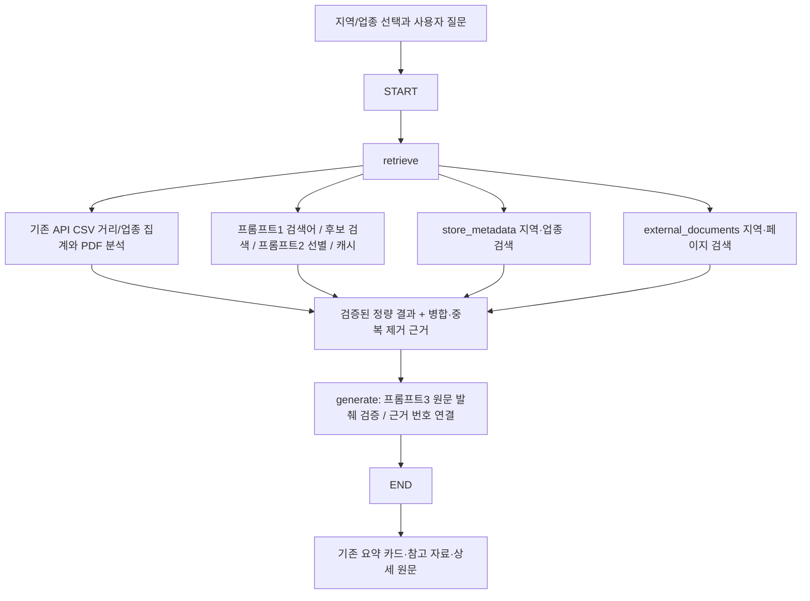

# RAG 파이프라인 설계

기존 UI·CSV 전체 집계·PDF 원문 해석은 유지하고 `chat_controller.answer_question`의 진입점에 LangGraph를 연결했다.

## 색인

- 현재 경로: `db/portable_vectors.json.gz`와 자동 복원된 `db/runtime/<해시>/chroma_db`. 아래 8,496개 과거 개별 상가 레코드 보존은 개발 단계 기록이며, 제출판은 활성 지역·업종 메타데이터와 PDF 벡터를 사용한다. 기존 `make_document`가 상가 1건을 하나의 텍스트로 만든다.
- 새 상권·업종 메타데이터 1,452문서를 동일 컬렉션에 추가했다. 지역 전체·대/중/소분류별 설명과 원본 등록 건수이며, 1,452개의 새로운 물리 점포라는 의미가 아니다. 질의 범위의 현재 개수는 이 숫자를 복사하지 않고 CSV 전체에서 다시 계산한다.
- `external_documents`에는 활성 `상권보고서.pdf`만 사용한다. PDF 원문 지역 설명과 지역별 구조화 통계 14문서/청크를 저장했다. 도심의 세 구역은 각각 보존하고 PDF 통계를 합산하지 않는다.
- 청크 기본 1000/200 유지. 문서 URL/내부 식별자·본문 해시·모델·설정·지역·출처에 따른 revision으로 멱등 upsert. 새 버전 저장 후 같은 문서의 구버전만 정리한다. 기존 무관 레코드는 삭제하지 않는다.
- 프라이빗 내부 `pdf:해시:지역:종류` 식별자는 문서 ID 재현용이며 공개 URL이 아니다. 사용자는 실제 PDF 파일명과 페이지를 보고, 실제 파일이 있을 때 다운로드한다.
- GMS 승인 전 잠시 사용한 로컬 문자 n-gram 벡터는 학습형 의미 임베딩이나 GMS 성공으로 기록하지 않는다. 최종 활성 색인은 실제 GMS `text-embedding-3-small`이며 지역·모델·자료 버전·청크 설정 필터로 다른 모델/구버전 혼입을 막는다.

## 수집과 검색

- 기본 문서 출처는 이미 제공된 지정 PDF이다. 새 웹 출처를 임의 추가하지 않는다. 검색어 추출에는 선택 지역명·업종·분석 범위를 전달한다.
- 후보 목록·선정/제외 사유·프롬프트 실행 여부는 `data/raw/rag_collection_cache`에 기록한다. 선택 지역 자체의 설명/통계 후보는 항상 포함하고 다른 지역 후보는 제외한다.
- 같은 질문/문맥, 추출 검색어, 원문에는 별도 캐시를 적용한다. 만료·본문/자료 변경 시 새로 확인한다. 검색 실패·빈 결과를 정상 생성 성공으로 숨기지 않는다.
- 기존 웹 CLI는 유지하며 `TAVILY_API_KEY`가 필요하다. 검색 결과 캐시, 원문 캐시, robots 확인, 호스트 간격 및 제한된 재시도를 사용한다. 법령 도메인 차단을 유지한다.
- 두 컬렉션을 따로 검색하고 병합한다. RAG 1은 업종을 정확한 공식 분류로 제한한다. 선택 지역 전체의 메타데이터 1건은 Top-k와 별도로 필수 포함한다. 구성 구역 질문은 PDF 지역명까지 제한한다.
- 동일 출처·지역·페이지·본문의 중복을 제거하고 검색 근거에 R ID를 부여한다. 서로 다른 원문 출처를 같은 텍스트라는 이유만으로 없애지 않는다.

## 생성과 근거

- 기본 `generation_mode=llm`에서는 검증된 분석 답변이 있는 질문에 프롬프트1·2·3을 실제 적용한다. 키/연결/생성 검증이 실패하면 정확한 기존 API/PDF 답변과 안내로 대체한다. 미확인 질문이나 비밀값 요청은 모델이 임의로 채우지 않는다.
- `on_demand`는 정확한 집계/PDF 직접 응답을 우선하고 '검색 근거', '심층 분석' 등의 질문에서 모델을 호출하는 선택적 저지연 모드다. `extractive`는 원문 기반 응답만 사용하는 모드다. 모드 차이는 실행 trace에 남는다.
- 프롬프트3은 검색 근거의 실제 연속 문자열만 발췌하도록 제한한다. 응답의 근거 ID·인용문을 검증하고 원문 불일치, 비검색 ID, 벡터 메타데이터의 오래된 숫자 재사용을 거절한다. 이것은 자유 문장의 무조건적 사실 검증 기능이 아니라, 답변을 검증된 집계와 발췌에 제한하는 설계다.
- 검증된 생성 결과를 질의·모델·프롬프트·실제 근거 내용으로 캐시한다. 캐시 반환 때도 원문 일치를 다시 검사하며 실행과 캐시 사용을 구분한다.
- API 집계 문단과 KPI, PDF 통계/설명에 `[근거 n]`을 연결한다. 실제 본문에서 사용한 출처만 목록에 추가하고 같은 자료·지역·페이지는 번호를 재사용한다. 검색된 모든 후보를 인용한 것처럼 표시하지 않는다.
- API 원본 수집일과 PDF의 지표별 2026-06/07 기준월을 구분한다. PDF는 지정 경계의 과거 통계이며 주소 반경의 유동인구/매출로 대체하지 않는다.

## 실패·상태·보안

`st.status`가 데이터 검색 → 외부 문서 검색 → 근거 분석 → 답변 생성을 표시한다. 안전한 실패 안내만 저장하고 SDK 예외 전문, 프롬프트 전문, 키, 스택을 사용자에게 보내지 않는다. CSV/PDF 자체의 검증 결과와 벡터/모델 검색 성공 여부는 별도로 다룬다. 무근거 질문에 검색된 지역의 무관한 내용을 끼워 넣지 않는다.

키는 `.env`/환경변수만 사용한다. 이 세션에서 사용자가 질문·상권 메타데이터·지정 PDF 청크의 SSAFY GMS 전송을 명시 승인했다. `external_processing_approved`는 그 전송 허용 설정이다. 다른 환경에서는 자료 이용 조건과 외부 처리 허용 여부를 확인한 뒤 설정하며, 불허 시 로컬 설정 예제를 사용한다.

로그/캐시/CSV/PDF/DB는 Git 제외 대상이다. 새 서버에는 자료를 별도 제공하고 색인을 재생성해야 한다. 생성 캐시에는 사용자 질문과 발췌가 저장되므로 운영 환경의 보관/접근 정책을 적용해야 한다.
