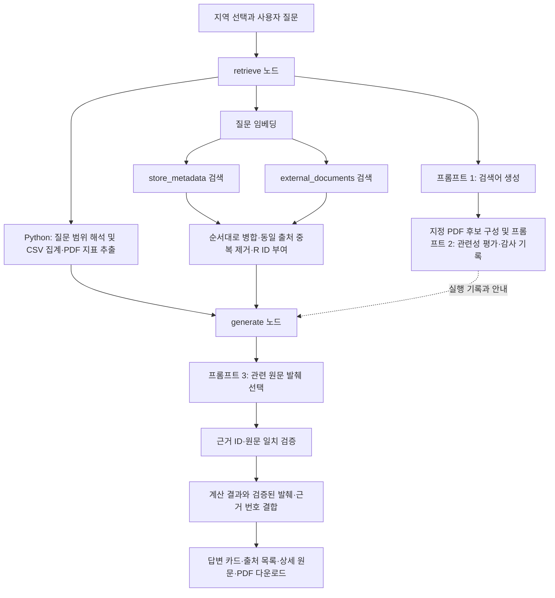

# SPOT CHECK RAG 파이프라인 설계문서

작성일: 2026-10-23  
프로젝트: 소상공인 상권·입지 분석 RAG 챗봇 SPOT CHECK  
대상: 현재 코드 및 출처정보 추가판 「상권보고서.pdf」 기준

제출 구조 갱신: 소스코드는 `output`의 중복 폴더 대신 프로젝트 루트의 `src`, `scripts`, `app.py`를 제출한다. CSV·PDF와 이미 계산된 로컬/GMS 벡터를 동봉하고, 처음 실행할 때 벡터를 로컬 DB에 복원한다. 압축 해제 시 수정시각이 바뀌어도 사용할 수 있도록 자료 버전은 콘텐츠 해시로 계산한다. 아래의 9,948개 저장량은 개발 검증 당시 기록이며, 제출판에는 활성 메타데이터 1,452개와 PDF 14개를 각 백엔드로 저장한다(합계 2,904/28). 실제 키가 없으면 로컬 검색·CSV/PDF 답변, 본인 GMS 키가 있으면 GPT-6 Luna가 동작한다.

## 1. 설계 목표와 전체 구조

SPOT CHECK는 대구 상권의 점포 현황과 지역 통계를 근거와 함께 제공한다. 지원 권역은 대구 도심 통합상권(동성로·대구역·반월당), 수성못, 삼덕동, 동대구역, 칠곡3지구다.

상권 질문에는 정확한 수치 계산과 지역에 대한 설명이 함께 필요하다. 따라서 점포 수·업종 비율·좌표 거리는 Python이 원본 CSV 전체를 대상으로 계산하고, RAG는 관련 메타데이터와 PDF 설명을 찾는 역할로 분리했다. 검색 결과에 들어온 표본의 개수를 전체 점포 수로 사용하지 않는다.

| 구성 요소 | 현재 사용 방식 |
|---|---|
| 화면 | Streamlit 지역 선택·채팅·지도·통계 |
| 생성 모델 | SSAFY GMS `gpt-6-luna`, Responses API |
| 임베딩 | SSAFY GMS `text-embedding-3-small` |
| 벡터 저장소 | `db/portable_vectors.json.gz` → 실제 ChromaDB `db/runtime/<해시>/chroma_db`로 자동 복원 |
| 실행 흐름 | LangGraph `START → retrieve → generate → END` |
| 정량 자료 | 미리 수집한 공공 상가정보 API CSV |
| 설명·통계 문서 | 지정 로컬 PDF 10쪽, 지역별 설명·구조화 통계 14청크 |



현재의 답변 생성은 GPT가 분석문 전체를 자유롭게 작성하는 방식이 아니다. 검증된 계산·PDF 해석 결과에 모델이 선택한 원문 발췌를 추가하는 구조다. 프롬프트 2의 선정 ID는 현재 벡터 검색을 제한하는 필터로 연결되지 않으며, 후보 평가와 실제 질문 기반 검색은 별도 단계다.

## 2. 두 Vector DB 컬렉션 구조와 메타데이터

### 2.1 컬렉션을 분리한 이유

상가·업종 정보는 구조화된 항목이고, PDF는 문맥을 가진 설명 자료다. 두 종류를 하나의 검색 예산에 넣으면 항목이 많은 상가 정보가 PDF 설명을 밀어낼 수 있다. 컬렉션별로 검색 개수와 조건을 지정해 양쪽 자료를 확보하도록 분리했다.

| 구분 | `store_metadata` — RAG 1 | `external_documents` — RAG 2 |
|---|---|---|
| 역할 | 지역·공식 업종 정보 검색 | 상권 설명·보고서 통계 검색 |
| 구성 | 기존 개별 상가 문서와 지역·대/중/소분류 메타데이터 | PDF 지역 설명 `pdf_chapter`, 구조화 지역 통계 `pdf_statistics` |
| 전체 저장량 | 9,948레코드 | 14청크 |
| 현재 버전 검색 대상 | 지역·업종 메타데이터 1,452개 | 활성 PDF 14청크 |
| 별도 보존 데이터 | 기존 개별 상가 8,496개. 현재 버전 검색 필터에는 포함되지 않음 | 교체 전 PDF의 14청크는 교체 후 정리 |
| 기본 Top-k | 3 + 지역 전체 메타데이터 별도 필수 포함 | 4, 단 지역 필터에 맞는 실제 문서 수 이내 |

9,948는 저장 레코드 합계이지 고유 점포 수가 아니다. 현재 채팅의 RAG 1 검색이 8,496개 개별 상가 문서를 모두 사용하는 것으로 표현하지 않는다. 실제 점포 수는 선택 지역의 원본 CSV를 다시 계산한다.

### 2.2 활성 색인의 공통 메타데이터

Chroma 레코드는 `id`, 본문 `document`, 임베딩 벡터와 다음 메타데이터를 가진다. 아래는 현재 새 색인 경로의 필드이며 보존된 과거 레코드의 필드 구성이 모두 같다는 뜻은 아니다.

| 필드 | 의미와 활용 |
|---|---|
| `document_id` | 문서 내부 식별자에서 만든 SHA-256. 같은 문서의 개정 관리 |
| `revision` | 본문·모델·설정·주요 메타데이터를 반영한 버전 해시 |
| `chunk_id`, `chunk_index` | 청크 식별자와 문서 내 순서 |
| `title`, `source`, `url` | 문서 제목, 실제 출처 경로, 내부 식별자 또는 원 URL |
| `source_type`, `content_type` | 상권 메타데이터·PDF 설명·PDF 통계 및 콘텐츠 유형 |
| `region_id`, `region_name` | 지원 권역 ID와 세부 지역명. 검색 범위 제한에 사용 |
| `page` | PDF 실제 페이지. 메타데이터 문서는 0 |
| `collected_at`, `reference` | 수집일 또는 미기록 표시, 통계 기준월 |
| `content_hash` | 색인 대상 텍스트의 해시 |
| `embedding_model` | 벡터 생성 모델. 다른 모델의 색인을 섞지 않도록 필터링 |
| `chunk_size`, `chunk_overlap` | 청킹 설정. 설정이 다른 색인의 혼입 방지 |
| `corpus_version` | 파일 상태 기반 자료 서명과 임베딩 모델을 결합한 버전 |
| `usage_note`, `robots_note` | 이용 조건 및 접근 방식에 관한 기록 |

RAG 1은 `category_level`과 `category_name`으로 지역 전체 또는 공식 대·중·소분류를 구분한다. RAG 2는 `corpus_hash`에 PDF 파일 해시를 저장한다. `pdf:해시:권역:지역:종류` 형태의 `url`은 내부 문서 ID용 문자열이며 공개 웹 주소가 아니다.

예를 들어 수성못 지역 설명은 `region_id=suseongmot`, `region_name=수성못`, `source_type=pdf_chapter`, `page=6`을 가진다. 해당 지역 통계는 `source_type=pdf_statistics`, `page=2`로 구분한다.

## 3. 문서 수집 → 청킹 → 색인 흐름

### 3.1 기본 자료 준비와 수집

1. 공공 상가정보 API에서 수집해 둔 CSV와 지역별 수집 메타데이터를 읽는다. 기본 채팅은 질문마다 상가 API를 새로 호출하지 않는다.
2. 도심 통합상권의 CSV는 동성로·대구역·반월당 수집본을 상가 ID로 중복 제거한다.
3. 각 지역의 전체 정보와 공식 업종별 그룹을 텍스트로 만들어 1,452개 메타데이터 문서를 구성한다.
4. 지정 PDF와 `active_report.source.json`을 읽고 실제 파일의 SHA-256이 등록값과 같은지 검증한다.
5. PDF의 7개 세부 상권마다 지역 설명 1개와 지역 통계 1개를 구성한다. 통계표는 지역별로 구조화해 다른 지역 수치가 섞이지 않도록 한다.
6. 문서마다 지역·페이지·기준월·출처·이용 조건을 연결한다.

2026-10-23에는 출처정보 추가판으로 PDF를 교체했다. 1~9쪽의 추출 본문은 이전 판과 같고, 10쪽에 자료 출처와 이용 조건 등이 추가됐다. 현재 색인 14개는 지역 설명·통계 중심으로 구성하며 10쪽 부록 전체를 별도 청크로 색인하지 않는다. 부록은 원문 PDF와 출처 문서에서 확인할 수 있다.

### 3.2 청킹

`RecursiveCharacterTextSplitter`를 사용한다. 기본 최대 길이는 **1,000자**, 중복 길이는 **200자**이며 토큰 수 기준이 아니다. 문단, 줄바꿈, 마침표 뒤 공백, 공백 순으로 경계를 시도해 문맥을 최대한 보존한다. 의미 경계에 따라 실제 청크 길이와 중복량은 설정값보다 작을 수 있다.

PDF 전체를 먼저 자르는 대신 지역과 문서 유형을 먼저 나눈다. 이 방식은 다른 지역 통계가 한 청크에 함께 들어가는 것을 줄이고, 검색 결과를 원문 페이지와 연결하기 쉽게 한다.

### 3.3 임베딩과 색인

1. 자료 파일의 경로·크기·수정시각 등을 해시해 자료 서명을 만들고 임베딩 모델명을 결합한다. PDF 파일 자체는 별도의 콘텐츠 해시로도 확인한다.
2. 문서 식별자로 `document_id`, 본문·청킹·모델·지역·페이지·버전으로 `revision`을 만든다.
3. 청크 ID를 `document_id:revision:chunk_index`로 구성한다.
4. 저장된 ID와 비교해 새 청크만 준비하고, GMS 임베딩을 생성한다. 준비 스크립트는 최대 50개 텍스트씩 묶어서 호출한다.
5. 각 컬렉션에 `upsert`한다. 같은 ID의 중복 레코드가 증가하지 않도록 한다.
6. 새 청크를 저장한 뒤 같은 문서 ID에 속한 이전 revision을 정리한다.
7. 컬렉션 건수와 색인 결과를 `data/processed/rag_inventory.json`에 기록한다.

PDF 파일 해시가 바뀌면 PDF 내부 문서 ID도 달라지므로 같은 문서 ID의 구버전 삭제만으로 이전 PDF가 모두 제거되지는 않는다. 이번 교체에서는 새 PDF 14청크 저장을 확인한 뒤 이전 파일 해시의 14청크를 별도로 제거했다.

자료 버전은 두 컬렉션이 공유한다. 따라서 PDF나 활성 메타데이터를 바꾸면 상권 메타데이터도 새 버전으로 갱신해야 한다. 현재 준비 도구는 버전이 바뀔 때 본문이 같아도 재임베딩할 수 있어 갱신 시간과 비용이 발생한다.

### 3.4 질문 시 후보 평가와 웹 경로의 구분

질문 시에는 프롬프트 1로 검색어를 생성하고, 이미 지정된 PDF에서 후보를 구성한 뒤 프롬프트 2로 평가한다. 선택 지역의 설명·통계는 평가 점수와 무관하게 필수 포함하고 다른 지역 후보는 제외한다. 후보·선정·제외·사유는 캐시에 남긴다.

생성한 검색어는 현재 PDF 후보 캐시와 감사 기록에 사용된다. 검색어로 PDF를 전문 검색하거나 웹/API를 실시간 호출하는 구조는 아니다. 실제 벡터 검색에는 사용자 질문을 사용한다.

별도 웹 수집 CLI에는 Tavily 검색 → 후보 선별 → HTML/PDF 본문 수집 → 청킹·색인 경로가 있다. 그러나 현재 Tavily 키가 없어 실수집 성공을 검증하지 않았으며, 기본 서비스는 제공 PDF 대체 경로로 동작한다.

## 4. 검색 결과 병합과 중복 제거

1. 사용자 질문을 임베딩한다. 동일 질문·백엔드·모델의 질의 벡터는 캐시한다.
2. 두 컬렉션을 각각 검색한다. 공통 필터는 권역, 임베딩 모델, 자료 버전, 청크 크기·중복 길이다.
3. 업종이 지정되면 RAG 1을 공식 업종 분류로 제한한다. 선택 권역 전체 메타데이터는 Top-k와 별도로 추가한다.
4. 도심의 구성 구역을 직접 질문하면 PDF 검색을 세부 지역명으로도 제한한다.
5. RAG 1 결과 다음에 RAG 2 결과를 이어 붙인다. 서로 다른 컬렉션의 거리 점수를 통합 정렬하거나 별도 재순위화하지 않는다. MMR도 사용하지 않는다.
6. 아래 동일성 키가 같은 항목을 제거하고 남은 근거에 `R1`, `R2` 등의 내부 ID를 부여한다.

```text
중복 키 = (source, region_name, page, SHA256(본문 양끝 공백 제거))
```

같은 출처·지역·페이지의 동일 문단은 한 번만 남긴다. 본문이 같아도 출처나 페이지가 다르면 보존한다. 의미가 비슷한 문단을 제거하는 방식은 아니며, 문단 내부 공백까지 정규화한 유사 중복 제거도 아니다. 필수 지역 문서가 일반 검색 결과와 겹치는 경우도 이 단계에서 정리한다.

후보 선별 점수가 낮더라도 지역 필수 문서를 보존하며, 프롬프트 2의 선정 ID로 Chroma 검색 범위를 제한하지 않는다. 이 설계는 지역 기본 근거 누락을 줄이지만, 후보 평가가 최종 검색을 직접 제어하지 않는 한계가 있다.

## 5. 세 프롬프트의 역할과 출력 형식

세 단계 모두 모델 응답을 JSON 객체로 파싱한다. Responses API의 텍스트 블록만 결합하며 추론 등 비텍스트 블록은 JSON 본문으로 취급하지 않는다. 모델이 임의 ID·URL·수치를 반환했을 때 그대로 화면에 쓰지 않도록 단계별 검증을 둔다.

### 5.1 프롬프트 1 — 검색어 추출

- 역할: 창업·상권 자료 검색 담당자.
- 입력: 사용자 질문과 지역명·업종·분석 범위 문맥.
- 지시: 지역·업종을 반영한 검색어 1~3개를 만들고 법령·인허가·사업자등록 안내를 제외한다. URL이나 문서 내용은 생성하지 않는다.
- 출력 검증: 목록 길이 1~3, 각 검색어 2~200자, 공백 정리와 완전 동일 검색어 중복 제거.

```json
{"queries":["수성못 카페 상권 분석","수성못 소비 특성"]}
```

예시는 출력 구조 설명용이며 실제 실행 기록을 복사한 값은 아니다. 질문·문서 안의 지시문은 입력 데이터로 취급하도록 한다.

### 5.2 프롬프트 2 — 후보 선별

- 역할: 상권 문서의 관련성 평가 담당자.
- 입력: 질문과 후보의 ID·제목·요약·지역·페이지 등.
- 지시: 직접적인 지역·업종 자료를 우선하고 광고·기관 메인 화면·무관한 지역 자료를 제외한다. 제목·요약만으로 사실성·최신성·이용 허가를 확정하지 않는다.
- 출력 검증: 제공된 정수 ID만 허용, 점수는 0~1, 선정 이유는 문자열. 기본 기준 0.6 이상만 모델 선정 목록으로 인정한다.
- 빈 `selected`도 허용한다. 이후 서비스의 필수 지역 자료 보존 정책을 별도로 적용한다.

```json
{"selected":[{"id":0,"score":0.9,"reason":"질문한 지역의 상권 설명 자료"}]}
```

### 5.3 프롬프트 3 — 답변 생성 단계의 원문 발췌

- 역할: 상권 분석 담당자.
- 실제 입력: 질문과 검색 근거의 `evidence_id`, 본문(근거당 최대 1,800자), `source_type`.
- 지시: 도움이 되는 원문 발췌 1~3개만 선택한다. 해석을 창작하거나 창업 성공·확인되지 않는 매출 등을 확정하지 않는다. 근거가 없으면 `supports=[]`로 응답한다.
- 출력 검증: 검색된 ID인지 확인하고, 공백을 정규화한 발췌가 원문에 실제 포함되는지 검사한다. 인용문은 비어 있지 않고 700자 이하여야 한다. 처리하는 발췌는 최대 3개다.
- 상권 메타데이터에서 숫자가 포함된 발췌는 현재 질문의 집계값처럼 재사용하지 않도록 제외한다.

```json
{"supports":[{"evidence_id":"R1","quote":"수성못은 호수와 산책·여가시설을 중심으로 한 수성구의 방문 목적지이며,"}]}
```

프롬프트에는 검증된 API 집계만 사용하라는 제약이 있으나, 현재 JSON 입력에 API 집계 객체를 별도 전달하지는 않는다. Python 계산 결과는 답변 조립 단계에서 결합한다. 즉, 현재 프롬프트 3은 자유로운 종합 분석문 생성보다 **검색 원문 선택**에 초점이 있다.

## 6. 청크 크기·중복 길이·Top-k의 선정 이유와 변경 효과

### 6.1 기본값 선정 이유

| 설정 | 값 | 설계 이유 |
|---|---:|---|
| `chunk_size` | 1,000자 | 지역 설명과 통계 단위의 문맥을 보존하면서 지나치게 긴 근거 입력을 피하기 위한 기준 |
| `chunk_overlap` | 200자 | 긴 설명이 여러 청크로 나뉠 때 경계의 문맥 단절을 줄이기 위한 최대 중복량 |
| `top_k_stores` | 3 | 관련 업종·지역 메타데이터를 소수 확보하고 지역 전체 메타데이터를 별도로 보완 |
| `top_k_documents` | 4 | PDF 설명과 통계의 근거를 함께 확보하되 무관한 문맥의 증가를 제한 |
| `selection_min_score` | 0.6 | 모델의 후보 관련성 평가에서 낮은 점수 자료를 걸러내기 위한 기준 |
| 캐시 TTL | 86,400초 | 같은 자료·질의의 반복 호출을 줄이되 영구 재사용은 피함 |

이 값들은 서비스 규모에 맞춘 기본값이며, 전수 실험으로 찾은 최적값이라고 주장하지 않는다.

### 6.2 현재 PDF로 수행한 청킹 비교

2026-10-23 활성 PDF의 동일한 14개 논리 문서를 대상으로 `split_document`만 실행했다. 운영 설정이나 실제 DB는 변경하지 않았고, 임베딩·답변 품질 실험도 수행하지 않았다.

| 청크 크기 | 중복 길이 | 결과 청크 수 | 전체 청크 문자 수 |
|---:|---:|---:|---:|
| 500 | 0 | 18 | 4,808 |
| 500 | 100 | 18 | 5,175 |
| 1,000 | 0 | 14 | 4,812 |
| **1,000** | **200** | **14** | **4,812** |
| 1,500 | 300 | 14 | 4,812 |

현재 논리 문서의 최대 청크 길이는 기본 설정에서 696자다. 따라서 1,000자 이상에서는 각 문서가 분할되지 않아 중복 0과 200의 결과가 같다. 500자로 줄이면 일부 지역 설명이 나뉘어 18청크가 되고, 중복 100은 청크 개수는 같지만 저장 문자량을 늘린다. 위 수치는 변환 과정의 공백 정리도 반영하므로 원본 PDF 전체 글자 수와 같지는 않다.

일반적으로 작은 청크는 필요한 구절에 집중하기 쉽지만 문맥이 끊길 수 있고, 큰 청크는 문맥을 보존하는 대신 관련 없는 내용과 입력량이 늘어날 수 있다. 이 가능성과 현재 자료에서 실제 관측한 수치 변화를 구분한다.

### 6.3 Top-k 변경 시 차이

기존 실제 검색 검증에서는 작은 설정 `stores=1, documents=1`일 때 원시 반환이 RAG 1/2 각각 **2/1건**, 큰 설정 `stores=3, documents=4`일 때 **4/2건**이었다. RAG 1의 추가 1건은 필수 지역 메타데이터이며, 중복 제거 후 최종 개수는 더 줄 수 있다. 일반 단일 지역 PDF는 설명·통계 2개라 documents=4여도 최대 2개만 검색된다. 도심 통합권역에는 여러 세부 지역 문서가 있으므로 반환 상한이 다르다.

Top-k를 늘리면 더 많은 관련 근거를 확보할 수 있지만 모델 입력량과 지연, 무관한 근거의 가능성이 늘어난다. 줄이면 입력량이 감소하지만 설명 또는 통계가 빠질 수 있다. 이 프로젝트는 두 컬렉션의 예산을 분리하고 실제 자료 수로 상한을 제한한다.

청킹 설정을 바꾸면 새 설정으로 재색인해야 한다. 검색은 설정값까지 필터로 사용하므로 설정 파일만 바꾸고 DB를 갱신하지 않으면 최신 근거가 없다는 안내가 발생할 수 있다. Top-k는 재색인 없이 검색 설정에서 조정할 수 있다.

## 7. 답변의 근거 표시 방식

검색 단계의 `R1`, `R2`는 모델 검증용 내부 ID다. 사용자에게 보여주는 `[근거 1]`, `[근거 2]`는 최종 답변에서 실제 사용한 출처를 기준으로 다시 부여한다.

- API 점포 집계에는 수집 출처·수집일·기준점·반경을 연결한다.
- PDF 통계에는 2쪽을 연결하고 지역 설명에는 해당 지역의 실제 페이지를 연결한다.
- 같은 자료·지역·페이지를 다시 인용하면 같은 번호를 재사용한다.
- 검색됐어도 사용하지 않은 문서는 최종 출처 목록에 자동 추가하지 않는다.
- 본문 번호 집합과 출처 목록 번호 집합이 일치하는지 검증한다.
- 화면에는 기본 참고 자료와 접힌 상세 원문을 제공하며 PDF 다운로드를 지원한다.

PDF의 2026년 6월·7월 기준월과 API 수집일은 서로 구분한다. PDF 수치는 보고서가 정한 상권 경계의 통계이므로 사용자 주소 반경의 유동인구·매출로 환산하지 않는다. 공개 URL이 없는 로컬 PDF에 가짜 웹 주소를 만들지 않는다.

원문 일치 검증은 모델이 인용을 만들어내는 위험을 줄이는 장치다. PDF 자체의 모든 사실이 독립 검증됐다는 뜻은 아니며, 출처가 기재됐다고 재배포 허가가 자동 확인되는 것도 아니다.

## 8. 도메인 특화 기능과 설계 이유

| 기능 | 설계 이유와 처리 방식 |
|---|---|
| 주소·반경 점포 집계 | 창업자는 관심 지점 주변의 경쟁 업종을 확인해야 하므로 등록 주소의 좌표와 실제 직선 거리로 계산한다. 50m·100m는 검증 사례이고 양의 다른 반경도 수집 범위 안에서 처리한다. |
| 기준점과 범위 유지 | 후속 “50m는?”에서도 업종·주소·기준점을 유지해 같은 질문 흐름에서 비교할 수 있게 한다. “지역 전체”로 범위를 해제한다. |
| 범위 밖·미확인 주소 거절 | 수집 범위를 벗어난 원 전체의 점포 수나 미확인 현재 위치를 임의로 계산하면 과소 집계와 오해가 생기므로 안전하게 안내한다. |
| 도심 중복 제거 | 동성로·대구역·반월당 API 수집 원은 겹칠 수 있어 상가 ID 합집합으로 집계한다. PDF 세 구역 통계는 경계가 달라 합산하지 않는다. |
| 지역·업종·점포 수 조건 탐색 | 지원 지역을 실제 등록 업종과 점포 수로 좁히고 선택 후 채팅에 연결한다. 개별 점포나 주소의 추천 순위를 만드는 기능은 아니다. |
| 지도·수치·차트 일치 | 카드·도넛·막대그래프·지도 범위를 같은 계산 결과로 구성해 화면 간 수치 차이를 줄인다. |
| 미확인 정보 기권 | 실시간 임대료, 창업 성공률, 확보되지 않은 업종별 매출은 추측하지 않는다. |

점포 수는 RAG 표본에서 세지 않고 CSV 전체를 계산한다. 이 분리는 설명 자료의 검색 품질과 상관없이 정량 결과의 재현성을 확보하기 위한 핵심 선택이다.

## 9. 선택 이유, 겪은 문제와 해결 과정

| 문제·설계 과제 | 선택과 해결 과정 | 현재 한계 |
|---|---|---|
| 기존 검색 모듈이 실제 채팅 흐름과 분리돼 있음 | 채팅 진입점을 실제 LangGraph retrieve/generate 노드에 연결하고 기존 분석 함수를 재사용 | 기존 계산과 검색·모델 실행의 성공 여부를 구분해야 함 |
| PDF 컬렉션이 비어 있어 문서 근거를 검색할 수 없음 | 지역 설명과 지역별 구조화 통계를 별도 구성해 14청크 색인 | 지역 중심 자료이며 다수 외부 발행기관의 교차 검증은 아님 |
| 통계표의 타 지역 수치 혼입 가능성 | 지역별 행을 추출하고 region_id·region_name·page를 보존 | 보고서 원자료의 경계·집계 산식 미확인 사항은 유지 |
| 검색 표본을 전체 상가 수로 오인할 위험 | CSV 전체 계산과 벡터 근거 검색을 분리하고 숫자 포함 메타데이터 발췌 재사용을 제한 | 수집 시점의 등록 정보이며 현재 실제 영업 여부는 보장하지 않음 |
| 모델의 가짜 인용·근거 ID 생성 | 자유 분석문 대신 JSON 발췌를 요구하고 ID·원문 부분 문자열 검증 | 원문 자체의 사실성을 자동 판정하지 않음 |
| 지역 기본 자료가 모델 선별에서 누락될 수 있음 | 선택 지역의 설명·통계를 필수 포함 | 프롬프트 2가 최종 검색을 직접 제어하지 않음 |
| 반복 수집·모델 호출 비용과 지연 | 질의·후보·검색어·원문·검증된 생성 결과 캐시, 모델별 선별 캐시 분리 | TTL 만료·자료 교체 시 다시 처리. 캐시에는 질문과 발췌가 남아 접근 관리 필요 |
| GPT-6 Luna의 API·응답 형식 차이 | Responses API를 명시하고 텍스트 블록을 추출해 JSON 해석. 이전 모델용 temperature 설정을 Luna에는 전송하지 않음 | 기존 모델과의 동일 조건 품질 비교는 추가 필요 |
| PDF 교체 후 이전 문서가 남는 문제 | 새 파일 해시·메타데이터·자료 버전을 갱신하고 새 색인 확인 후 이전 PDF 14청크 제거 | 자료 버전 변경 시 상권 메타데이터도 재색인하는 비용 발생 |
| 답변 중 사용자 메시지가 보이지 않는 UI | 전송 직후 오른쪽에 사용자 메시지를 렌더링하고 왼쪽에서 단계별 로딩 후 답변으로 교체 | 토큰 단위 답변 스트리밍은 구현하지 않음 |
| 지역 선택 화면이 채팅과 겹치는 잔상 | 선택 화면을 비우는 placeholder와 단계별 가시성 규칙 적용, 브라우저 프레임 검사 | 네트워크·데이터 로딩 시간 자체를 없애는 조치는 아님 |

세 프롬프트를 분리한 이유는 검색어 생성, 후보 평가, 원문 선택의 책임과 실패 지점을 구분하기 위해서다. JSON 형식으로 결과를 제한하면 단계별 형식·ID·점수·원문 검증과 캐시·실행 감사가 가능하다. 문서 안의 지시문을 데이터로 취급하도록 하고, 프롬프트·API 키·SDK 오류 전문은 화면에 표시하지 않는다.

## 10. 검증 결과와 제출 범위

후속 검증: 이 설계문서 작성 후 GPT-6 Luna로 동일 모델 대표 5문항의 무검색/서비스 비교를 수행했다. 최신 결과는 [검증결과의 심화 비교](검증결과.md#quality)에 수록했다. 동대구역 문항에서는 검색어 호출 실패 후 대체 경로를 사용했다. 아래의 Luna 1문항 실연동과 이전 모델 F2015 항목은 앞선 검증 기록으로 구분한다.

| 검증 | 결과 및 범위 |
|---|---|
| 최신 단위·회귀 | 74개 통과. 외부 API를 끄고 모델 fixture와 실제 로컬 Chroma/LangGraph를 구분해 사용 |
| Luna 실연동 | 질문 1건에서 프롬프트 1·2·3 실제 실행, 두 컬렉션 검색, 원문 발췌와 근거 번호 일치 확인. 약 29.6초 |
| 새 PDF 반영 | 원본과 파일 바이트 일치, 7개 지역의 8개 지표 파싱, 새 PDF 해시의 근거만 검색되는 것 확인 |
| 청킹 변경 비교 | 본 문서 6.2의 동일 논리 문서 분할 실험. 운영 DB 재색인·응답 품질 실험과 구분 |
| 기존 F2015 | gpt-4o-mini 동일 모델 대표 5문항의 무검색/서비스 비교. Luna의 전후 비교가 아님 |
| UI | 지연 응답으로 사용자 메시지 선표시·로딩 교체·중복 없음·입력 테두리 제거·모바일 확인. 지역/채팅 전환 겹침 검사 |

Luna 실연동은 기능 연결 확인이며 이전 모델보다 정확하거나 빠르다는 증거는 아니다. 타인의 상호 검토, 새 배포 환경 재현, 공개 운영·동시 사용자 부하 검증, 원천 자료의 공개 재배포 허가는 별도 확인 사항이다.

주요 구현 파일은 프로젝트 루트 기준 다음과 같다.

- 자료 구성·색인: `src/rag/knowledge.py`, `src/rag/index_documents.py`, `scripts/prepare_rag.py`
- 후보·프롬프트: `src/rag/collection_flow.py`, `src/rag/document_prompts.py`
- 검색·병합: `src/rag/retrieval.py`
- 그래프·발췌·인용: `src/rag/pipeline.py`, `src/rag/generation.py`
- 도메인 계산·화면: `src/services/`, `src/ui/`, `app.py`
- 설정: `config/rag_settings.json`

제출 증빙은 [검증결과](검증결과.md)의 항목별 결과·심화 비교·전체 캡처·내장 실행 기록을 참조한다. 청킹 비교, 색인 수, Luna 실행, 테스트 결과와 과거 모델 비교도 해당 파일에 내장했으며 별도 evidence 폴더는 필요하지 않다. 구현 파일 경로는 프로젝트 루트의 `src`, `scripts`, `app.py`를 기준으로 읽는다.


## 후보 선별과 실제 색인·검색 연결 보완 (2026-10-23)

P2 선정 결과를 index_selected에 전달합니다. 선택 지역의 설명 문서는 필수 보존하고 통계 문서는 모델 기준을 적용합니다. 선택 문서의 URL 해시를 document_id로 만들고 모델·자료 버전·청킹 설정 및 본문이 일치하는 기존 청크는 재사용합니다. 누락·변경된 선택 문서만 색인하고, external_documents 검색에는 선정 document_id 목록을 필터로 전달합니다. 제외 문서는 이번 요청에서 색인·검색하지 않습니다. 과거 요청의 공용 청크는 다른 사용자를 위해 남깁니다. 모델 호출 실패·로컬 모드에서는 지역 후보 전체를 보존하는 대체 경로임을 감사 기록으로 구분합니다. 채팅 감사 기록에 선택 ID, 새 임베딩 수, 재사용 수, 제외 후보 수를 저장합니다.

실제 독립 ChromaDB를 사용한 회귀 검증으로 선택 문서만 생성됨, 제외 문서 미생성, 재요청 임베딩 0, 검색 결과 ID 제한을 확인했습니다. 수정 후 사용자 승인으로 실 GMS P1/P2/P3를 모두 확인했습니다. 최초 12.428초·반복 0.381초이며 실행 기록은 검증결과 최종 절에 수록했습니다.
