# SPOT CHECK 검증결과

2026-10-23 · GPT-6 Luna 및 출처정보 추가판 PDF 기준.

## 제출 구조 정리 및 ZIP 실행 확인

최종 제출 단위는 프로젝트 전체이며 `output`에는 문서 4개와 셀프 체크리스트 엑셀만 둔다. 실제 소스는 루트의 `src`·`scripts`·`app.py`, 캡처는 루트의 `assets/검증캡처`에 있다. CSV·PDF와 로컬/GMS 벡터를 포함하고 실제 키·가상환경·Git 이력·보관 폴더는 제출 ZIP에서 제외했다.

- 정리 후 최신 회귀: **75개 통과**. 자료 내용은 그대로 두고 수정시각만 바꿨을 때 버전이 유지되는 검사 1개를 추가했다. 아래 74개 기록은 이전 실행으로 보존한다.
- 생성 ZIP을 별도 폴더에 풀고 원본 경로·실제 키 없이 확인했다. 이미 검증된 Python 3.11 의존성 환경을 사용했으며, 새 PC에서 패키지 설치까지 수행한 검사는 아니다.
- 다섯 권역 CSV 로드: 도심 10,759 / 수성못 2,106 / 삼덕동 7,009 / 동대구역 3,321 / 칠곡3지구 2,359.
- 빈 캐시에서 포함 벡터를 자동 복원하고 두 컬렉션의 활성 메타데이터 1,452개·PDF 14개를 확인했다. API 호출·임베딩 재생성은 하지 않았다.
- 수성못 카페 95곳, 주소 100m 카페 19곳, 미확인 임대료 기권을 확인했다.
- 압축 해제된 `app.py`로 실제 Streamlit AppTest를 실행해 지역 선택 → 질문 → 보고서 표시를 확인했다.
- 키 없는 기본 실행은 로컬 모드이며 GPT-6 Luna 사용 시 받는 사람 본인의 GMS 키를 설정한다.

현재 전체 프로젝트 ZIP은 `scripts/build_submission.py`로 생성하며 추출 검사는 `scripts/verify_submission_zip.py`로 재현한다. 정리 전 원시 실행 기록은 아래에 그대로 보존했다.

요구서 4장 확인 결과, 요구사항 대조표, 테스트 결과표, 상호 점검 상태, 제출 전 점검, F2015 비교와 원시 기록을 한 문서에 모았다. 캡처 이미지는 `../assets/검증캡처`에 저장해 상대 경로로 연결한다. 전체 `output` 폴더 구조를 유지하면 이미지를 함께 볼 수 있다.

**상호 점검은 미실시다.** 다른 교육생의 실제 점검 결과를 대신 작성하지 않았다.

 | 내용 | 이동 |
|---|---|
| 검증결과 | [바로가기](#overview) |
| 요구사항_대조표 | [바로가기](#requirements) |
| 테스트_결과표 | [바로가기](#tests) |
| 상호_체크리스트 | [바로가기](#peer) |
| 제출전_점검결과 | [바로가기](#preflight) |
| 심화_F2015_비교 | [바로가기](#quality) |
| 전체 캡처 | [바로가기](#screens) |
| 원시 실행 기록 | [바로가기](#raw) |

<a id="overview"></a>

## 검증 결과 — 요구서 4장 항목별 확인

검증일: 2026-10-23. 기준은 사용자 제공 요구서 18~19쪽의 4.1~4.8이다. 실행 결과가 없는 항목을 통과로 기재하지 않았다.

## 문서 및 증빙 안내

`failure_*_notice.png`는 통제된 실패 환경에서 실제 출력한 안내 문구를 읽기 쉽게 확대한 캡처다. 캡처 시에만 상위 스크롤 영역의 잘림을 해제했으며 안내 문구는 수정하지 않았다. 원래 화면 전체는 `failure_*_controlled.png`에 함께 보관했다.

- [요구사항 대조표](#requirements)
- [테스트 결과표](#tests)
- [셀프 체크리스트](셀프체크리스트.xlsx)
- [상호 체크리스트](#peer) 및 [기록 양식](#peer)
- [제출 전 점검](#preflight)
- [F2015 전후 비교](#quality)

캡처 중 01~09는 현재 실제 서비스 화면이다. `failure_*_controlled`는 통제된 오류 환경이며, 10~14는 실제 JSON·그래프 기록을 표시한 증빙 뷰어다. 뷰어를 서비스 화면으로 가장하지 않았다. `chat_*` 캡처는 응답 지연을 주입한 UI 순서 검사다.

## 4.1 데이터와 색인

적재·활성 레코드 수, 표본 1건의 속성, 격리 DB 2회 색인 수를 확인했다. 격리 검사는 로컬 임베딩이며 운영 DB는 읽기만 했다.

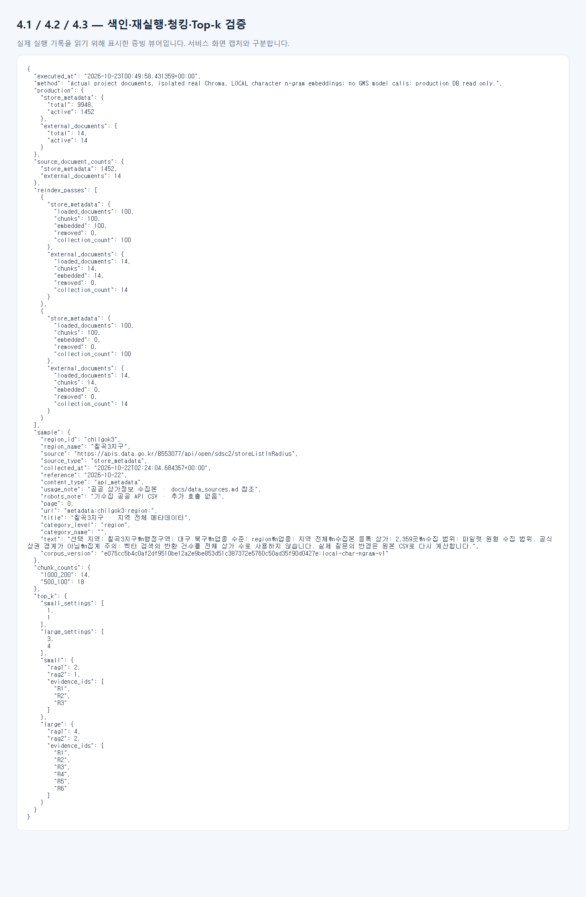

## 4.2 문서 수집과 색인

프롬프트 1 검색어·프롬프트 2 선정/제외 사유는 실제 기록으로 확인했다. 지역 필수 자료는 보존한다. 모델 선별에 따라 실제 색인/제외하는 경로는 미연결이므로 해당 항목은 미확인이다. 캐시 회귀 및 청킹 변경 색인 14→18은 별도 검증했다.

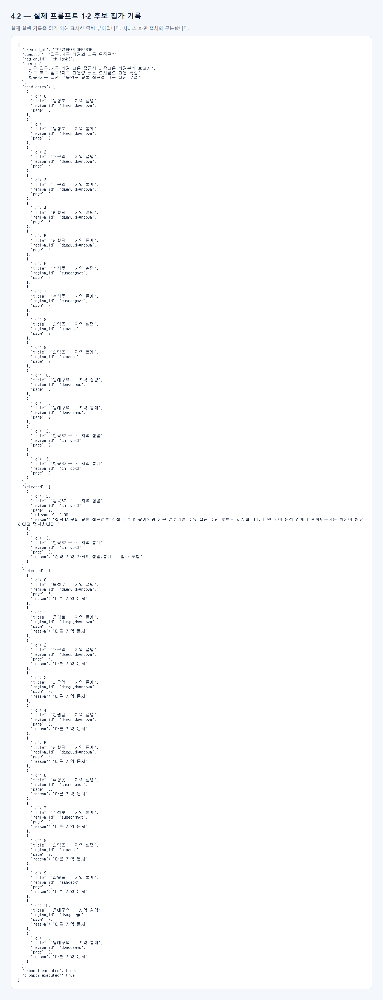

## 4.3 답변과 근거

두 컬렉션·Top-k 변경·중복 제거와 실제 그래프를 확인했다. 본문/목록 번호 일치와 유형·페이지·기준월을 화면에서 확인했다. 미확인 임대료는 인용 없이 기권했다.

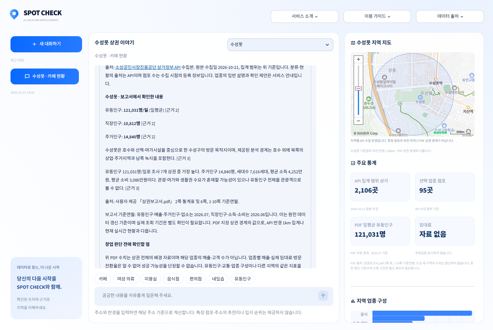

## 4.4 서비스 기능과 화면

조건 검색, 지역별 대화 분리, 주소 100m 분석, 진행 상태, 키·빈 색인 안내를 확인했다. 실패 캡처는 운영이 아닌 통제 환경이다. 건강·금융 면책 항목은 해당없음이다.

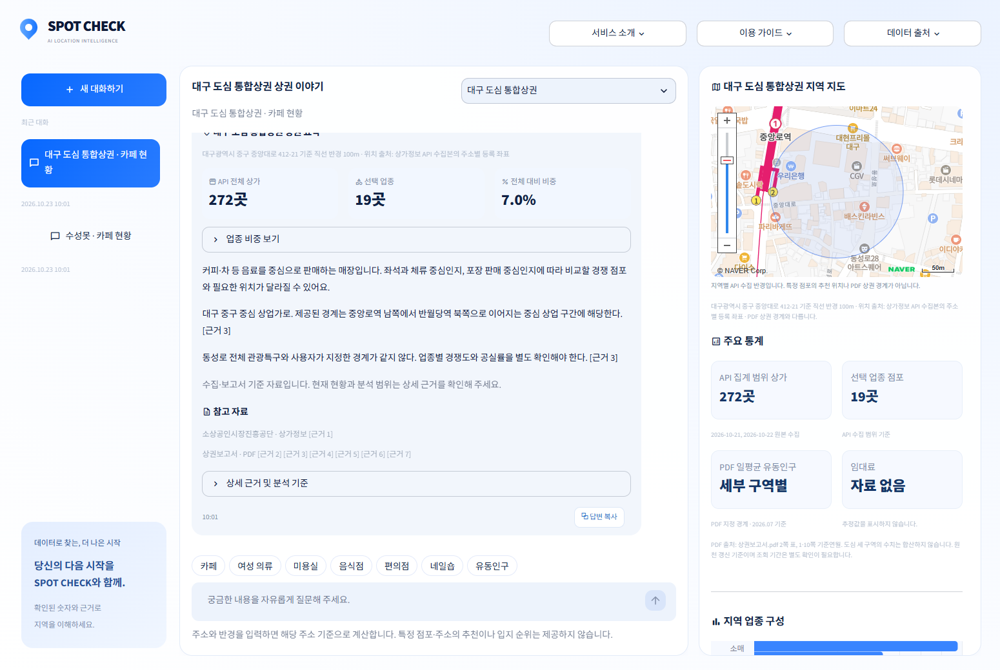

## 4.5 선택 심화

F2015만 선택. F2013/F2014/F2016은 해당없음. 현재 Luna로 5문항 비교와 원시 기록을 포함했다.

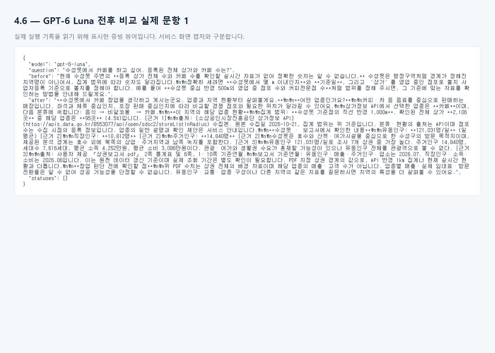

## 4.6 RAG 전후 품질 비교

동일 Luna의 무검색/서비스 답변 5쌍을 기록했다. 정확성·근거 제시·기권을 평가했다. CSV 계산과 PDF 직접 해석이 포함된 전체 서비스 비교이며 순수 RAG 인과 실험은 아니다.


## 4.7 비기능

키 관리·내부 오류 비노출·캐시·모듈 분리를 검사했다. 응답 시간 사용성·출처별 호출 조건·공개 재배포 조건은 미확인으로 남긴다.

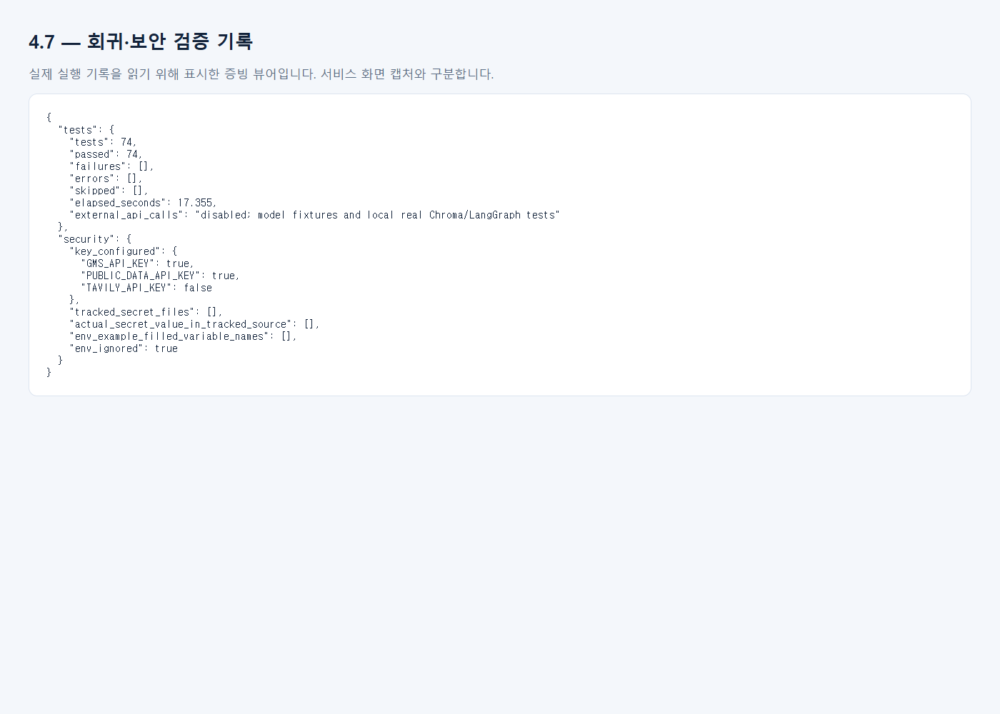

## 4.8 제출 전 점검

작성 문서·코드·증빙을 모았다. 상호 검토, 원천 자료 이용조건, 별도 실행 데이터 준비와 최종 제출자 정보는 남아 있다.

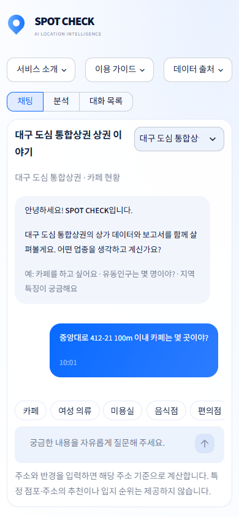

## 보조 실행 화면

| 확인 내용 | 화면 |
|---|---|
| 조건 기반 지역 탐색 | [캡처](../assets/검증캡처/02_region_conditions.png) |
| 사용자 메시지·로딩 | [실제 처리 중](../assets/검증캡처/03_user_pending.png), [지연 주입 UI 검사](../assets/검증캡처/chat_user_and_loading.png) |
| 답변·기본 출처 | [캡처](../assets/검증캡처/04_answer_sources.png) |
| 없는 정보·근거 없음 | [캡처](../assets/검증캡처/06_unknown_answer.png) |
| 지역 변경 시 대화 분리 | [캡처](../assets/검증캡처/07_region_isolation.png) |
| LangGraph | [구조 캡처](../assets/검증캡처/11_graph.png), [Mermaid 원본](#record-13) |
| 키 누락 안내 | [통제 환경 캡처](../assets/검증캡처/failure_key_notice.png) |
| 빈 색인 안내 | [통제 환경 캡처](../assets/검증캡처/failure_index_notice.png) |
| 모바일 | [현재 서비스](../assets/검증캡처/09_mobile.png), [전환 겹침 검사](../assets/검증캡처/clean_navigation_mobile.png) |

## 남은 확인

상호 점검은 사용자가 미실시라고 확인했다. 타인의 점검자·일시·실행 결과·피드백을 받아 반영해야 한다. F2004 선정 결과와 실제 색인·검색 연결 및 ZIP 추출 실행은 확인했다. 원천 자료 공개 재배포 조건·최종 제출자 정보·상호 점검은 별도 최종 확인 사항이다.


<a id="requirements"></a>

## 요구사항 대조표

2026-10-23 현재 구현 및 실제 기록 기준. “확인”은 표시한 범위의 검사 결과이며 공식 평가 통과를 뜻하지 않는다. 미선택 심화와 미확인 항목을 분리했다.

| ID | 기능 | 판정 | 실제 확인 범위·한계 | 증빙 |
|---|---|---|---|---|
| F2001 | 메타데이터 적재 | 확인 | 전체 9,948 저장/활성 1,452. 실 자료 표본 100개 적재·색인 및 항목 속성 확인 | [기록](#record-3) |
| F2002 | 임베딩·중복 방지 | 확인 | 현재 GMS 색인 존재. 별도 로컬 임베딩·실제 Chroma에서 동일 표본 재색인 증가 0, 임베딩 0 | [기록](#record-3) |
| F2003 | 검색어 추출 | 부분 확인 | Luna 4개 분석 문항 중 3개 성공, 동대구역 문항은 호출 실패 후 질문 사용. 웹 검색 실행과 구분 | [기록](#record-4) |
| F2004 | 후보 선별·수집 | 확인 | 선택 문서 색인 확인·추가와 document_id 제한 검색 구현. 실제 GMS P1/P2/P3 및 독립 DB 회귀 확인 | [기록](#record-2) |
| F2005 | 청킹·문서 색인 | 확인 | PDF 14청크. 별도 DB에서 1000/200→500/100 변경 시 14→18청크 | [기록](#record-3) |
| F2006 | 검색·병합 | 확인 | 실제 두 컬렉션 검색, 필터·필수 지역 메타데이터·동일 출처 중복 제거. Top-k 비교는 격리 DB | [기록](#record-3) |
| F2007 | LangGraph | 확인 | retrieve/generate 실제 구조와 5문항 노드 순서·원문 검증 | [기록](#record-13) |
| F2008 | 출처 연결 | 확인 | 실제 본문/목록 번호 집합 일치, 자료 유형·페이지·기준월·PDF 다운로드 | [기록](../assets/검증캡처/05_source_details.png) |
| F2009 | 지역별 대화 | 확인 | 실제 브라우저 지역 변경 대화 분리·보관 대화 복원. 세션 영구 저장 아님 | [기록](#record-1) |
| F2010 | 주소 반경 분석 | 확인 | 주소 등록 좌표의 실제 100m 집계·근거와 화면 확인. 수집 범위 안으로 제한 | [기록](../assets/검증캡처/08_address_radius.png) |
| F2011 | 자연어 조건 | 확인 | 카페 100곳 이상 지역에서 수성못 제외. 지역 선택 후 분석 연결 | [기록](../assets/검증캡처/02_region_conditions.png) |
| F2012 | 상태·실패 안내 | 확인 | 사용자 메시지 선표시·단계 로딩. 통제된 실패 환경의 키/빈 색인 상세 안내 및 미확인 기권 | [기록](../assets/검증캡처/failure_index_notice.png) |
| F2013 | 프론트/서버 분리 | 해당없음 | 미선택 | — |
| F2014 | MMR | 해당없음 | 미선택 | — |
| F2015 | 전후 비교 | 확인 | 현재 Luna 동일 모델 대표 5문항 실제 비교, 실패·대체 경로도 기록 | [기록](#quality) |
| F2016 | 여러 외부 문서 출처 | 해당없음 | 미선택. API와 PDF 구분만으로 완료 주장하지 않음 | — |
| NF2001 | 응답 시간 | 미확인 | 처리 시간 측정은 완료. 일반 답변 9.673~36.104초. 사용자 사용성·동시 부하 기준 미검증 | [기록](#record-4) |
| NF2002 | 캐시 | 확인 | 질의·모델·자료 버전 캐시. 오프라인 회귀에서 중복 모델 호출·수집 방지 확인 | [기록](#record-11) |
| NF2003 | 키 관리 | 확인 | 실제 키 소스 혼입·비밀 파일 추적 0, .env Git 제외 | [기록](#record-10) |
| NF2004 | 내부 비노출 | 확인 | 통제된 오류 안내·키/프롬프트/예외 비노출 회귀. 상세 영역도 안전한 상태만 제공 | [기록](../assets/검증캡처/failure_key_notice.png) |
| NF2005 | 모듈 분리 | 확인 | collectors/rag/services/ui 및 scripts 분리 | [기록](README.md) |
| NF2006 | 호출 예절 | 확인(현재 채팅 범위) | GMS 인증·제한 재시도·시간 제한 및 429 검사. PDF/CSV 로컬 사용, 위키백과 미사용. 별도 웹 수집 CLI 실호출은 범위 외 | [기록](#record-11) |
| NF2007 | 출처·이용 조건 | 미확인 | 출처·기준월 기록은 있음. 공식 API 이용허락 증빙·소상공인365 재배포 조건 확인 남음 | [기록](README.md) |


<a id="tests"></a>

## 테스트 결과표

기준일: 2026-10-23. 실제 GMS 호출과 모의 모델·로컬 임베딩 검사를 구분한다.

| 검사 | 결과 | 환경·한계 | 기록 |
|---|---|---|---|
| 단위·회귀 | 74개 중 74개 통과, 실패/오류/스킵 0, 17.355초 | 외부 API 끔, 모델 fixture + 실제 로컬 Chroma/LangGraph | [JSON](#record-11) |
| 실제 Luna 서비스 | 대표 5문항 응답 확보, 근거 번호 일치 | 프롬프트 1 실패 1건의 대체 처리 포함. 실시간 임대료는 생성 생략 | [비교](#quality) |
| 격리 DB 재색인 | 실제 메타데이터 100개 + PDF 14개, 2회차 증가 0·신규 임베딩 0 | 로컬 문자 n-gram 임베딩, 운영 GMS DB 재색인과 구분 | [JSON](#record-3) |
| 청킹 변경 후 색인 | 1000/200:14청크 → 500/100:18청크 | 실제 PDF, 별도 Chroma 컬렉션. 운영 설정 유지 | [JSON](#record-3) |
| Top-k 비교 | 작은 설정/큰 설정 근거 수 변화 확인 | 실제 자료의 격리 DB, 로컬 임베딩. 지역 필수 문서 별도 포함 | [JSON](#record-3) |
| 새 PDF | 10쪽, 현재 PDF 해시 다운로드 일치 | 브라우저에서 실제 파일 다운로드 | [JSON](#record-1) |
| 서비스 브라우저 | 조건 검색·근거·기권·지역 분리·주소 반경·기록 복원·모바일 통과 | 실제 서버 8501, 현재 설정 모델 호출 | [JSON](#record-1) |
| 키/색인 실패 화면 | 안전한 안내 확인 | 8502 별도 환경에서 get_llm 실패 주입·실제 빈 Chroma 사용. 운영 키/DB는 건드리지 않음 | [키](../assets/검증캡처/failure_key_notice.png), [색인](../assets/검증캡처/failure_index_notice.png) |
| 키 유출 검사 | 추적 비밀 파일·실제 키 혼입 0 | 검사한 소스·문서 범위, 최종 패키지 재검사 별도 수행 | [JSON](#record-10) |
| 의존성 검사 | pip check 충돌 없음 | Windows Python 3.11 .venv | [이전 지정버전 기록](#record-8) |
| 상호 검토 | 미실시 | 사용자 확인. AI 검사로 대체하지 않음 | [상호 점검표](#peer) |

실제 Luna 전후 비교의 5문항은 모든 단계가 항상 성공한 기록이 아니다. 동대구역 문항의 검색어 모델 호출 실패와 약 36.104초 응답도 포함한다. 사용성·동시 접속·공개 운영 보안은 별도 미확인 사항이다.


<a id="peer"></a>

## 상호 체크리스트 — 미실시

2026-10-23 사용자 확인: **미실시**. 아래는 다른 교육생에게 전달할 기록 양식이며 점검 결과가 아니다.

- 앱 작성자: 입력 필요
- 점검자(옆 교육생): 입력 필요
- 점검 일시·환경: 입력 필요
- 주고받은 원본 점검표·화면 파일: 입력 필요

같은 폴더의 `상호_체크리스트.xlsx`에서 실제 실행 후 결과·증빙·사유를 기록한다. 선택하지 않은 심화와 해당하지 않는 도메인 항목 외에는 미확인으로 두었다.

| 확인할 항목 | 현재 결과 |
|---|---|
| README로 새 환경 실행 | 미확인 |
| 적재·재색인·항목 속성 | 미확인 |
| 검색어·후보 선별·청킹 변경 | 미확인 |
| 두 컬렉션·Top-k·그래프·근거 번호 | 미확인 |
| 자료 없는 질문·근거 없음 안내 | 미확인 |
| 지역별 대화·조건 탐색·반경 집계 | 미확인 |
| 키/색인 누락·안전한 오류 안내 | 미확인 |
| 동일 모델 대표 5문항 비교 기록 | 미확인 |
| 키·출처·이용 조건·제출물 | 미확인 |

잘한 것 하나: **미작성 — 실제 검토 후 입력**

개선할 것 하나: **미작성 — 실제 검토 후 입력**

받은 피드백에 대한 조치 및 재확인: **미작성**


<a id="preflight"></a>

## 제출 전 점검 결과

2026-10-23 기준. 문서·코드 준비와 요구사항 충족 판정을 구분한다.

| 요구서 4.8 점검 항목 | 결과 | 확인 내용·남은 일 |
|---|---|---|
| F2001~F2012 모두 동작 | 확인(제출 범위) | 회귀·실연동·선정 문서 색인 및 제한 검색 확인. 과거 비교 중 검색어 생성 실패 1건은 당시 기록으로 유지 |
| 선택 심화 동작 및 필수 구현과 비교 | 확인 | F2015 동일 Luna 대표 5문항의 무검색/서비스 비교 문서와 JSON 포함. 계산·PDF 해석까지 포함한 서비스 비교라는 한계 명시 |
| 필요한 실행 화면 첨부 | 확인(수록 범위) | 4.1~4.8 연결 캡처와 실제 기록 뷰어, 통제된 실패 화면을 포함. F2004의 미연결 동작을 성공 화면으로 대체하지 않음 |
| 요구사항 정의서·설계·소스·README 포함 | 확인 | output의 문서와 프로젝트 루트의 실제 src·scripts·app.py. 요구사항 정의서에 현재 모델과 구현 한계 반영 |
| 대조표·테스트·셀프·상호 체크리스트 포함 | 부분 확인 | 파일·양식은 포함. 실제 타인의 상호 검토·교환 결과는 미실시 |

## 제출자가 마무리할 항목

- [ ] 옆 교육생의 실제 상호 점검·검토자·일시·주고받은 표·피드백을 받는다.
- [ ] 요구사항 정의서 원본을 최신 모델·활성 검색량·수집/선별 한계에 맞춰 최종 확정한다. 검토 의견은 이미 포함했다.
- [x] F2004 선정 문서 색인 확인·추가 및 검색 범위 제한을 구현하고 회귀·실 GMS로 검증했다.
- [ ] 소상공인365 통계·이미지의 재이용/재배포 조건과 공식 API 이용허락 증빙을 확인한다.
- [x] 프로젝트 ZIP에 실제 CSV·원문 PDF·준비된 로컬/GMS 벡터와 실행 도구를 포함했다. 키 없이 로컬 실행이 가능하며 GPT-6 Luna 사용 시 본인 GMS 키를 설정한다.
- [ ] 실제 지역·반·성명으로 최종 ZIP명을 정한다: `AI 코어프로젝트 2_[주제명]_지역_반_성명.zip`.

출력 폴더를 완성된 공식 평가 통과·배포 완료로 표현하지 않는다. 제출 패키지의 비밀값·파일 무결성 검사는 `evidence/package_validation.json`을 참조한다.


<a id="quality"></a>

## 심화 F2015 — GPT-6 Luna RAG 전후 비교

실행 시각(UTC): 2026-10-23T00:49:01.621759+00:00. 모델: `gpt-6-luna`. 2026-10-23 실제 GMS 실행.

동일 모델과 동일 질문 5개를 사용했다. 무검색 조건에는 질문·지역명만 전달하고 CSV·PDF·검색 근거·이전 대화는 주지 않았다. 서비스 조건은 Python CSV 계산·PDF 해석·두 컬렉션 검색·검증된 원문 발췌를 사용했다. 따라서 검색 문맥만 바꾼 통제 실험이 아니라 **무검색 모델과 전체 RAG 서비스의 비교**다.

사실 정확성은 제공 CSV/PDF와의 일치로 평가한다. 출처 없는 기권은 오답으로 보지 않는다. 평가는 AI가 자료를 대조한 것이며 타인의 상호 점검은 아니다. 각 조건 1회 실행으로 확률적 변동·부하 영향을 통제하지 않았다.

| 문항 | 무검색 | 서비스의 확인 결과 | 근거 수 | 시간(무검색/서비스, 초) | 처리 상태 |
|---|---|---|---:|---|---|
| counts | 확인 자료 없어 기권 | 전체 2,106 / 카페 95 | 3 | 13.697 / 9.673 | 프롬프트 1·2·3 실행 |
| radius | 확인 자료 없어 기권 | 주소 100m 전체 272 / 카페 19 | 7 | 3.625 / 27.404 | 프롬프트 1·2·3 실행 |
| pdf | 확인 자료 없어 기권 | PDF 43,284명/일 | 1 | 5.214 / 36.104 | 검색어 생성 실패 후 대체 응답 |
| transport | 일반 설명, 출처 없음 | PDF 팔거역 후보·경계 한계 | 2 | 17.361 / 24.61 | 프롬프트 1·2·3 실행 |
| unknown | 확인 자료 없어 기권 | 실시간 임대료 미확인 | 0 | 18.84 / 0.002 | 안전한 기권 |

## 1. 수성못에서 카페를 하고 싶어. 등록된 전체 상가와 카페 수는?

### RAG 사용 전

현재 수성못 주변의 **등록 상가 전체 수와 카페 수를 확인할 실시간 자료가 없어 정확한 숫자는 알 수 없습니다.** 수성못은 행정구역처럼 경계가 정해진 지역명이 아니어서, 집계 범위에 따라 숫자도 달라집니다.

정확히 세려면 **수성못에서 몇 m 이내인지**와 **기준일**, 그리고 ‘상가’를 영업 중인 점포로 볼지 사업자등록 기준으로 볼지를 정해야 합니다. 예를 들어 **수성못 중심 반경 500m의 영업 중 점포 수와 커피전문점 수**처럼 범위를 정해 주시면, 그 기준에 맞는 자료를 확인하는 방법을 안내해 드릴게요.

### RAG 서비스 사용 후

**수성못에서 카페 창업을 생각하고 계시는군요. 업종과 지역 현황부터 살펴볼게요.**

**어떤 업종인가요?**

커피·차 등 음료를 중심으로 판매하는 매장입니다. 좌석과 체류 중심인지, 포장 판매 중심인지에 따라 비교할 경쟁 점포와 필요한 위치가 달라질 수 있어요.

상가정보 API에서 선택한 업종은 **카페**이며, 다음 분류에 속합니다: 음식 → 비알코올  → 카페.

**이 지역의 해당 업종 현황**

집계 범위: **수성못 기준점의 직선 반경 1,000m**. 확인된 전체 상가 **2,106곳** 중 해당 업종은 **95곳** (4.5%)입니다. [근거 1]

출처: [소상공인시장진흥공단 상가정보 API](https://apis.data.go.kr/B553077/api/open/sdsc2/storeListInRadius) 수집본. 원본 수집일 2026-10-21, 집계 범위는 위 기준입니다. 분류·현황의 출처는 API이며 점포 수는 수집 시점의 등록 정보입니다. 업종의 일반 설명과 확인 제안은 서비스 안내입니다.

**수성못 · 보고서에서 확인한 내용**

유동인구: **121,031명/일** (일평균) [근거 2]

직장인구: **10,812명** [근거 2]

주거인구: **14,840명** [근거 2]

수성못은 호수와 산책·여가시설을 중심으로 한 수성구의 방문 목적지이며, 제공된 분석 경계는 호수 외에 북쪽의 상업·주거지역과 남쪽 녹지를 포함한다. [근거 3]

유동인구 121,031명/일로 조사 7개 상권 중 가장 높다. 주거인구 14,840명, 세대수 7,616세대, 평균 소득 4,252만원, 평균 소비 3,086만원이다. 관광·여가와 생활권 수요가 혼재할 가능성이 있으나 유동인구 전체를 관광객으로 볼 수 없다. [근거 3]

출처: 사용자 제공 「상권보고서.pdf」 2쪽 통계표 및 6쪽, 1·10쪽 기준연월.

보고서 기준연월: 유동인구·매출·주거인구·업소는 2026.07, 직장인구·소득·소비는 2026.06입니다. 이는 원천 데이터 갱신 기준이며 실제 조회 기간은 별도 확인이 필요합니다. PDF 지정 상권 경계의 값으로, API 반경 1km 집계나 현재 실시간 현황과 다릅니다.

**창업 판단 전에 확인할 점**

위 PDF 수치는 상권 전체의 배경 자료이며 해당 업종의 매출·고객 수가 아닙니다. 업종별 매출·실제 임대료·방문 전환율은 알 수 없어 성공 가능성을 단정할 수 없습니다. 유동인구·교통·업종 구성이나 다른 지역의 같은 지표를 질문하시면 지역의 특성을 더 살펴볼 수 있어요.

### 평가

무검색 모델은 정확한 수치를 모른다고 답했다. 서비스는 CSV 전체 2,106곳·카페 95곳과 수집 범위·일자를 제공했다. 기권을 오답으로 채점하지 않고 검증 가능한 정보 제공량의 차이로 평가한다.

프롬프트 1/2: `True` / `True`. 프롬프트 3: `True`. 생성 캐시: `False`.

실행 안내: 없음
- [근거 1] 질문 범위의 실제 API 집계 · https://apis.data.go.kr/B553077/api/open/sdsc2/storeListInRadius · 페이지 해당없음 · 2026-10-21
- [근거 2] 수성못 · 보고서 통계 · 상권보고서.pdf · 2 · 유동인구·매출·주거인구·업소 2026-07 / 직장인구·소득·소비 2026-06 · 정의 1·10쪽
- [근거 3] 수성못 · 지역 설명 · 상권보고서.pdf · 6 · 유동인구·매출·주거인구·업소 2026-07 / 직장인구·소득·소비 2026-06 · 정의 1·10쪽

## 2. 중앙대로 412-21 100m 이내 카페는 몇 곳이야?

### RAG 사용 전

현재 확인 가능한 지도·사업체 데이터가 없어 **중앙대로 412-21에서 100m 이내 카페 수를 정확히 알 수 없습니다.** 지도에서 100m 범위와 영업 중인 업소를 확인해야 해요. (직선거리 기준인지 도보거리 기준인지에 따라서도 수가 달라질 수 있습니다.)

### RAG 서비스 사용 후

**대구 도심 통합상권에서 카페 창업을 생각하고 계시는군요. 업종과 지역 현황부터 살펴볼게요.**

**어떤 업종인가요?**

커피·차 등 음료를 중심으로 판매하는 매장입니다. 좌석과 체류 중심인지, 포장 판매 중심인지에 따라 비교할 경쟁 점포와 필요한 위치가 달라질 수 있어요.

상가정보 API에서 선택한 업종은 **카페**이며, 다음 분류에 속합니다: 음식 → 비알코올  → 카페.

**이 지역의 해당 업종 현황**

집계 범위: **대구광역시 중구 중앙대로 412-21 기준 직선 반경 100m · 위치 출처: 상가정보 API 수집본의 주소별 등록 좌표**. 확인된 전체 상가 **272곳** 중 해당 업종은 **19곳** (7.0%)입니다. [근거 1]

출처: [소상공인시장진흥공단 상가정보 API](https://apis.data.go.kr/B553077/api/open/sdsc2/storeListInRadius) 수집본. 원본 수집일 2026-10-21, 2026-10-22, 집계 범위는 위 기준입니다. 분류·현황의 출처는 API이며 점포 수는 수집 시점의 등록 정보입니다. 업종의 일반 설명과 확인 제안은 서비스 안내입니다.

**동성로 · 보고서에서 확인한 내용**

유동인구: **110,640명/일** (일평균) [근거 2]

직장인구: **20,011명** [근거 2]

주거인구: **721명** [근거 2]

대구 중구 중심 상업가로. 제공된 경계는 중앙로역 남쪽에서 반월당역 북쪽으로 이어지는 중심 상업 구간에 해당한다. [근거 3]

동성로 전체 관광특구와 사용자가 지정한 경계가 같지 않다. 업종별 경쟁도와 공실률을 별도 확인해야 한다. [근거 3]

출처: 사용자 제공 「상권보고서.pdf」 2쪽 통계표 및 3쪽, 1·10쪽 기준연월.

**대구역 · 보고서에서 확인한 내용**

유동인구: **55,851명/일** (일평균) [근거 4]

직장인구: **9,145명** [근거 4]

주거인구: **1,675명** [근거 4]

대구역 남쪽의 교동시장·대구광역시청 주변 도심 구역. 대구역 전체 역세권이나 북측 생활권과 동일하지 않다. [근거 5]

남측 지정 구역만 분석한 수치이므로 북측 역세권과 혼동하지 않는다. [근거 5]

출처: 사용자 제공 「상권보고서.pdf」 2쪽 통계표 및 4쪽, 1·10쪽 기준연월.

**반월당 · 보고서에서 확인한 내용**

유동인구: **18,012명/일** (일평균) [근거 6]

직장인구: **2,570명** [근거 6]

주거인구: **546명** [근거 6]

중구 반월당역 동측의 도심 구역으로, 사용자가 선택한 경계에는 삼덕초등학교 및 경북대학교사범대학부설초등학교 주변이 포함된다. [근거 7]

환승객이 모두 이 구역 내 소비자로 전환되는 것은 아니다. 지상·지하 상업공간도 구분해야 한다. [근거 7]

출처: 사용자 제공 「상권보고서.pdf」 2쪽 통계표 및 5쪽, 1·10쪽 기준연월.

보고서 기준연월: 유동인구·매출·주거인구·업소는 2026.07, 직장인구·소득·소비는 2026.06입니다. 이는 원천 데이터 갱신 기준이며 실제 조회 기간은 별도 확인이 필요합니다. PDF 지정 상권 경계의 값으로, API 반경 1km 집계나 현재 실시간 현황과 다릅니다.

동성로·대구역·반월당은 대구 도심 통합상권에 속하지만, 위 PDF 통계는 합산하지 않습니다.

**창업 판단 전에 확인할 점**

위 PDF 수치는 상권 전체의 배경 자료이며 해당 업종의 매출·고객 수가 아닙니다. 업종별 매출·실제 임대료·방문 전환율은 알 수 없어 성공 가능성을 단정할 수 없습니다. 유동인구·교통·업종 구성이나 다른 지역의 같은 지표를 질문하시면 지역의 특성을 더 살펴볼 수 있어요.

### 평가

무검색 모델은 수치를 모른다고 답했다. 서비스는 등록 주소 좌표의 직선 반경 100m를 계산해 전체 272곳·카페 19곳을 제공했다. 지역 대표 기준점 반경 집계와 다를 수 있으며 PDF 수치를 반경 값으로 환산하지 않았다.

프롬프트 1/2: `True` / `True`. 프롬프트 3: `True`. 생성 캐시: `False`.

실행 안내: 없음
- [근거 1] 질문 범위의 실제 API 집계 · https://apis.data.go.kr/B553077/api/open/sdsc2/storeListInRadius · 페이지 해당없음 · 2026-10-21, 2026-10-22
- [근거 2] 동성로 · 보고서 통계 · 상권보고서.pdf · 2 · 유동인구·매출·주거인구·업소 2026-07 / 직장인구·소득·소비 2026-06 · 정의 1·10쪽
- [근거 3] 동성로 · 지역 설명 · 상권보고서.pdf · 3 · 유동인구·매출·주거인구·업소 2026-07 / 직장인구·소득·소비 2026-06 · 정의 1·10쪽
- [근거 4] 대구역 · 보고서 통계 · 상권보고서.pdf · 2 · 유동인구·매출·주거인구·업소 2026-07 / 직장인구·소득·소비 2026-06 · 정의 1·10쪽
- [근거 5] 대구역 · 지역 설명 · 상권보고서.pdf · 4 · 유동인구·매출·주거인구·업소 2026-07 / 직장인구·소득·소비 2026-06 · 정의 1·10쪽
- [근거 6] 반월당 · 보고서 통계 · 상권보고서.pdf · 2 · 유동인구·매출·주거인구·업소 2026-07 / 직장인구·소득·소비 2026-06 · 정의 1·10쪽
- [근거 7] 반월당 · 지역 설명 · 상권보고서.pdf · 5 · 유동인구·매출·주거인구·업소 2026-07 / 직장인구·소득·소비 2026-06 · 정의 1·10쪽

## 3. 동대구역 상권의 일평균 유동인구는 몇 명이야?

### RAG 사용 전

동대구역 상권의 **일평균 유동인구 수치는 기준 구역·기간·집계 방식에 따라 달라서**, 현재 확인 가능한 근거 없이 특정 인원으로 답할 수 없습니다.

역 이용객 수(승하차 인원)와 상권 유동인구는 서로 다른 지표입니다. 원하시면 **상권 유동인구**와 **동대구역 승하차 인원** 중 어떤 수치를 찾는지 기준을 정해 안내해 드릴게요.

### RAG 서비스 사용 후

**동대구역 · 보고서에서 확인한 내용**

유동인구: **43,284명/일** (일평균) [근거 1]

출처: 사용자 제공 「상권보고서.pdf」 2쪽 통계표 및 8쪽, 1·10쪽 기준연월.

보고서 기준연월: 유동인구·매출·주거인구·업소는 2026.07, 직장인구·소득·소비는 2026.06입니다. 이는 원천 데이터 갱신 기준이며 실제 조회 기간은 별도 확인이 필요합니다. PDF 지정 상권 경계의 값으로, API 반경 1km 집계나 현재 실시간 현황과 다릅니다.

> 유동인구: 43,284명/일 [근거 1]

### 평가

무검색 모델은 확인 자료가 없어 기권했다. 서비스는 PDF 2쪽의 43,284명/일과 기준월을 제시했다. 이 실행에서는 프롬프트 1 호출이 실패해 질문 자체를 검색어로 사용하는 대체 경로가 실행됐다. 프롬프트 2·3은 실행됐으며 전체 단계를 정상 성공으로 기재하지 않는다.

프롬프트 1/2: `False` / `True`. 프롬프트 3: `True`. 생성 캐시: `False`.

실행 안내: 검색어 모델 호출 실패 · 기존 지역 자료를 사용합니다.
- [근거 1] 동대구역 · 보고서 통계 · 상권보고서.pdf · 2 · 유동인구·매출·주거인구·업소 2026-07 / 직장인구·소득·소비 2026-06 · 정의 1·10쪽

## 4. 칠곡3지구 상권의 교통 특징은?

### RAG 사용 전

칠곡3지구는 **대구 북구 칠곡 생활권의 주거·상업지역**으로, 교통은 대중교통과 간선도로를 함께 이용하는 형태입니다.

- **도시철도:** 대구 도시철도 3호선이 칠곡권을 지나며, 상권의 위치에 따라 동천역 등 인근 역을 이용할 수 있습니다. 다만 역과의 거리는 상권 안에서도 구역별로 다릅니다.
- **버스:** 대구 시내버스가 칠곡 생활권과 도심·인근 지역을 연결합니다. 실제 노선 선택과 배차는 목적지와 시간대에 따라 달라집니다.
- **도로·자동차:** 칠곡중앙대로 등 주요 도로를 통한 접근이 가능하고, 차량 이용 시 칠곡IC를 거쳐 중앙고속도로로 연결할 수 있습니다.
- **상권 관점:** 역이나 간선도로에 가까운 곳은 접근성과 노출도가 상대적으로 유리할 수 있지만, 상권 내부의 주차 여건과 시간대별 혼잡도는 블록마다 차이가 있습니다.

정확한 버스 노선 수, 유동인구, 혼잡도 같은 수치는 기준 지점과 조사 시점이 필요하므로 여기서는 단정하기 어렵습니다.

### RAG 서비스 사용 후

**칠곡3지구 · 보고서에서 확인한 내용**

유동인구: **50,357명/일** (일평균) [근거 1]

직장인구: **4,140명** [근거 1]

주거인구: **73명** [근거 1]

대구 북구 칠곡 생활권 내 상업·생활 중심지로 알려진 칠곡3지구를 대상으로 한다. 정확한 분석 경계와 포함 도로는 사용자 지도 자료가 아직 없어 확정하지 않는다. [근거 2]

주거인구 73명과 30세대는 상권 내 수치이지 칠곡 생활권 전체 수치가 아니다. 면적·경계 확인 전에는 상권 밀도를 계산하지 않는다. [근거 2]

지하철·철도: 도시철도 3호선 팔거역과 인근 정류장이 주요 접근 교통수단 후보이다. 해당 역이 실제 지정 경계 안에 포함되는지는 지도로 검증해야 한다. [근거 2]

출처: 사용자 제공 「상권보고서.pdf」 2쪽 통계표 및 9쪽, 1·10쪽 기준연월.

보고서 기준연월: 유동인구·매출·주거인구·업소는 2026.07, 직장인구·소득·소비는 2026.06입니다. 이는 원천 데이터 갱신 기준이며 실제 조회 기간은 별도 확인이 필요합니다. PDF 지정 상권 경계의 값으로, API 반경 1km 집계나 현재 실시간 현황과 다릅니다.

> 도시철도 3호선 팔거역과 인근 정류장이 주요 접근 교통수단 후보이다. 해당 역이 실제 지정 경계 안에 포함되는지는 지도로 검증해야 한다. [근거 2]

### 평가

무검색 모델은 동천역·도로·IC 등 제공 자료만으로 검증할 수 없는 설명을 했다. 이를 거짓으로 확정하지 않는다. 서비스는 PDF 9쪽의 팔거역 접근 후보와 경계 미확정 한계를 제시했다. 다만 교통 질문에 불필요한 인구 수치도 포함돼 간결성 개선 여지가 있다.

프롬프트 1/2: `True` / `True`. 프롬프트 3: `True`. 생성 캐시: `False`.

실행 안내: 없음
- [근거 1] 칠곡3지구 · 보고서 통계 · 상권보고서.pdf · 2 · 유동인구·매출·주거인구·업소 2026-07 / 직장인구·소득·소비 2026-06 · 정의 1·10쪽
- [근거 2] 칠곡3지구 · 지역 설명 · 상권보고서.pdf · 9 · 유동인구·매출·주거인구·업소 2026-07 / 직장인구·소득·소비 2026-06 · 정의 1·10쪽

## 5. 삼덕동 상권의 오늘 실시간 점포 임대료는 얼마야?

### RAG 사용 전

삼덕동 상권의 **오늘 실시간 점포 임대료는 확인할 수 없습니다.** 임대료는 삼덕동 안에서도 위치, 층수, 전용면적, 보증금·권리금에 따라 크게 달라지고, 공개된 단일 실시간 시세도 없습니다.

현재 매물의 호가를 확인하려면 부동산 매물 플랫폼이나 삼덕동 현지 중개업소에 문의해야 합니다. 비교할 때는 **보증금·월세·권리금·관리비**를 따로 확인하세요. 원하시면 원하는 위치와 면적을 알려주시면 어떤 조건으로 매물을 비교해야 할지 정리해 드릴게요.

### RAG 서비스 사용 후

제공된 API 수집본과 PDF에서 질문의 답을 확인할 수 없어 알 수 없습니다.

### 평가

양쪽 모두 실시간 임대료를 모른다고 답했다. 서비스는 인용 0건, 모델 생성 생략으로 기권했다. 이 문항에서 RAG의 정확성 우위를 주장하지 않는다.

프롬프트 1/2: `None` / `None`. 프롬프트 3: `False`. 생성 캐시: `False`.

실행 안내: 질문의 범위에서 확인 가능한 근거가 없습니다. 지역·업종 또는 필요한 자료를 구체적으로 알려주세요.

## 결과 해석

수치 3문항은 무검색 조건이 안전하게 기권한 반면 서비스가 CSV/PDF 값을 제공했다. 교통 문항은 확인 가능한 원문과 경계 한계를 제공했으며, 실시간 임대료는 양쪽 모두 기권했다. 모델이 모든 문항에서 더 정확해졌다거나 환각이 제거됐다고 결론 내리지 않는다. 이번 서비스 응답은 약 0.002~36.104초였고 일반 4문항은 9.673~36.104초였다. 사용성·동시 접속 SLA 충족은 미확인이다.

[원시 실행 기록](#record-4) · [비교 화면](../assets/검증캡처/14_quality_comparison.png)


<a id="screens"></a>

## 전체 캡처

01~09는 실제 서비스 화면, failure는 통제된 실패 환경, 10~14는 실제 기록 뷰어다. chat 이미지는 지연 응답을 주입한 UI 순서 검사다. notice 확대 캡처는 실제 문구가 잘리지 않도록 캡처할 때만 스크롤 잘림을 해제했다.

### 01_home.png

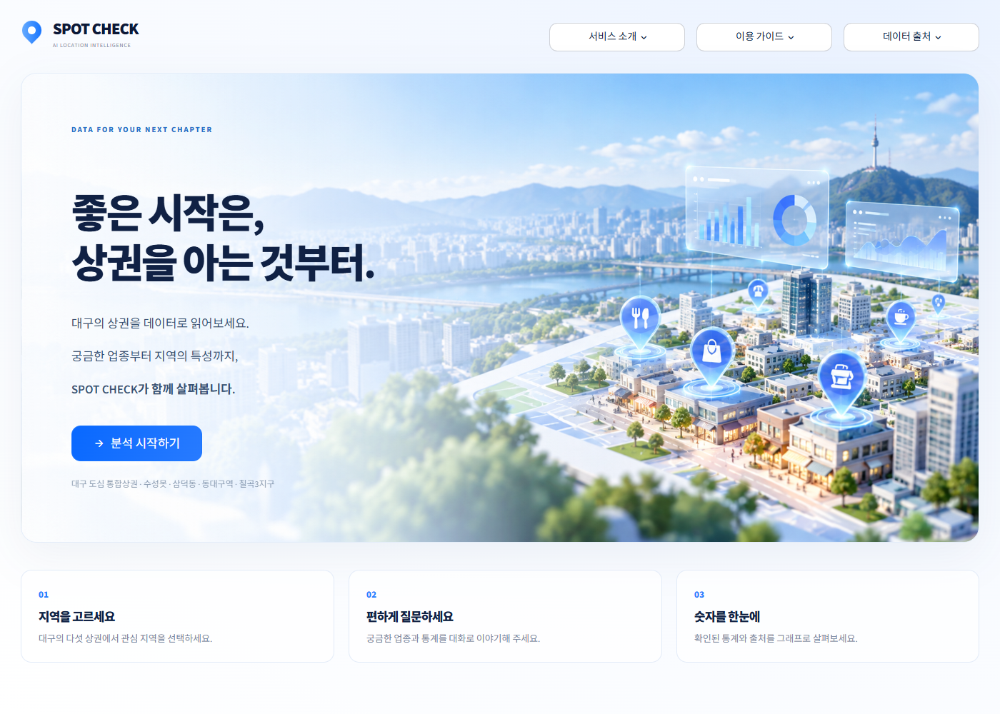

### 02_region_conditions.png

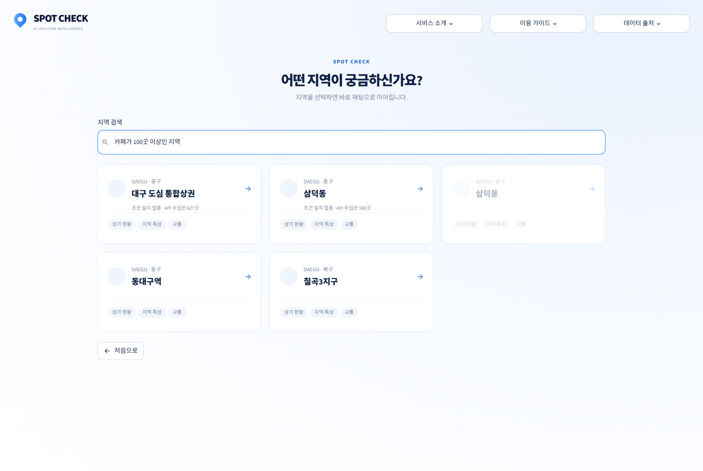

### 03_user_pending.png

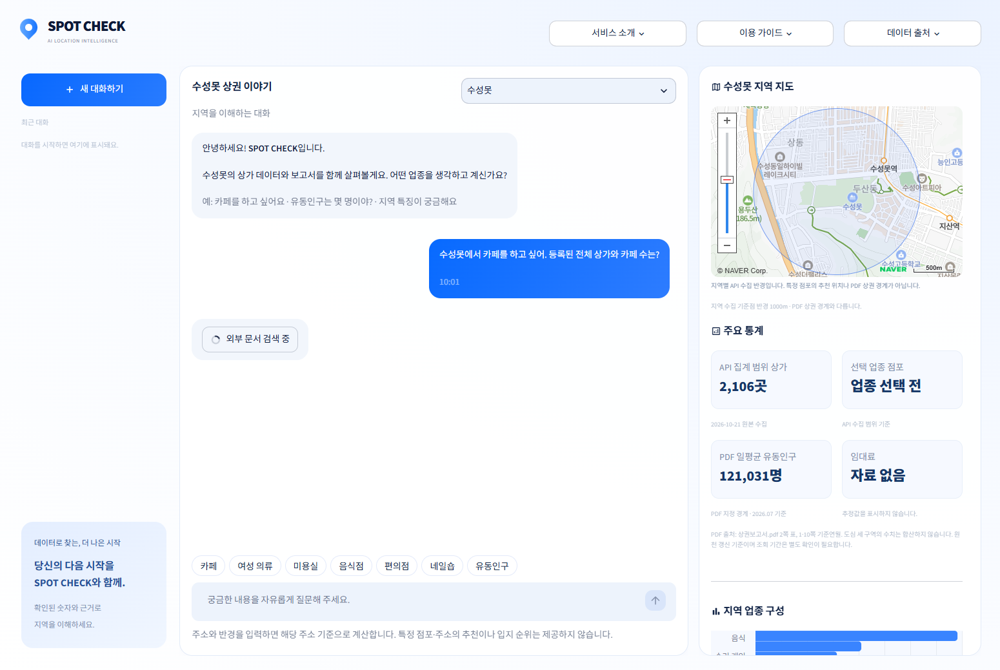

### 04_answer_sources.png

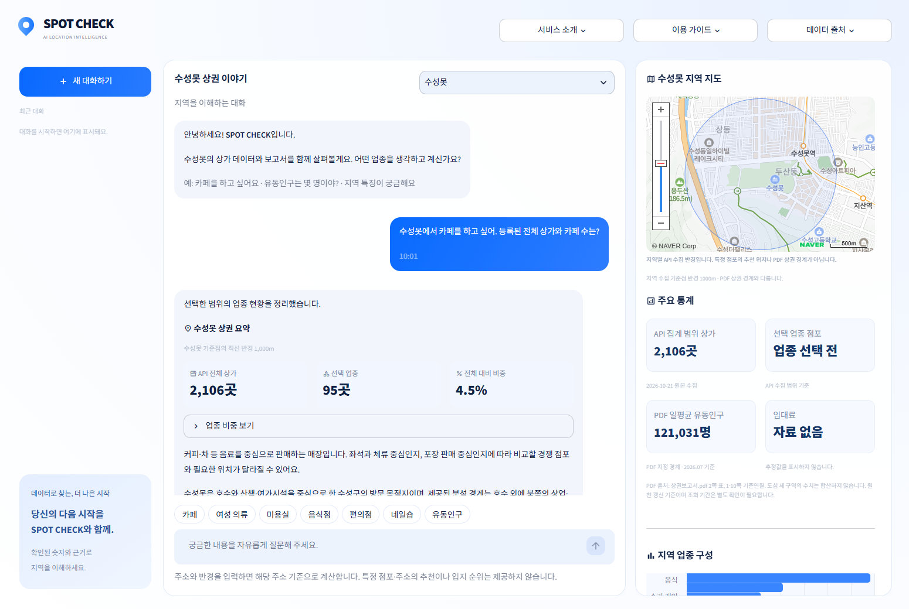

### 05_source_details.png


### 06_unknown_answer.png

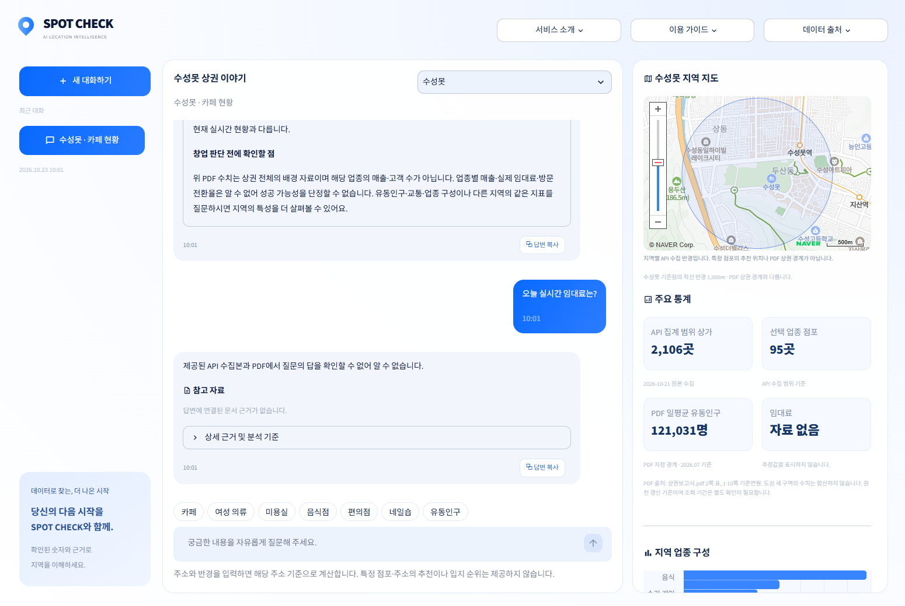

### 07_region_isolation.png

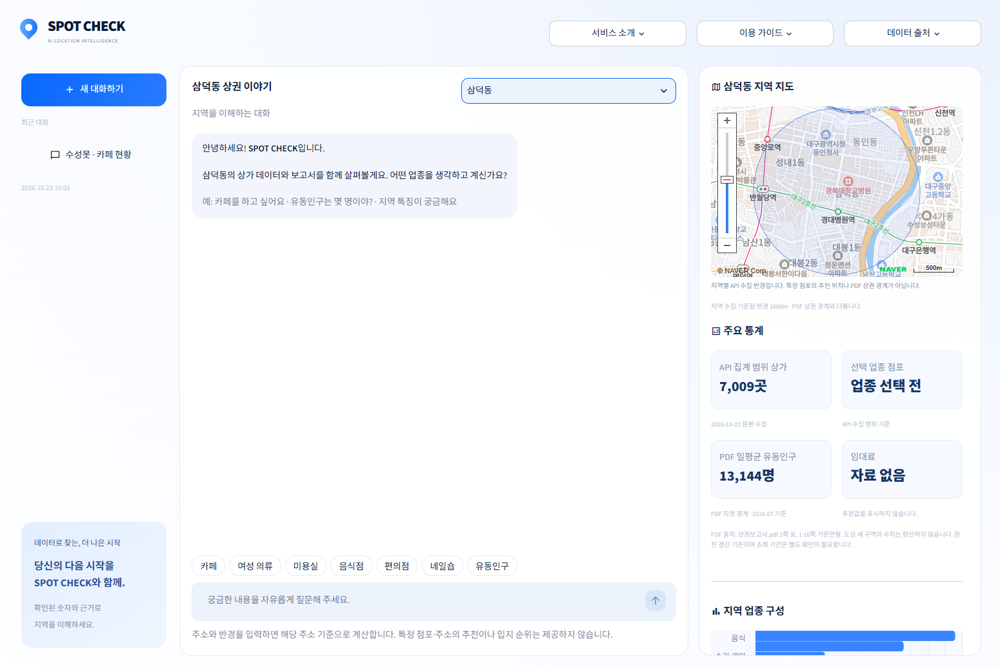

### 08_address_radius.png


### 09_mobile.png


### 10_index_checks.png


### 11_graph.png

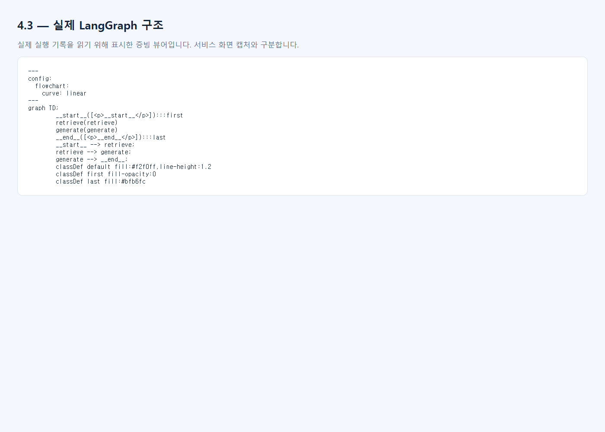

### 12_collection_audit.png


### 13_tests_security.png


### 14_quality_comparison.png


### chat_answer_complete.png

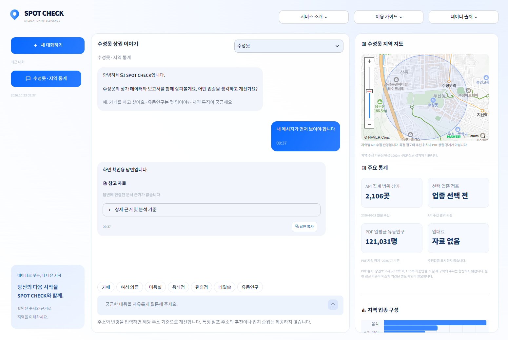

### chat_user_and_loading.png

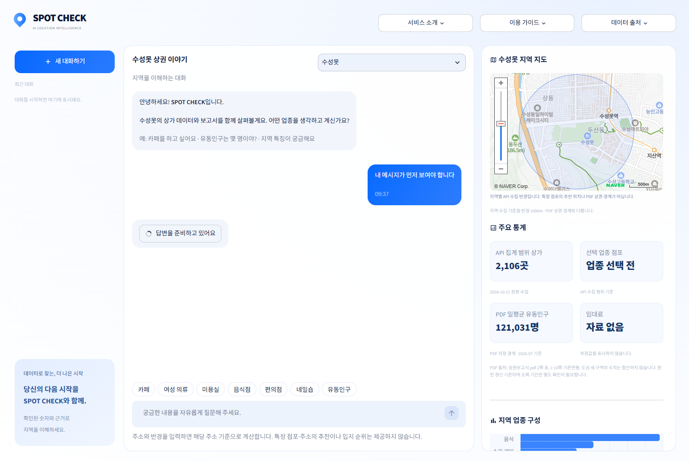

### clean_navigation_mobile.png

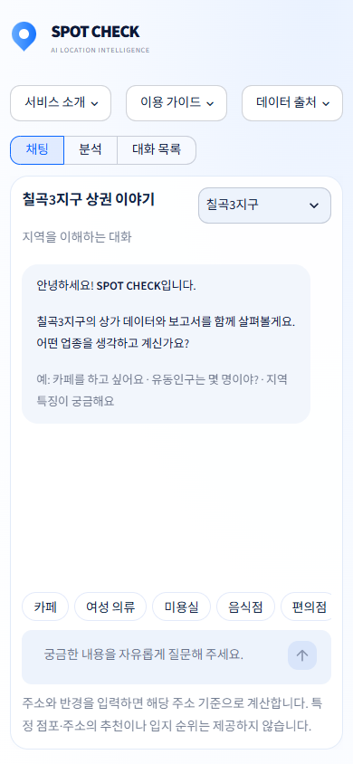

### failure_index_controlled.png

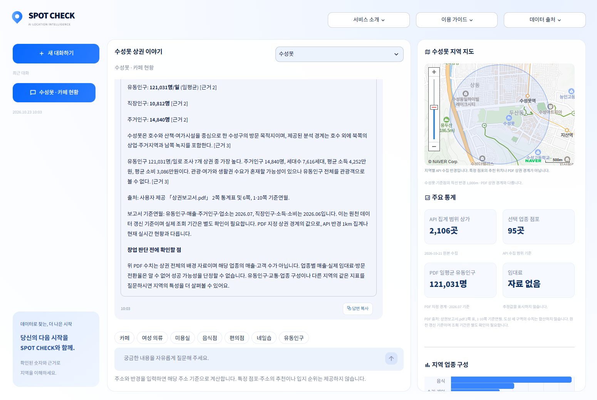

### failure_index_notice.png


### failure_key_controlled.png

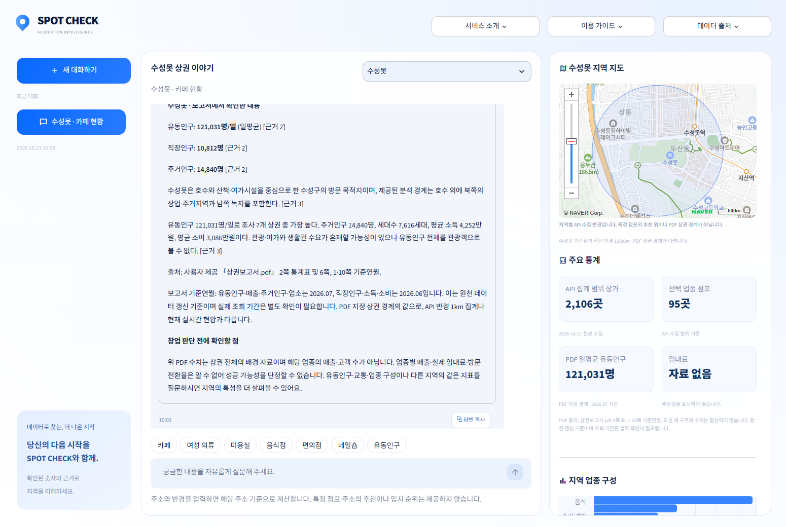

### failure_key_notice.png


<a id="raw"></a>

## 원시 실행 기록

아래는 실행 당시의 기록이다. previous로 시작하는 기록과 기존 package_validation은 이전 모델·정리 전 패키지의 기록으로 구분한다. 현재 제출물은 최상위 6개 항목이며 검증결과 형식은 Markdown이다.

<a id="record-1"></a>

### browser_checks.json

```json
{
  "region_condition_excludes_suseongmot": true,
  "download_matches_current_pdf": true,
  "unknown_abstention": true,
  "region_isolation": true,
  "radius_answer": true,
  "archive_restore": true,
  "mobile_no_horizontal_overflow": true
}
```

<a id="record-2"></a>

### collection_audit.json

```json
{
  "created_at": 1792716676.3652606,
  "question": "칠곡3지구 상권의 교통 특징은?",
  "region_id": "chilgok3",
  "queries": [
    "대구 칠곡3지구 상권 교통 접근성 대중교통 상권분석 보고서",
    "대구 북구 칠곡3지구 교통량 버스 도시철도 교통 특성",
    "칠곡3지구 상권 유동인구 교통 접근성 대구 상권 분석"
  ],
  "candidates": [
    {
      "id": 0,
      "title": "동성로 · 지역 설명",
      "url": "pdf:8cddbe5f53006877be0c608b3346e73cd4285e13f51047d9a9345744d66e1904:daegu_downtown:동성로:pdf_chapter",
      "region_id": "daegu_downtown",
      "snippet": "3\n02. 대구 도심 통합상권\n분석 범위: 동성로 + 대구역 + 반월당. 세 상권은 하나의 도심 생활·상업권역으로 설명하지만, 각 수치는 별도 구역으로\n유지한다. 경계 이미지는 사용자가 제공한 소상공인365 화면을 기준으로 한다.\n2-1. 동성로\n위치와 공간적 특징\n대구 중구 중심 상업가로. 제공된 경계는 중앙로역 남쪽에서 반월당역 북쪽으로 이어지는 중심 상업 구간에 해당한다.\n교통 접근성\n도시철도 1호선 중앙로역, 1·2호선 반월당역을 이용할 수 있다. 중앙대로와 인접한 도심 버스정류장 접근성도 함께 검토할 수\n있다.\n주변 랜드마크·방문 장소\n동성로 상업거리, 동성로28아트스퀘어, 2·28기념중앙공원(인근), 교동시장(인근).\n소상공인365 데이터 해석\n동성로 전체 관광특구와 사용자가 지정한 경계가 같지 않다. 업종별 경쟁도와 공실률을 별도 확인해야 한다.\n해석상 주의\n유동인구 110,640명/일, 업소 2,090개, 월평균 매출 지표 8,177만원. 조사 7개 상권 중 업소 수와 매출 지표가 가장 높다.\n직장인구 20,011명으로 업무·상업 수요를 함께 살펴볼 필요가 있다.\n자료·근거 | 소상공인365 사용자 수집자료(2026.06~07); 대구관광 공식 안내 https://tour.daegu.go.kr; 도시철도 노선·역 안내는 대구교통공사\nhttps://www.dtro.or.kr\n사용자가 지정한 상권 경계(참고 이미지)\n",
      "source": "data/reports/상권보고서.pdf",
      "page": 3
    },
    {
      "id": 1,
      "title": "동성로 · 지역 통계",
      "url": "pdf:8cddbe5f53006877be0c608b3346e73cd4285e13f51047d9a9345744d66e1904:daegu_downtown:동성로:pdf_statistics",
      "region_id": "daegu_downtown",
      "snippet": "동성로 · PDF 지정 상권 경계 통계\n유동인구: 110,640명/일\n월평균 매출: 8,177만원\n직장인구: 20,011명\n주거인구: 721명\n업소 수: 2,090개\n평균 소비: 2,480만원\n평균 소득: 3,518만원\n세대 수: 525세대",
      "source": "data/reports/상권보고서.pdf",
      "page": 2
    },
    {
      "id": 2,
      "title": "대구역 · 지역 설명",
      "url": "pdf:8cddbe5f53006877be0c608b3346e73cd4285e13f51047d9a9345744d66e1904:daegu_downtown:대구역:pdf_chapter",
      "region_id": "daegu_downtown",
      "snippet": "4\n2-2. 대구역\n위치와 공간적 특징\n대구역 남쪽의 교동시장·대구광역시청 주변 도심 구역. 대구역 전체 역세권이나 북측 생활권과 동일하지 않다.\n교통 접근성\n철도 대구역 및 도시철도 1호선 대구역 접근이 가능하다. 중앙로·교동 일대의 버스정류장과 보행 연결성을 함께 검토한다.\n주변 랜드마크·방문 장소\n대구역, 교동시장, 대구광역시청 동인청사(주변), 경상감영공원(인근).\n소상공인365 데이터 해석\n남측 지정 구역만 분석한 수치이므로 북측 역세권과 혼동하지 않는다.\n해석상 주의\n유동인구 55,851명/일, 업소 1,316개, 직장인구 9,145명. 도심형 상업·업무 활동이 확인되지만 유동인구 전부를 철도\n이용객으로 볼 수 없다.\n자료·근거 | 소상공인365 사용자 수집자료(2026.06~07); 국가철도공단 철도역 정보 https://www.kr.or.kr; 대구교통공사 https://www.dtro.or.kr\n사용자가 지정한 상권 경계(참고 이미지)\n",
      "source": "data/reports/상권보고서.pdf",
      "page": 4
    },
    {
      "id": 3,
      "title": "대구역 · 지역 통계",
      "url": "pdf:8cddbe5f53006877be0c608b3346e73cd4285e13f51047d9a9345744d66e1904:daegu_downtown:대구역:pdf_statistics",
      "region_id": "daegu_downtown",
      "snippet": "대구역 · PDF 지정 상권 경계 통계\n유동인구: 55,851명/일\n월평균 매출: 4,223만원\n직장인구: 9,145명\n주거인구: 1,675명\n업소 수: 1,316개\n평균 소비: 2,480만원\n평균 소득: 3,518만원\n세대 수: 1,219세대",
      "source": "data/reports/상권보고서.pdf",
      "page": 2
    },
    {
      "id": 4,
      "title": "반월당 · 지역 설명",
      "url": "pdf:8cddbe5f53006877be0c608b3346e73cd4285e13f51047d9a9345744d66e1904:daegu_downtown:반월당:pdf_chapter",
      "region_id": "daegu_downtown",
      "snippet": "5\n2-3. 반월당\n위치와 공간적 특징\n중구 반월당역 동측의 도심 구역으로, 사용자가 선택한 경계에는 삼덕초등학교 및 경북대학교사범대학부설초등학교 주변이\n포함된다.\n교통 접근성\n도시철도 1·2호선 반월당역 환승이 가능하다. 달구벌대로·중앙대로 일대 버스정류장 접근성을 고려한다.\n주변 랜드마크·방문 장소\n반월당 지하상가, 봉산문화거리(인근), 대구약령시(인근).\n소상공인365 데이터 해석\n환승객이 모두 이 구역 내 소비자로 전환되는 것은 아니다. 지상·지하 상업공간도 구분해야 한다.\n해석상 주의\n유동인구 18,012명/일, 업소 261개, 월평균 매출 지표 3,544만원. 지정 경계가 도심 전체보다 좁아 교통 결절점의 규모와\n통계상 업소 규모가 다르게 나타날 수 있다.\n자료·근거 | 소상공인365 사용자 수집자료(2026.06~07); 대구교통공사 https://www.dtro.or.kr; 대구관광 https://tour.daegu.go.kr\n사용자가 지정한 상권 경계(참고 이미지)\n",
      "source": "data/reports/상권보고서.pdf",
      "page": 5
    },
    {
      "id": 5,
      "title": "반월당 · 지역 통계",
      "url": "pdf:8cddbe5f53006877be0c608b3346e73cd4285e13f51047d9a9345744d66e1904:daegu_downtown:반월당:pdf_statistics",
      "region_id": "daegu_downtown",
      "snippet": "반월당 · PDF 지정 상권 경계 통계\n유동인구: 18,012명/일\n월평균 매출: 3,544만원\n직장인구: 2,570명\n주거인구: 546명\n업소 수: 261개\n평균 소비: 2,480만원\n평균 소득: 3,518만원\n세대 수: 398세대",
      "source": "data/reports/상권보고서.pdf",
      "page": 2
    },
    {
      "id": 6,
      "title": "수성못 · 지역 설명",
      "url": "pdf:8cddbe5f53006877be0c608b3346e73cd4285e13f51047d9a9345744d66e1904:suseongmot:수성못:pdf_chapter",
      "region_id": "suseongmot",
      "snippet": "6\n03. 수성못(두산동)\n수성못은 호수와 산책·여가시설을 중심으로 한 수성구의 방문 목적지이며, 제공된 분석 경계는 호수 외에 북쪽의\n상업·주거지역과 남쪽 녹지를 포함한다.\n교통·랜드마크\n도시철도 3호선 수성못역, 수성못 주변 버스정류장을 이용할 수 있다. 수성못 산책로, 수성랜드, 수성못 카페거리, 들안길\n먹거리타운이 대표적인 주변 방문 요소다.\n통계 해석\n유동인구 121,031명/일로 조사 7개 상권 중 가장 높다. 주거인구 14,840명, 세대수 7,616세대, 평균 소득 4,252만원, 평균\n소비 3,086만원이다. 관광·여가와 생활권 수요가 혼재할 가능성이 있으나 유동인구 전체를 관광객으로 볼 수 없다.\n출처: 소상공인365 사용자 수집자료(2026.06~07); 수성구청 관광안내 https://www.suseong.kr; 대구관광 https://tour.daegu.go.kr\n",
      "source": "data/reports/상권보고서.pdf",
      "page": 6
    },
    {
      "id": 7,
      "title": "수성못 · 지역 통계",
      "url": "pdf:8cddbe5f53006877be0c608b3346e73cd4285e13f51047d9a9345744d66e1904:suseongmot:수성못:pdf_statistics",
      "region_id": "suseongmot",
      "snippet": "수성못 · PDF 지정 상권 경계 통계\n유동인구: 121,031명/일\n월평균 매출: 3,537만원\n직장인구: 10,812명\n주거인구: 14,840명\n업소 수: 1,671개\n평균 소비: 3,086만원\n평균 소득: 4,252만원\n세대 수: 7,616세대",
      "source": "data/reports/상권보고서.pdf",
      "page": 2
    },
    {
      "id": 8,
      "title": "삼덕동 · 지역 설명",
      "url": "pdf:8cddbe5f53006877be0c608b3346e73cd4285e13f51047d9a9345744d66e1904:samdeok:삼덕동:pdf_chapter",
      "region_id": "samdeok",
      "snippet": "7\n04. 삼덕동\n위치와 공간적 특징\n대구 중구 삼덕동의 경북대학교병원·대구동덕초등학교 주변으로, 제공된 경계는 삼덕동 전체 행정구역과 같지 않다.\n교통 접근성\n도시철도 2호선 경대병원역과 인근 버스정류장을 이용할 수 있다. 병원·주거 골목과 주요 도로 사이의 보행 동선 차이를\n살펴야 한다.\n주변 랜드마크·방문 장소\n경북대학교병원, 삼덕동 문화거리, 국채보상운동기념공원(인근), 김광석다시그리기길(인근).\n소상공인365 데이터 해석\n삼덕동1·2·3가 전체와 현재 지정 구역을 혼동하지 않는다.\n해석상 주의\n유동인구 13,144명/일로 조사 대상 중 가장 낮지만 직장인구 6,415명, 소득 지표 4,024만원이다. 작은 유동 규모가 곧 낮은\n입지 경쟁력을 뜻하지는 않으며 세부 골목별 방문 목적이 중요하다.\n자료·근거 | 소상공인365 사용자 수집자료(2026.06~07); 대구관광 https://tour.daegu.go.kr; 대구교통공사 https://www.dtro.or.kr\n사용자가 지정한 상권 경계(참고 이미지)\n",
      "source": "data/reports/상권보고서.pdf",
      "page": 7
    },
    {
      "id": 9,
      "title": "삼덕동 · 지역 통계",
      "url": "pdf:8cddbe5f53006877be0c608b3346e73cd4285e13f51047d9a9345744d66e1904:samdeok:삼덕동:pdf_statistics",
      "region_id": "samdeok",
      "snippet": "삼덕동 · PDF 지정 상권 경계 통계\n유동인구: 13,144명/일\n월평균 매출: 3,439만원\n직장인구: 6,415명\n주거인구: 1,779명\n업소 수: 274개\n평균 소비: 2,771만원\n평균 소득: 4,024만원\n세대 수: 1,087세대",
      "source": "data/reports/상권보고서.pdf",
      "page": 2
    },
    {
      "id": 10,
      "title": "동대구역 · 지역 설명",
      "url": "pdf:8cddbe5f53006877be0c608b3346e73cd4285e13f51047d9a9345744d66e1904:dongdaegu:동대구역:pdf_chapter",
      "region_id": "dongdaegu",
      "snippet": "8\n05. 동대구역(신천4동)\n위치와 공간적 특징\n대구 동구 신천4동의 동대구역 주변 상권을 대상으로 한다. 동대구역은 철도와 광역·도시 교통의 연결 거점이며,\n동대구복합환승센터가 인접한다. 정확한 상권 경계는 추후 확인해야 한다.\n교통 접근성\nKTX·일반철도 동대구역, 도시철도 1호선 동대구역, 동대구복합환승센터의 고속·시외버스 이용이 가능하다. 개별 시내버스\n정류장·노선은 실시간 교통정보로 별도 검증해야 한다.\n주변 랜드마크·방문 장소\n동대구역, 동대구복합환승센터, 신세계백화점 대구점(주변).\n소상공인365 데이터 해석\n신천4동 통계와 동대구역 전체 역세권을 동일시하지 않는다. 사용자가 선택한 경계 이미지를 추가하면 내부·외부 시설을\n확정할 수 있다.\n해석상 주의\n유동인구 43,284명/일, 업소 543개, 월평균 매출 지표 2,333만원, 직장인구 3,603명, 주거인구 1,568명이다. 교통 거점의\n존재가 해당 경계 내 상점 매출로 직접 이어지는지는 업종별 매출과 보행 동선 분석이 필요하다.\n자료·근거 | 소상공인365 사용자 수집자료(2026.06~07); 코레일 https://www.letskorail.com; 대구교통공사 https://www.dtro.or.kr\n",
      "source": "data/reports/상권보고서.pdf",
      "page": 8
    },
    {
      "id": 11,
      "title": "동대구역 · 지역 통계",
      "url": "pdf:8cddbe5f53006877be0c608b3346e73cd4285e13f51047d9a9345744d66e1904:dongdaegu:동대구역:pdf_statistics",
      "region_id": "dongdaegu",
      "snippet": "동대구역 · PDF 지정 상권 경계 통계\n유동인구: 43,284명/일\n월평균 매출: 2,333만원\n직장인구: 3,603명\n주거인구: 1,568명\n업소 수: 543개\n평균 소비: 2,551만원\n평균 소득: 3,896만원\n세대 수: 902세대",
      "source": "data/reports/상권보고서.pdf",
      "page": 2
    },
    {
      "id": 12,
      "title": "칠곡3지구 · 지역 설명",
      "url": "pdf:8cddbe5f53006877be0c608b3346e73cd4285e13f51047d9a9345744d66e1904:chilgok3:칠곡3지구:pdf_chapter",
      "region_id": "chilgok3",
      "snippet": "9\n06. 칠곡3지구\n위치와 공간적 특징\n대구 북구 칠곡 생활권 내 상업·생활 중심지로 알려진 칠곡3지구를 대상으로 한다. 정확한 분석 경계와 포함 도로는 사용자\n지도 자료가 아직 없어 확정하지 않는다.\n교통 접근성\n도시철도 3호선 팔거역과 인근 정류장이 주요 접근 교통수단 후보이다. 해당 역이 실제 지정 경계 안에 포함되는지는 지도로\n검증해야 한다.\n주변 랜드마크·방문 장소\n칠곡3지구 상업거리, 팔거역 주변 생활·상업시설, 칠곡 지역의 주거 배후 생활권. 특정 시설의 경계 포함 여부는 추후\n확인한다.\n소상공인365 데이터 해석\n주거인구 73명과 30세대는 상권 내 수치이지 칠곡 생활권 전체 수치가 아니다. 면적·경계 확인 전에는 상권 밀도를 계산하지\n않는다.\n해석상 주의\n유동인구 50,357명/일, 업소 666개, 월평균 매출 지표 3,781만원, 직장인구 4,140명, 주거인구 73명, 세대수 30세대이다.\n낮은 주거인구 수치는 상권 경계가 상업용지 위주로 설정되었을 가능성을 시사하지만, 주변 주거 수요가 없다는 의미는\n아니다.\n자료·근거 | 소상공인365 사용자 수집자료(2026.06~07); 대구교통공사 https://www.dtro.or.kr; 대구광역시 https://www.daegu.go.kr\n",
      "source": "data/reports/상권보고서.pdf",
      "page": 9
    },
    {
      "id": 13,
      "title": "칠곡3지구 · 지역 통계",
      "url": "pdf:8cddbe5f53006877be0c608b3346e73cd4285e13f51047d9a9345744d66e1904:chilgok3:칠곡3지구:pdf_statistics",
      "region_id": "chilgok3",
      "snippet": "칠곡3지구 · PDF 지정 상권 경계 통계\n유동인구: 50,357명/일\n월평균 매출: 3,781만원\n직장인구: 4,140명\n주거인구: 73명\n업소 수: 666개\n평균 소비: 2,440만원\n평균 소득: 3,602만원\n세대 수: 30세대",
      "source": "data/reports/상권보고서.pdf",
      "page": 2
    }
  ],
  "selected": [
    {
      "id": 12,
      "title": "칠곡3지구 · 지역 설명",
      "url": "pdf:8cddbe5f53006877be0c608b3346e73cd4285e13f51047d9a9345744d66e1904:chilgok3:칠곡3지구:pdf_chapter",
      "region_id": "chilgok3",
      "snippet": "9\n06. 칠곡3지구\n위치와 공간적 특징\n대구 북구 칠곡 생활권 내 상업·생활 중심지로 알려진 칠곡3지구를 대상으로 한다. 정확한 분석 경계와 포함 도로는 사용자\n지도 자료가 아직 없어 확정하지 않는다.\n교통 접근성\n도시철도 3호선 팔거역과 인근 정류장이 주요 접근 교통수단 후보이다. 해당 역이 실제 지정 경계 안에 포함되는지는 지도로\n검증해야 한다.\n주변 랜드마크·방문 장소\n칠곡3지구 상업거리, 팔거역 주변 생활·상업시설, 칠곡 지역의 주거 배후 생활권. 특정 시설의 경계 포함 여부는 추후\n확인한다.\n소상공인365 데이터 해석\n주거인구 73명과 30세대는 상권 내 수치이지 칠곡 생활권 전체 수치가 아니다. 면적·경계 확인 전에는 상권 밀도를 계산하지\n않는다.\n해석상 주의\n유동인구 50,357명/일, 업소 666개, 월평균 매출 지표 3,781만원, 직장인구 4,140명, 주거인구 73명, 세대수 30세대이다.\n낮은 주거인구 수치는 상권 경계가 상업용지 위주로 설정되었을 가능성을 시사하지만, 주변 주거 수요가 없다는 의미는\n아니다.\n자료·근거 | 소상공인365 사용자 수집자료(2026.06~07); 대구교통공사 https://www.dtro.or.kr; 대구광역시 https://www.daegu.go.kr\n",
      "source": "data/reports/상권보고서.pdf",
      "page": 9,
      "relevance": 0.88,
      "reason": "칠곡3지구의 교통 접근성을 직접 다루며 팔거역과 인근 정류장을 주요 접근 수단 후보로 제시합니다. 다만 역이 분석 경계에 포함되는지는 확인이 필요하다고 명시합니다."
    },
    {
      "id": 13,
      "title": "칠곡3지구 · 지역 통계",
      "url": "pdf:8cddbe5f53006877be0c608b3346e73cd4285e13f51047d9a9345744d66e1904:chilgok3:칠곡3지구:pdf_statistics",
      "region_id": "chilgok3",
      "snippet": "칠곡3지구 · PDF 지정 상권 경계 통계\n유동인구: 50,357명/일\n월평균 매출: 3,781만원\n직장인구: 4,140명\n주거인구: 73명\n업소 수: 666개\n평균 소비: 2,440만원\n평균 소득: 3,602만원\n세대 수: 30세대",
      "source": "data/reports/상권보고서.pdf",
      "page": 2,
      "reason": "선택 지역 자체의 설명/통계 · 필수 포함"
    }
  ],
  "rejected": [
    {
      "id": 0,
      "title": "동성로 · 지역 설명",
      "url": "pdf:8cddbe5f53006877be0c608b3346e73cd4285e13f51047d9a9345744d66e1904:daegu_downtown:동성로:pdf_chapter",
      "region_id": "daegu_downtown",
      "snippet": "3\n02. 대구 도심 통합상권\n분석 범위: 동성로 + 대구역 + 반월당. 세 상권은 하나의 도심 생활·상업권역으로 설명하지만, 각 수치는 별도 구역으로\n유지한다. 경계 이미지는 사용자가 제공한 소상공인365 화면을 기준으로 한다.\n2-1. 동성로\n위치와 공간적 특징\n대구 중구 중심 상업가로. 제공된 경계는 중앙로역 남쪽에서 반월당역 북쪽으로 이어지는 중심 상업 구간에 해당한다.\n교통 접근성\n도시철도 1호선 중앙로역, 1·2호선 반월당역을 이용할 수 있다. 중앙대로와 인접한 도심 버스정류장 접근성도 함께 검토할 수\n있다.\n주변 랜드마크·방문 장소\n동성로 상업거리, 동성로28아트스퀘어, 2·28기념중앙공원(인근), 교동시장(인근).\n소상공인365 데이터 해석\n동성로 전체 관광특구와 사용자가 지정한 경계가 같지 않다. 업종별 경쟁도와 공실률을 별도 확인해야 한다.\n해석상 주의\n유동인구 110,640명/일, 업소 2,090개, 월평균 매출 지표 8,177만원. 조사 7개 상권 중 업소 수와 매출 지표가 가장 높다.\n직장인구 20,011명으로 업무·상업 수요를 함께 살펴볼 필요가 있다.\n자료·근거 | 소상공인365 사용자 수집자료(2026.06~07); 대구관광 공식 안내 https://tour.daegu.go.kr; 도시철도 노선·역 안내는 대구교통공사\nhttps://www.dtro.or.kr\n사용자가 지정한 상권 경계(참고 이미지)\n",
      "source": "data/reports/상권보고서.pdf",
      "page": 3,
      "reason": "다른 지역 문서"
    },
    {
      "id": 1,
      "title": "동성로 · 지역 통계",
      "url": "pdf:8cddbe5f53006877be0c608b3346e73cd4285e13f51047d9a9345744d66e1904:daegu_downtown:동성로:pdf_statistics",
      "region_id": "daegu_downtown",
      "snippet": "동성로 · PDF 지정 상권 경계 통계\n유동인구: 110,640명/일\n월평균 매출: 8,177만원\n직장인구: 20,011명\n주거인구: 721명\n업소 수: 2,090개\n평균 소비: 2,480만원\n평균 소득: 3,518만원\n세대 수: 525세대",
      "source": "data/reports/상권보고서.pdf",
      "page": 2,
      "reason": "다른 지역 문서"
    },
    {
      "id": 2,
      "title": "대구역 · 지역 설명",
      "url": "pdf:8cddbe5f53006877be0c608b3346e73cd4285e13f51047d9a9345744d66e1904:daegu_downtown:대구역:pdf_chapter",
      "region_id": "daegu_downtown",
      "snippet": "4\n2-2. 대구역\n위치와 공간적 특징\n대구역 남쪽의 교동시장·대구광역시청 주변 도심 구역. 대구역 전체 역세권이나 북측 생활권과 동일하지 않다.\n교통 접근성\n철도 대구역 및 도시철도 1호선 대구역 접근이 가능하다. 중앙로·교동 일대의 버스정류장과 보행 연결성을 함께 검토한다.\n주변 랜드마크·방문 장소\n대구역, 교동시장, 대구광역시청 동인청사(주변), 경상감영공원(인근).\n소상공인365 데이터 해석\n남측 지정 구역만 분석한 수치이므로 북측 역세권과 혼동하지 않는다.\n해석상 주의\n유동인구 55,851명/일, 업소 1,316개, 직장인구 9,145명. 도심형 상업·업무 활동이 확인되지만 유동인구 전부를 철도\n이용객으로 볼 수 없다.\n자료·근거 | 소상공인365 사용자 수집자료(2026.06~07); 국가철도공단 철도역 정보 https://www.kr.or.kr; 대구교통공사 https://www.dtro.or.kr\n사용자가 지정한 상권 경계(참고 이미지)\n",
      "source": "data/reports/상권보고서.pdf",
      "page": 4,
      "reason": "다른 지역 문서"
    },
    {
      "id": 3,
      "title": "대구역 · 지역 통계",
      "url": "pdf:8cddbe5f53006877be0c608b3346e73cd4285e13f51047d9a9345744d66e1904:daegu_downtown:대구역:pdf_statistics",
      "region_id": "daegu_downtown",
      "snippet": "대구역 · PDF 지정 상권 경계 통계\n유동인구: 55,851명/일\n월평균 매출: 4,223만원\n직장인구: 9,145명\n주거인구: 1,675명\n업소 수: 1,316개\n평균 소비: 2,480만원\n평균 소득: 3,518만원\n세대 수: 1,219세대",
      "source": "data/reports/상권보고서.pdf",
      "page": 2,
      "reason": "다른 지역 문서"
    },
    {
      "id": 4,
      "title": "반월당 · 지역 설명",
      "url": "pdf:8cddbe5f53006877be0c608b3346e73cd4285e13f51047d9a9345744d66e1904:daegu_downtown:반월당:pdf_chapter",
      "region_id": "daegu_downtown",
      "snippet": "5\n2-3. 반월당\n위치와 공간적 특징\n중구 반월당역 동측의 도심 구역으로, 사용자가 선택한 경계에는 삼덕초등학교 및 경북대학교사범대학부설초등학교 주변이\n포함된다.\n교통 접근성\n도시철도 1·2호선 반월당역 환승이 가능하다. 달구벌대로·중앙대로 일대 버스정류장 접근성을 고려한다.\n주변 랜드마크·방문 장소\n반월당 지하상가, 봉산문화거리(인근), 대구약령시(인근).\n소상공인365 데이터 해석\n환승객이 모두 이 구역 내 소비자로 전환되는 것은 아니다. 지상·지하 상업공간도 구분해야 한다.\n해석상 주의\n유동인구 18,012명/일, 업소 261개, 월평균 매출 지표 3,544만원. 지정 경계가 도심 전체보다 좁아 교통 결절점의 규모와\n통계상 업소 규모가 다르게 나타날 수 있다.\n자료·근거 | 소상공인365 사용자 수집자료(2026.06~07); 대구교통공사 https://www.dtro.or.kr; 대구관광 https://tour.daegu.go.kr\n사용자가 지정한 상권 경계(참고 이미지)\n",
      "source": "data/reports/상권보고서.pdf",
      "page": 5,
      "reason": "다른 지역 문서"
    },
    {
      "id": 5,
      "title": "반월당 · 지역 통계",
      "url": "pdf:8cddbe5f53006877be0c608b3346e73cd4285e13f51047d9a9345744d66e1904:daegu_downtown:반월당:pdf_statistics",
      "region_id": "daegu_downtown",
      "snippet": "반월당 · PDF 지정 상권 경계 통계\n유동인구: 18,012명/일\n월평균 매출: 3,544만원\n직장인구: 2,570명\n주거인구: 546명\n업소 수: 261개\n평균 소비: 2,480만원\n평균 소득: 3,518만원\n세대 수: 398세대",
      "source": "data/reports/상권보고서.pdf",
      "page": 2,
      "reason": "다른 지역 문서"
    },
    {
      "id": 6,
      "title": "수성못 · 지역 설명",
      "url": "pdf:8cddbe5f53006877be0c608b3346e73cd4285e13f51047d9a9345744d66e1904:suseongmot:수성못:pdf_chapter",
      "region_id": "suseongmot",
      "snippet": "6\n03. 수성못(두산동)\n수성못은 호수와 산책·여가시설을 중심으로 한 수성구의 방문 목적지이며, 제공된 분석 경계는 호수 외에 북쪽의\n상업·주거지역과 남쪽 녹지를 포함한다.\n교통·랜드마크\n도시철도 3호선 수성못역, 수성못 주변 버스정류장을 이용할 수 있다. 수성못 산책로, 수성랜드, 수성못 카페거리, 들안길\n먹거리타운이 대표적인 주변 방문 요소다.\n통계 해석\n유동인구 121,031명/일로 조사 7개 상권 중 가장 높다. 주거인구 14,840명, 세대수 7,616세대, 평균 소득 4,252만원, 평균\n소비 3,086만원이다. 관광·여가와 생활권 수요가 혼재할 가능성이 있으나 유동인구 전체를 관광객으로 볼 수 없다.\n출처: 소상공인365 사용자 수집자료(2026.06~07); 수성구청 관광안내 https://www.suseong.kr; 대구관광 https://tour.daegu.go.kr\n",
      "source": "data/reports/상권보고서.pdf",
      "page": 6,
      "reason": "다른 지역 문서"
    },
    {
      "id": 7,
      "title": "수성못 · 지역 통계",
      "url": "pdf:8cddbe5f53006877be0c608b3346e73cd4285e13f51047d9a9345744d66e1904:suseongmot:수성못:pdf_statistics",
      "region_id": "suseongmot",
      "snippet": "수성못 · PDF 지정 상권 경계 통계\n유동인구: 121,031명/일\n월평균 매출: 3,537만원\n직장인구: 10,812명\n주거인구: 14,840명\n업소 수: 1,671개\n평균 소비: 3,086만원\n평균 소득: 4,252만원\n세대 수: 7,616세대",
      "source": "data/reports/상권보고서.pdf",
      "page": 2,
      "reason": "다른 지역 문서"
    },
    {
      "id": 8,
      "title": "삼덕동 · 지역 설명",
      "url": "pdf:8cddbe5f53006877be0c608b3346e73cd4285e13f51047d9a9345744d66e1904:samdeok:삼덕동:pdf_chapter",
      "region_id": "samdeok",
      "snippet": "7\n04. 삼덕동\n위치와 공간적 특징\n대구 중구 삼덕동의 경북대학교병원·대구동덕초등학교 주변으로, 제공된 경계는 삼덕동 전체 행정구역과 같지 않다.\n교통 접근성\n도시철도 2호선 경대병원역과 인근 버스정류장을 이용할 수 있다. 병원·주거 골목과 주요 도로 사이의 보행 동선 차이를\n살펴야 한다.\n주변 랜드마크·방문 장소\n경북대학교병원, 삼덕동 문화거리, 국채보상운동기념공원(인근), 김광석다시그리기길(인근).\n소상공인365 데이터 해석\n삼덕동1·2·3가 전체와 현재 지정 구역을 혼동하지 않는다.\n해석상 주의\n유동인구 13,144명/일로 조사 대상 중 가장 낮지만 직장인구 6,415명, 소득 지표 4,024만원이다. 작은 유동 규모가 곧 낮은\n입지 경쟁력을 뜻하지는 않으며 세부 골목별 방문 목적이 중요하다.\n자료·근거 | 소상공인365 사용자 수집자료(2026.06~07); 대구관광 https://tour.daegu.go.kr; 대구교통공사 https://www.dtro.or.kr\n사용자가 지정한 상권 경계(참고 이미지)\n",
      "source": "data/reports/상권보고서.pdf",
      "page": 7,
      "reason": "다른 지역 문서"
    },
    {
      "id": 9,
      "title": "삼덕동 · 지역 통계",
      "url": "pdf:8cddbe5f53006877be0c608b3346e73cd4285e13f51047d9a9345744d66e1904:samdeok:삼덕동:pdf_statistics",
      "region_id": "samdeok",
      "snippet": "삼덕동 · PDF 지정 상권 경계 통계\n유동인구: 13,144명/일\n월평균 매출: 3,439만원\n직장인구: 6,415명\n주거인구: 1,779명\n업소 수: 274개\n평균 소비: 2,771만원\n평균 소득: 4,024만원\n세대 수: 1,087세대",
      "source": "data/reports/상권보고서.pdf",
      "page": 2,
      "reason": "다른 지역 문서"
    },
    {
      "id": 10,
      "title": "동대구역 · 지역 설명",
      "url": "pdf:8cddbe5f53006877be0c608b3346e73cd4285e13f51047d9a9345744d66e1904:dongdaegu:동대구역:pdf_chapter",
      "region_id": "dongdaegu",
      "snippet": "8\n05. 동대구역(신천4동)\n위치와 공간적 특징\n대구 동구 신천4동의 동대구역 주변 상권을 대상으로 한다. 동대구역은 철도와 광역·도시 교통의 연결 거점이며,\n동대구복합환승센터가 인접한다. 정확한 상권 경계는 추후 확인해야 한다.\n교통 접근성\nKTX·일반철도 동대구역, 도시철도 1호선 동대구역, 동대구복합환승센터의 고속·시외버스 이용이 가능하다. 개별 시내버스\n정류장·노선은 실시간 교통정보로 별도 검증해야 한다.\n주변 랜드마크·방문 장소\n동대구역, 동대구복합환승센터, 신세계백화점 대구점(주변).\n소상공인365 데이터 해석\n신천4동 통계와 동대구역 전체 역세권을 동일시하지 않는다. 사용자가 선택한 경계 이미지를 추가하면 내부·외부 시설을\n확정할 수 있다.\n해석상 주의\n유동인구 43,284명/일, 업소 543개, 월평균 매출 지표 2,333만원, 직장인구 3,603명, 주거인구 1,568명이다. 교통 거점의\n존재가 해당 경계 내 상점 매출로 직접 이어지는지는 업종별 매출과 보행 동선 분석이 필요하다.\n자료·근거 | 소상공인365 사용자 수집자료(2026.06~07); 코레일 https://www.letskorail.com; 대구교통공사 https://www.dtro.or.kr\n",
      "source": "data/reports/상권보고서.pdf",
      "page": 8,
      "reason": "다른 지역 문서"
    },
    {
      "id": 11,
      "title": "동대구역 · 지역 통계",
      "url": "pdf:8cddbe5f53006877be0c608b3346e73cd4285e13f51047d9a9345744d66e1904:dongdaegu:동대구역:pdf_statistics",
      "region_id": "dongdaegu",
      "snippet": "동대구역 · PDF 지정 상권 경계 통계\n유동인구: 43,284명/일\n월평균 매출: 2,333만원\n직장인구: 3,603명\n주거인구: 1,568명\n업소 수: 543개\n평균 소비: 2,551만원\n평균 소득: 3,896만원\n세대 수: 902세대",
      "source": "data/reports/상권보고서.pdf",
      "page": 2,
      "reason": "다른 지역 문서"
    }
  ],
  "prompt1_executed": true,
  "prompt2_executed": true
}
```

<a id="record-3"></a>

### index_validation.json

```json
{
  "executed_at": "2026-10-23T00:49:58.431359+00:00",
  "method": "Actual project documents, isolated real Chroma, LOCAL character n-gram embeddings; no GMS model calls; production DB read only.",
  "production": {
    "store_metadata": {
      "total": 9948,
      "active": 1452
    },
    "external_documents": {
      "total": 14,
      "active": 14
    }
  },
  "source_document_counts": {
    "store_metadata": 1452,
    "external_documents": 14
  },
  "reindex_passes": [
    {
      "store_metadata": {
        "loaded_documents": 100,
        "chunks": 100,
        "embedded": 100,
        "removed": 0,
        "collection_count": 100
      },
      "external_documents": {
        "loaded_documents": 14,
        "chunks": 14,
        "embedded": 14,
        "removed": 0,
        "collection_count": 14
      }
    },
    {
      "store_metadata": {
        "loaded_documents": 100,
        "chunks": 100,
        "embedded": 0,
        "removed": 0,
        "collection_count": 100
      },
      "external_documents": {
        "loaded_documents": 14,
        "chunks": 14,
        "embedded": 0,
        "removed": 0,
        "collection_count": 14
      }
    }
  ],
  "sample": {
    "region_id": "chilgok3",
    "region_name": "칠곡3지구",
    "source": "https://apis.data.go.kr/B553077/api/open/sdsc2/storeListInRadius",
    "source_type": "store_metadata",
    "collected_at": "2026-10-22T02:24:04.684357+00:00",
    "reference": "2026-10-22",
    "content_type": "api_metadata",
    "usage_note": "공공 상가정보 수집본 · docs/data_sources.md 참조",
    "robots_note": "기수집 공공 API CSV · 추가 호출 없음",
    "page": 0,
    "url": "metadata:chilgok3:region:",
    "title": "칠곡3지구 · 지역 전체 메타데이터",
    "category_level": "region",
    "category_name": "",
    "text": "선택 지역: 칠곡3지구\n행정구역: 대구 북구\n업종 수준: region\n업종: 지역 전체\n수집본 등록 상가: 2,359곳\n수집 범위: 파일럿 원형 수집 범위. 공식 상권 경계가 아님\n집계 주의: 벡터 검색의 반환 건수를 전체 상가 수로 사용하지 않습니다. 실제 질문의 반경은 원본 CSV로 다시 계산합니다.",
    "corpus_version": "e075cc5b4c0af2df9510be12a2e9be853d51c387372e5760c50ad35f90d0427e:local-char-ngram-v1"
  },
  "chunk_counts": {
    "1000_200": 14,
    "500_100": 18
  },
  "top_k": {
    "small_settings": [
      1,
      1
    ],
    "large_settings": [
      3,
      4
    ],
    "small": {
      "rag1": 2,
      "rag2": 1,
      "evidence_ids": [
        "R1",
        "R2",
        "R3"
      ]
    },
    "large": {
      "rag1": 4,
      "rag2": 2,
      "evidence_ids": [
        "R1",
        "R2",
        "R3",
        "R4",
        "R5",
        "R6"
      ]
    }
  }
}
```

<a id="record-4"></a>

### luna_quality_comparison.json

```json
{
  "executed_at": "2026-10-23T00:49:01.621759+00:00",
  "model": "gpt-6-luna",
  "method": "무검색 LLM 대 실제 CSV/PDF 검증·RAG 검색·발췌 결합 서비스 비교. 순수 프롬프트 단독 효과 실험이 아님.",
  "cases": [
    {
      "region": "suseongmot",
      "question": "수성못에서 카페를 하고 싶어. 등록된 전체 상가와 카페 수는?",
      "kind": "counts",
      "before": "현재 수성못 주변의 **등록 상가 전체 수와 카페 수를 확인할 실시간 자료가 없어 정확한 숫자는 알 수 없습니다.** 수성못은 행정구역처럼 경계가 정해진 지역명이 아니어서, 집계 범위에 따라 숫자도 달라집니다.\n\n정확히 세려면 **수성못에서 몇 m 이내인지**와 **기준일**, 그리고 ‘상가’를 영업 중인 점포로 볼지 사업자등록 기준으로 볼지를 정해야 합니다. 예를 들어 **수성못 중심 반경 500m의 영업 중 점포 수와 커피전문점 수**처럼 범위를 정해 주시면, 그 기준에 맞는 자료를 확인하는 방법을 안내해 드릴게요.",
      "before_seconds": 13.697,
      "after": "**수성못에서 카페 창업을 생각하고 계시는군요. 업종과 지역 현황부터 살펴볼게요.**\n\n**어떤 업종인가요?**\n\n커피·차 등 음료를 중심으로 판매하는 매장입니다. 좌석과 체류 중심인지, 포장 판매 중심인지에 따라 비교할 경쟁 점포와 필요한 위치가 달라질 수 있어요.\n\n상가정보 API에서 선택한 업종은 **카페**이며, 다음 분류에 속합니다: 음식 → 비알코올  → 카페.\n\n**이 지역의 해당 업종 현황**\n\n집계 범위: **수성못 기준점의 직선 반경 1,000m**. 확인된 전체 상가 **2,106곳** 중 해당 업종은 **95곳** (4.5%)입니다. [근거 1]\n\n출처: [소상공인시장진흥공단 상가정보 API](https://apis.data.go.kr/B553077/api/open/sdsc2/storeListInRadius) 수집본. 원본 수집일 2026-10-21, 집계 범위는 위 기준입니다. 분류·현황의 출처는 API이며 점포 수는 수집 시점의 등록 정보입니다. 업종의 일반 설명과 확인 제안은 서비스 안내입니다.\n\n**수성못 · 보고서에서 확인한 내용**\n\n유동인구: **121,031명/일** (일평균) [근거 2]\n\n직장인구: **10,812명** [근거 2]\n\n주거인구: **14,840명** [근거 2]\n\n수성못은 호수와 산책·여가시설을 중심으로 한 수성구의 방문 목적지이며, 제공된 분석 경계는 호수 외에 북쪽의 상업·주거지역과 남쪽 녹지를 포함한다. [근거 3]\n\n유동인구 121,031명/일로 조사 7개 상권 중 가장 높다. 주거인구 14,840명, 세대수 7,616세대, 평균 소득 4,252만원, 평균 소비 3,086만원이다. 관광·여가와 생활권 수요가 혼재할 가능성이 있으나 유동인구 전체를 관광객으로 볼 수 없다. [근거 3]\n\n출처: 사용자 제공 「상권보고서.pdf」 2쪽 통계표 및 6쪽, 1·10쪽 기준연월.\n\n보고서 기준연월: 유동인구·매출·주거인구·업소는 2026.07, 직장인구·소득·소비는 2026.06입니다. 이는 원천 데이터 갱신 기준이며 실제 조회 기간은 별도 확인이 필요합니다. PDF 지정 상권 경계의 값으로, API 반경 1km 집계나 현재 실시간 현황과 다릅니다.\n\n**창업 판단 전에 확인할 점**\n\n위 PDF 수치는 상권 전체의 배경 자료이며 해당 업종의 매출·고객 수가 아닙니다. 업종별 매출·실제 임대료·방문 전환율은 알 수 없어 성공 가능성을 단정할 수 없습니다. 유동인구·교통·업종 구성이나 다른 지역의 같은 지표를 질문하시면 지역의 특성을 더 살펴볼 수 있어요.",
      "after_seconds": 9.673,
      "visual": {
        "type": "overview",
        "spot": "수성못",
        "categories": [
          {
            "level": "small",
            "name": "카페"
          }
        ],
        "region_id": "suseongmot",
        "parent_id": "suseongmot",
        "scope_kind": "region",
        "scope_center": "수성못 기준점",
        "scope_description": "수성못 기준점의 직선 반경 1,000m",
        "source_dates": [
          "2026-10-21"
        ],
        "total_stores": 2106,
        "competitor_count": 95,
        "category_counts": [
          {
            "업종": "카페",
            "점포 수": 95
          }
        ],
        "radius_m": 1000,
        "source": "https://apis.data.go.kr/B553077/api/open/sdsc2/storeListInRadius",
        "collected_at": "2026-10-21T06:22:41.299999+00:00",
        "distribution": {
          "카페": 95
        },
        "all_distribution": {
          "음식": 783,
          "소매": 410,
          "수리·개인": 316,
          "과학·기술": 214,
          "예술·스포츠": 107,
          "교육": 91,
          "부동산": 82,
          "시설관리·임대": 63,
          "숙박": 28,
          "보건의료": 12
        }
      },
      "citations": [
        {
          "title": "질문 범위의 실제 API 집계",
          "source_type": "api_aggregate",
          "source": "https://apis.data.go.kr/B553077/api/open/sdsc2/storeListInRadius",
          "reference": "2026-10-21",
          "scope": "수성못 기준점의 직선 반경 1,000m",
          "page": null,
          "number": 1
        },
        {
          "title": "수성못 · 보고서 통계",
          "source_type": "pdf_statistics",
          "source": "상권보고서.pdf",
          "page": 2,
          "reference": "유동인구·매출·주거인구·업소 2026-07 / 직장인구·소득·소비 2026-06 · 정의 1·10쪽",
          "scope": "수성못 PDF 지정 상권 경계",
          "number": 2
        },
        {
          "title": "수성못 · 지역 설명",
          "source_type": "pdf_chapter",
          "source": "상권보고서.pdf",
          "page": 6,
          "reference": "유동인구·매출·주거인구·업소 2026-07 / 직장인구·소득·소비 2026-06 · 정의 1·10쪽",
          "scope": "수성못 PDF 지정 상권 경계",
          "number": 3
        }
      ],
      "trace": {
        "nodes": [
          "retrieve",
          "generate"
        ],
        "retrieve_seconds": 7.349649,
        "rag1_count": 2,
        "rag2_count": 2,
        "merged_count": 4,
        "generation_mode": "llm",
        "generate_seconds": 2.242317,
        "prompt3_executed": true,
        "generation_cache_hit": false,
        "used_citations": 3,
        "total_seconds": 9.596681
      },
      "statuses": [],
      "collection_audit": {
        "queries": [
          "수성못 반경 1km 상권분석 전체 점포 수 카페 점포 수 업종별 현황",
          "대구 수성못 상권분석 보고서 카페 업종 점포수 소상공인 상권정보"
        ],
        "prompt1_executed": true,
        "prompt2_executed": true,
        "cache_hit": false
      }
    },
    {
      "region": "daegu_downtown",
      "question": "중앙대로 412-21 100m 이내 카페는 몇 곳이야?",
      "kind": "radius",
      "before": "현재 확인 가능한 지도·사업체 데이터가 없어 **중앙대로 412-21에서 100m 이내 카페 수를 정확히 알 수 없습니다.** 지도에서 100m 범위와 영업 중인 업소를 확인해야 해요. (직선거리 기준인지 도보거리 기준인지에 따라서도 수가 달라질 수 있습니다.)",
      "before_seconds": 3.625,
      "after": "**대구 도심 통합상권에서 카페 창업을 생각하고 계시는군요. 업종과 지역 현황부터 살펴볼게요.**\n\n**어떤 업종인가요?**\n\n커피·차 등 음료를 중심으로 판매하는 매장입니다. 좌석과 체류 중심인지, 포장 판매 중심인지에 따라 비교할 경쟁 점포와 필요한 위치가 달라질 수 있어요.\n\n상가정보 API에서 선택한 업종은 **카페**이며, 다음 분류에 속합니다: 음식 → 비알코올  → 카페.\n\n**이 지역의 해당 업종 현황**\n\n집계 범위: **대구광역시 중구 중앙대로 412-21 기준 직선 반경 100m · 위치 출처: 상가정보 API 수집본의 주소별 등록 좌표**. 확인된 전체 상가 **272곳** 중 해당 업종은 **19곳** (7.0%)입니다. [근거 1]\n\n출처: [소상공인시장진흥공단 상가정보 API](https://apis.data.go.kr/B553077/api/open/sdsc2/storeListInRadius) 수집본. 원본 수집일 2026-10-21, 2026-10-22, 집계 범위는 위 기준입니다. 분류·현황의 출처는 API이며 점포 수는 수집 시점의 등록 정보입니다. 업종의 일반 설명과 확인 제안은 서비스 안내입니다.\n\n**동성로 · 보고서에서 확인한 내용**\n\n유동인구: **110,640명/일** (일평균) [근거 2]\n\n직장인구: **20,011명** [근거 2]\n\n주거인구: **721명** [근거 2]\n\n대구 중구 중심 상업가로. 제공된 경계는 중앙로역 남쪽에서 반월당역 북쪽으로 이어지는 중심 상업 구간에 해당한다. [근거 3]\n\n동성로 전체 관광특구와 사용자가 지정한 경계가 같지 않다. 업종별 경쟁도와 공실률을 별도 확인해야 한다. [근거 3]\n\n출처: 사용자 제공 「상권보고서.pdf」 2쪽 통계표 및 3쪽, 1·10쪽 기준연월.\n\n**대구역 · 보고서에서 확인한 내용**\n\n유동인구: **55,851명/일** (일평균) [근거 4]\n\n직장인구: **9,145명** [근거 4]\n\n주거인구: **1,675명** [근거 4]\n\n대구역 남쪽의 교동시장·대구광역시청 주변 도심 구역. 대구역 전체 역세권이나 북측 생활권과 동일하지 않다. [근거 5]\n\n남측 지정 구역만 분석한 수치이므로 북측 역세권과 혼동하지 않는다. [근거 5]\n\n출처: 사용자 제공 「상권보고서.pdf」 2쪽 통계표 및 4쪽, 1·10쪽 기준연월.\n\n**반월당 · 보고서에서 확인한 내용**\n\n유동인구: **18,012명/일** (일평균) [근거 6]\n\n직장인구: **2,570명** [근거 6]\n\n주거인구: **546명** [근거 6]\n\n중구 반월당역 동측의 도심 구역으로, 사용자가 선택한 경계에는 삼덕초등학교 및 경북대학교사범대학부설초등학교 주변이 포함된다. [근거 7]\n\n환승객이 모두 이 구역 내 소비자로 전환되는 것은 아니다. 지상·지하 상업공간도 구분해야 한다. [근거 7]\n\n출처: 사용자 제공 「상권보고서.pdf」 2쪽 통계표 및 5쪽, 1·10쪽 기준연월.\n\n보고서 기준연월: 유동인구·매출·주거인구·업소는 2026.07, 직장인구·소득·소비는 2026.06입니다. 이는 원천 데이터 갱신 기준이며 실제 조회 기간은 별도 확인이 필요합니다. PDF 지정 상권 경계의 값으로, API 반경 1km 집계나 현재 실시간 현황과 다릅니다.\n\n동성로·대구역·반월당은 대구 도심 통합상권에 속하지만, 위 PDF 통계는 합산하지 않습니다.\n\n**창업 판단 전에 확인할 점**\n\n위 PDF 수치는 상권 전체의 배경 자료이며 해당 업종의 매출·고객 수가 아닙니다. 업종별 매출·실제 임대료·방문 전환율은 알 수 없어 성공 가능성을 단정할 수 없습니다. 유동인구·교통·업종 구성이나 다른 지역의 같은 지표를 질문하시면 지역의 특성을 더 살펴볼 수 있어요.",
      "after_seconds": 27.404,
      "visual": {
        "type": "overview",
        "spot": "대구 도심 통합상권",
        "categories": [
          {
            "level": "small",
            "name": "카페"
          }
        ],
        "region_id": "daegu_downtown",
        "parent_id": "daegu_downtown",
        "scope_kind": "radius",
        "scope_center": "대구광역시 중구 중앙대로 412-21",
        "scope_description": "대구광역시 중구 중앙대로 412-21 기준 직선 반경 100m · 위치 출처: 상가정보 API 수집본의 주소별 등록 좌표",
        "source_dates": [
          "2026-10-21",
          "2026-10-22"
        ],
        "total_stores": 272,
        "competitor_count": 19,
        "category_counts": [
          {
            "업종": "카페",
            "점포 수": 19
          }
        ],
        "radius_m": 100.0,
        "source": "https://apis.data.go.kr/B553077/api/open/sdsc2/storeListInRadius",
        "collected_at": "2026-10-22T01:31:01.448612+00:00",
        "distribution": {
          "카페": 19
        },
        "all_distribution": {
          "소매": 98,
          "음식": 62,
          "과학·기술": 31,
          "교육": 21,
          "수리·개인": 21,
          "보건의료": 14,
          "시설관리·임대": 10,
          "예술·스포츠": 9,
          "부동산": 6
        },
        "scope_latitude": 35.8699802954919,
        "scope_longitude": 128.595003806398,
        "scope_coordinate_source": "상가정보 API 수집본의 주소별 등록 좌표"
      },
      "citations": [
        {
          "title": "질문 범위의 실제 API 집계",
          "source_type": "api_aggregate",
          "source": "https://apis.data.go.kr/B553077/api/open/sdsc2/storeListInRadius",
          "reference": "2026-10-21, 2026-10-22",
          "scope": "대구광역시 중구 중앙대로 412-21 기준 직선 반경 100m · 위치 출처: 상가정보 API 수집본의 주소별 등록 좌표",
          "page": null,
          "number": 1
        },
        {
          "title": "동성로 · 보고서 통계",
          "source_type": "pdf_statistics",
          "source": "상권보고서.pdf",
          "page": 2,
          "reference": "유동인구·매출·주거인구·업소 2026-07 / 직장인구·소득·소비 2026-06 · 정의 1·10쪽",
          "scope": "동성로 PDF 지정 상권 경계",
          "number": 2
        },
        {
          "title": "동성로 · 지역 설명",
          "source_type": "pdf_chapter",
          "source": "상권보고서.pdf",
          "page": 3,
          "reference": "유동인구·매출·주거인구·업소 2026-07 / 직장인구·소득·소비 2026-06 · 정의 1·10쪽",
          "scope": "동성로 PDF 지정 상권 경계",
          "number": 3
        },
        {
          "title": "대구역 · 보고서 통계",
          "source_type": "pdf_statistics",
          "source": "상권보고서.pdf",
          "page": 2,
          "reference": "유동인구·매출·주거인구·업소 2026-07 / 직장인구·소득·소비 2026-06 · 정의 1·10쪽",
          "scope": "대구역 PDF 지정 상권 경계",
          "number": 4
        },
        {
          "title": "대구역 · 지역 설명",
          "source_type": "pdf_chapter",
          "source": "상권보고서.pdf",
          "page": 4,
          "reference": "유동인구·매출·주거인구·업소 2026-07 / 직장인구·소득·소비 2026-06 · 정의 1·10쪽",
          "scope": "대구역 PDF 지정 상권 경계",
          "number": 5
        },
        {
          "title": "반월당 · 보고서 통계",
          "source_type": "pdf_statistics",
          "source": "상권보고서.pdf",
          "page": 2,
          "reference": "유동인구·매출·주거인구·업소 2026-07 / 직장인구·소득·소비 2026-06 · 정의 1·10쪽",
          "scope": "반월당 PDF 지정 상권 경계",
          "number": 6
        },
        {
          "title": "반월당 · 지역 설명",
          "source_type": "pdf_chapter",
          "source": "상권보고서.pdf",
          "page": 5,
          "reference": "유동인구·매출·주거인구·업소 2026-07 / 직장인구·소득·소비 2026-06 · 정의 1·10쪽",
          "scope": "반월당 PDF 지정 상권 경계",
          "number": 7
        }
      ],
      "trace": {
        "nodes": [
          "retrieve",
          "generate"
        ],
        "retrieve_seconds": 25.241591,
        "rag1_count": 2,
        "rag2_count": 4,
        "merged_count": 6,
        "generation_mode": "llm",
        "generate_seconds": 2.160773,
        "prompt3_executed": true,
        "generation_cache_hit": false,
        "used_citations": 7,
        "total_seconds": 27.403674
      },
      "statuses": [],
      "collection_audit": {
        "queries": [
          "대구 중구 중앙대로 412-21 반경 100m 카페 점포 현황",
          "소상공인 상권정보 대구 중구 중앙대로 카페 업종 분포",
          "대구 도심 상권분석 카페 밀집도 중구"
        ],
        "prompt1_executed": true,
        "prompt2_executed": true,
        "cache_hit": false
      }
    },
    {
      "region": "dongdaegu",
      "question": "동대구역 상권의 일평균 유동인구는 몇 명이야?",
      "kind": "pdf",
      "before": "동대구역 상권의 **일평균 유동인구 수치는 기준 구역·기간·집계 방식에 따라 달라서**, 현재 확인 가능한 근거 없이 특정 인원으로 답할 수 없습니다.\n\n역 이용객 수(승하차 인원)와 상권 유동인구는 서로 다른 지표입니다. 원하시면 **상권 유동인구**와 **동대구역 승하차 인원** 중 어떤 수치를 찾는지 기준을 정해 안내해 드릴게요.",
      "before_seconds": 5.214,
      "after": "**동대구역 · 보고서에서 확인한 내용**\n\n유동인구: **43,284명/일** (일평균) [근거 1]\n\n출처: 사용자 제공 「상권보고서.pdf」 2쪽 통계표 및 8쪽, 1·10쪽 기준연월.\n\n보고서 기준연월: 유동인구·매출·주거인구·업소는 2026.07, 직장인구·소득·소비는 2026.06입니다. 이는 원천 데이터 갱신 기준이며 실제 조회 기간은 별도 확인이 필요합니다. PDF 지정 상권 경계의 값으로, API 반경 1km 집계나 현재 실시간 현황과 다릅니다.\n\n> 유동인구: 43,284명/일 [근거 1]",
      "after_seconds": 36.104,
      "visual": null,
      "citations": [
        {
          "title": "동대구역 · 보고서 통계",
          "source_type": "pdf_statistics",
          "source": "상권보고서.pdf",
          "page": 2,
          "reference": "유동인구·매출·주거인구·업소 2026-07 / 직장인구·소득·소비 2026-06 · 정의 1·10쪽",
          "scope": "동대구역 PDF 지정 상권 경계",
          "number": 1
        }
      ],
      "trace": {
        "nodes": [
          "retrieve",
          "generate"
        ],
        "retrieve_seconds": 33.991116,
        "rag1_count": 4,
        "rag2_count": 2,
        "merged_count": 6,
        "generation_mode": "llm",
        "generate_seconds": 2.111244,
        "prompt3_executed": true,
        "generation_cache_hit": false,
        "used_citations": 1,
        "total_seconds": 36.103558
      },
      "statuses": [
        "검색어 모델 호출 실패 · 기존 지역 자료를 사용합니다."
      ],
      "collection_audit": {
        "queries": [
          "동대구역 상권의 일평균 유동인구는 몇 명이야?"
        ],
        "prompt1_executed": false,
        "prompt2_executed": true,
        "cache_hit": false
      }
    },
    {
      "region": "chilgok3",
      "question": "칠곡3지구 상권의 교통 특징은?",
      "kind": "transport",
      "before": "칠곡3지구는 **대구 북구 칠곡 생활권의 주거·상업지역**으로, 교통은 대중교통과 간선도로를 함께 이용하는 형태입니다.\n\n- **도시철도:** 대구 도시철도 3호선이 칠곡권을 지나며, 상권의 위치에 따라 동천역 등 인근 역을 이용할 수 있습니다. 다만 역과의 거리는 상권 안에서도 구역별로 다릅니다.\n- **버스:** 대구 시내버스가 칠곡 생활권과 도심·인근 지역을 연결합니다. 실제 노선 선택과 배차는 목적지와 시간대에 따라 달라집니다.\n- **도로·자동차:** 칠곡중앙대로 등 주요 도로를 통한 접근이 가능하고, 차량 이용 시 칠곡IC를 거쳐 중앙고속도로로 연결할 수 있습니다.\n- **상권 관점:** 역이나 간선도로에 가까운 곳은 접근성과 노출도가 상대적으로 유리할 수 있지만, 상권 내부의 주차 여건과 시간대별 혼잡도는 블록마다 차이가 있습니다.\n\n정확한 버스 노선 수, 유동인구, 혼잡도 같은 수치는 기준 지점과 조사 시점이 필요하므로 여기서는 단정하기 어렵습니다.",
      "before_seconds": 17.361,
      "after": "**칠곡3지구 · 보고서에서 확인한 내용**\n\n유동인구: **50,357명/일** (일평균) [근거 1]\n\n직장인구: **4,140명** [근거 1]\n\n주거인구: **73명** [근거 1]\n\n대구 북구 칠곡 생활권 내 상업·생활 중심지로 알려진 칠곡3지구를 대상으로 한다. 정확한 분석 경계와 포함 도로는 사용자 지도 자료가 아직 없어 확정하지 않는다. [근거 2]\n\n주거인구 73명과 30세대는 상권 내 수치이지 칠곡 생활권 전체 수치가 아니다. 면적·경계 확인 전에는 상권 밀도를 계산하지 않는다. [근거 2]\n\n지하철·철도: 도시철도 3호선 팔거역과 인근 정류장이 주요 접근 교통수단 후보이다. 해당 역이 실제 지정 경계 안에 포함되는지는 지도로 검증해야 한다. [근거 2]\n\n출처: 사용자 제공 「상권보고서.pdf」 2쪽 통계표 및 9쪽, 1·10쪽 기준연월.\n\n보고서 기준연월: 유동인구·매출·주거인구·업소는 2026.07, 직장인구·소득·소비는 2026.06입니다. 이는 원천 데이터 갱신 기준이며 실제 조회 기간은 별도 확인이 필요합니다. PDF 지정 상권 경계의 값으로, API 반경 1km 집계나 현재 실시간 현황과 다릅니다.\n\n> 도시철도 3호선 팔거역과 인근 정류장이 주요 접근 교통수단 후보이다. 해당 역이 실제 지정 경계 안에 포함되는지는 지도로 검증해야 한다. [근거 2]",
      "after_seconds": 24.61,
      "visual": null,
      "citations": [
        {
          "title": "칠곡3지구 · 보고서 통계",
          "source_type": "pdf_statistics",
          "source": "상권보고서.pdf",
          "page": 2,
          "reference": "유동인구·매출·주거인구·업소 2026-07 / 직장인구·소득·소비 2026-06 · 정의 1·10쪽",
          "scope": "칠곡3지구 PDF 지정 상권 경계",
          "number": 1
        },
        {
          "title": "칠곡3지구 · 지역 설명",
          "source_type": "pdf_chapter",
          "source": "상권보고서.pdf",
          "page": 9,
          "reference": "유동인구·매출·주거인구·업소 2026-07 / 직장인구·소득·소비 2026-06 · 정의 1·10쪽",
          "scope": "칠곡3지구 PDF 지정 상권 경계",
          "number": 2
        }
      ],
      "trace": {
        "nodes": [
          "retrieve",
          "generate"
        ],
        "retrieve_seconds": 22.51105,
        "rag1_count": 4,
        "rag2_count": 2,
        "merged_count": 6,
        "generation_mode": "llm",
        "generate_seconds": 2.09779,
        "prompt3_executed": true,
        "generation_cache_hit": false,
        "used_citations": 2,
        "total_seconds": 24.610111
      },
      "statuses": [],
      "collection_audit": {
        "queries": [
          "대구 칠곡3지구 상권 교통 접근성 대중교통 상권분석 보고서",
          "대구 북구 칠곡3지구 교통량 버스 도시철도 교통 특성",
          "칠곡3지구 상권 유동인구 교통 접근성 대구 상권 분석"
        ],
        "prompt1_executed": true,
        "prompt2_executed": true,
        "cache_hit": false
      }
    },
    {
      "region": "samdeok",
      "question": "삼덕동 상권의 오늘 실시간 점포 임대료는 얼마야?",
      "kind": "unknown",
      "before": "삼덕동 상권의 **오늘 실시간 점포 임대료는 확인할 수 없습니다.** 임대료는 삼덕동 안에서도 위치, 층수, 전용면적, 보증금·권리금에 따라 크게 달라지고, 공개된 단일 실시간 시세도 없습니다.\n\n현재 매물의 호가를 확인하려면 부동산 매물 플랫폼이나 삼덕동 현지 중개업소에 문의해야 합니다. 비교할 때는 **보증금·월세·권리금·관리비**를 따로 확인하세요. 원하시면 원하는 위치와 면적을 알려주시면 어떤 조건으로 매물을 비교해야 할지 정리해 드릴게요.",
      "before_seconds": 18.84,
      "after": "제공된 API 수집본과 PDF에서 질문의 답을 확인할 수 없어 알 수 없습니다.",
      "after_seconds": 0.002,
      "visual": null,
      "citations": [],
      "trace": {
        "nodes": [
          "retrieve",
          "generate"
        ],
        "retrieve_seconds": 0.001329,
        "rag1_count": 0,
        "rag2_count": 0,
        "merged_count": 0,
        "generation_mode": "llm",
        "generate_seconds": 0.00014,
        "prompt3_executed": false,
        "generation_cache_hit": false,
        "used_citations": 0,
        "total_seconds": 0.002404
      },
      "statuses": [
        "질문의 범위에서 확인 가능한 근거가 없습니다. 지역·업종 또는 필요한 자료를 구체적으로 알려주세요."
      ],
      "collection_audit": {
        "queries": null,
        "prompt1_executed": null,
        "prompt2_executed": null,
        "cache_hit": null
      }
    }
  ]
}
```

<a id="record-5"></a>

### luna_verification.json

```json
{
  "executed_at": "2026-10-23T00:17:28.087614+00:00",
  "model": "gpt-6-luna",
  "api": "responses",
  "elapsed_seconds": 29.565,
  "rag": {
    "trace": {
      "nodes": [
        "retrieve",
        "generate"
      ],
      "retrieve_seconds": 15.763245,
      "rag1_count": 4,
      "rag2_count": 2,
      "merged_count": 6,
      "generation_mode": "llm",
      "generate_seconds": 13.717807,
      "prompt3_executed": true,
      "generation_cache_hit": false,
      "used_citations": 2,
      "total_seconds": 29.486943
    },
    "citations": [
      {
        "title": "수성못 · 보고서 통계",
        "source_type": "pdf_statistics",
        "source": "상권보고서.pdf",
        "page": 2,
        "reference": "유동인구·매출·주거인구·업소 2026-07 / 직장인구·소득·소비 2026-06 · 정의 1·10쪽",
        "scope": "수성못 PDF 지정 상권 경계",
        "number": 1
      },
      {
        "title": "수성못 · 지역 설명",
        "source_type": "pdf_chapter",
        "source": "상권보고서.pdf",
        "page": 6,
        "reference": "유동인구·매출·주거인구·업소 2026-07 / 직장인구·소득·소비 2026-06 · 정의 1·10쪽",
        "scope": "수성못 PDF 지정 상권 경계",
        "number": 2
      }
    ],
    "statuses": [],
    "collection_audit": {
      "queries": [
        "대구 수성못 상권분석 보고서 카페 매출 유동인구 소비특성",
        "소상공인시장진흥공단 수성못 상권 카페 업종 분석",
        "수성못 상권 변화 공실 임대료 관광객 소비 특성 보고서"
      ],
      "prompt1_executed": true,
      "prompt2_executed": true,
      "cache_hit": false
    }
  },
  "answer": "**수성못 · 보고서에서 확인한 내용**\n\n유동인구: **121,031명/일** (일평균) [근거 1]\n\n직장인구: **10,812명** [근거 1]\n\n주거인구: **14,840명** [근거 1]\n\n수성못은 호수와 산책·여가시설을 중심으로 한 수성구의 방문 목적지이며, 제공된 분석 경계는 호수 외에 북쪽의 상업·주거지역과 남쪽 녹지를 포함한다. [근거 2]\n\n유동인구 121,031명/일로 조사 7개 상권 중 가장 높다. 주거인구 14,840명, 세대수 7,616세대, 평균 소득 4,252만원, 평균 소비 3,086만원이다. 관광·여가와 생활권 수요가 혼재할 가능성이 있으나 유동인구 전체를 관광객으로 볼 수 없다. [근거 2]\n\n출처: 사용자 제공 「상권보고서.pdf」 2쪽 통계표 및 6쪽, 1·10쪽 기준연월.\n\n보고서 기준연월: 유동인구·매출·주거인구·업소는 2026.07, 직장인구·소득·소비는 2026.06입니다. 이는 원천 데이터 갱신 기준이며 실제 조회 기간은 별도 확인이 필요합니다. PDF 지정 상권 경계의 값으로, API 반경 1km 집계나 현재 실시간 현황과 다릅니다.\n\n> 수성못은 호수와 산책·여가시설을 중심으로 한 수성구의 방문 목적지이며, 제공된 분석 경계는 호수 외에 북쪽의 상업·주거지역과 남쪽 녹지를 포함한다. [근거 2]\n\n> 유동인구 121,031명/일로 조사 7개 상권 중 가장 높다. [근거 2]"
}
```

<a id="record-6"></a>

### package_validation.json

```json
{
  "checked_at": "2026-10-23T01:04:17.657418+00:00",
  "source_files": 106,
  "source_archive": "SPOT_CHECK_소스코드.zip",
  "zip_integrity": "passed",
  "actual_secret_values_found": 0,
  "raw_pdf_csv_db_cache_included": false,
  "markdown_broken_local_links": [],
  "screenshots": 21,
  "peer_review": "not performed; user confirmed",
  "complete_submission_approved": false,
  "reason": "peer review and documented requirement/data/identity checks remain"
}
```

<a id="record-7"></a>

### previous_rag_quality_comparison.json

```json
{
  "executed_at": "2026-10-22T06:07:07.927382+00:00",
  "model": "gpt-4o-mini",
  "method": "무검색 LLM 대 실제 CSV/PDF 검증·RAG 검색·발췌 결합 서비스 비교. 순수 프롬프트 단독 효과 실험이 아님.",
  "cases": [
    {
      "region": "suseongmot",
      "question": "수성못에서 카페를 하고 싶어. 등록된 전체 상가와 카페 수는?",
      "kind": "counts",
      "before": "수성못 지역의 등록된 전체 상가와 카페 수에 대한 구체적인 수치는 알 수 없습니다. 하지만 수성못은 대구에서 인기 있는 관광지이자 휴식 공간으로, 다양한 카페와 상가가 밀집해 있는 지역입니다. 카페 창업을 고려하신다면, 해당 지역의 상권 분석과 경쟁업체 조사를 통해 더 많은 정보를 얻는 것이 좋습니다.",
      "before_seconds": 10.807,
      "after": "**수성못에서 카페 창업을 생각하고 계시는군요. 업종과 지역 현황부터 살펴볼게요.**\n\n**어떤 업종인가요?**\n\n커피·차 등 음료를 중심으로 판매하는 매장입니다. 좌석과 체류 중심인지, 포장 판매 중심인지에 따라 비교할 경쟁 점포와 필요한 위치가 달라질 수 있어요.\n\n상가정보 API에서 선택한 업종은 **카페**이며, 다음 분류에 속합니다: 음식 → 비알코올  → 카페.\n\n**이 지역의 해당 업종 현황**\n\n집계 범위: **수성못 기준점의 직선 반경 1,000m**. 확인된 전체 상가 **2,106곳** 중 해당 업종은 **95곳** (4.5%)입니다. [근거 1]\n\n출처: [소상공인시장진흥공단 상가정보 API](https://apis.data.go.kr/B553077/api/open/sdsc2/storeListInRadius) 수집본. 원본 수집일 2026-10-21, 집계 범위는 위 기준입니다. 분류·현황의 출처는 API이며 점포 수는 수집 시점의 등록 정보입니다. 업종의 일반 설명과 확인 제안은 서비스 안내입니다.\n\n**수성못 · 보고서에서 확인한 내용**\n\n유동인구: **121,031명/일** (일평균) [근거 2]\n\n직장인구: **10,812명** [근거 2]\n\n주거인구: **14,840명** [근거 2]\n\n수성못은 호수와 산책·여가시설을 중심으로 한 수성구의 방문 목적지이며, 제공된 분석 경계는 호수 외에 북쪽의 상업·주거지역과 남쪽 녹지를 포함한다. [근거 3]\n\n유동인구 121,031명/일로 조사 7개 상권 중 가장 높다. 주거인구 14,840명, 세대수 7,616세대, 평균 소득 4,252만원, 평균 소비 3,086만원이다. 관광·여가와 생활권 수요가 혼재할 가능성이 있으나 유동인구 전체를 관광객으로 볼 수 없다. [근거 3]\n\n출처: 사용자 제공 「상권보고서.pdf」 2쪽 통계표 및 6쪽, 1·10쪽 기준연월.\n\n보고서 기준연월: 유동인구·매출·주거인구·업소는 2026.07, 직장인구·소득·소비는 2026.06입니다. 이는 원천 데이터 갱신 기준이며 실제 조회 기간은 별도 확인이 필요합니다. PDF 지정 상권 경계의 값으로, API 반경 1km 집계나 현재 실시간 현황과 다릅니다.\n\n**창업 판단 전에 확인할 점**\n\n위 PDF 수치는 상권 전체의 배경 자료이며 해당 업종의 매출·고객 수가 아닙니다. 업종별 매출·실제 임대료·방문 전환율은 알 수 없어 성공 가능성을 단정할 수 없습니다. 유동인구·교통·업종 구성이나 다른 지역의 같은 지표를 질문하시면 지역의 특성을 더 살펴볼 수 있어요.",
      "after_seconds": 14.492,
      "visual": {
        "type": "overview",
        "spot": "수성못",
        "categories": [
          {
            "level": "small",
            "name": "카페"
          }
        ],
        "region_id": "suseongmot",
        "parent_id": "suseongmot",
        "scope_kind": "region",
        "scope_center": "수성못 기준점",
        "scope_description": "수성못 기준점의 직선 반경 1,000m",
        "source_dates": [
          "2026-10-21"
        ],
        "total_stores": 2106,
        "competitor_count": 95,
        "category_counts": [
          {
            "업종": "카페",
            "점포 수": 95
          }
        ],
        "radius_m": 1000,
        "source": "https://apis.data.go.kr/B553077/api/open/sdsc2/storeListInRadius",
        "collected_at": "2026-10-21T06:22:41.299999+00:00",
        "distribution": {
          "카페": 95
        },
        "all_distribution": {
          "음식": 783,
          "소매": 410,
          "수리·개인": 316,
          "과학·기술": 214,
          "예술·스포츠": 107,
          "교육": 91,
          "부동산": 82,
          "시설관리·임대": 63,
          "숙박": 28,
          "보건의료": 12
        }
      },
      "citations": [
        {
          "title": "질문 범위의 실제 API 집계",
          "source_type": "api_aggregate",
          "source": "https://apis.data.go.kr/B553077/api/open/sdsc2/storeListInRadius",
          "reference": "2026-10-21",
          "scope": "수성못 기준점의 직선 반경 1,000m",
          "page": null,
          "number": 1
        },
        {
          "title": "수성못 · 보고서 통계",
          "source_type": "pdf_statistics",
          "source": "상권보고서.pdf",
          "page": 2,
          "reference": "유동인구·매출·주거인구·업소 2026-07 / 직장인구·소득·소비 2026-06 · 정의 1·10쪽",
          "scope": "수성못 PDF 지정 상권 경계",
          "number": 2
        },
        {
          "title": "수성못 · 지역 설명",
          "source_type": "pdf_chapter",
          "source": "상권보고서.pdf",
          "page": 6,
          "reference": "유동인구·매출·주거인구·업소 2026-07 / 직장인구·소득·소비 2026-06 · 정의 1·10쪽",
          "scope": "수성못 PDF 지정 상권 경계",
          "number": 3
        }
      ],
      "trace": {
        "nodes": [
          "retrieve",
          "generate"
        ],
        "retrieve_seconds": 13.061957,
        "rag1_count": 2,
        "rag2_count": 2,
        "merged_count": 4,
        "generation_mode": "llm",
        "generate_seconds": 1.346084,
        "prompt3_executed": true,
        "generation_cache_hit": false,
        "used_citations": 3,
        "total_seconds": 14.410793
      },
      "statuses": []
    },
    {
      "region": "daegu_downtown",
      "question": "중앙대로 412-21 100m 이내 카페는 몇 곳이야?",
      "kind": "radius",
      "before": "죄송하지만, 중앙대로 412-21 100m 이내의 카페 수에 대한 구체적인 정보를 제공할 수 없습니다. 해당 지역의 상권 분석이나 카페 수에 대한 데이터는 알 수 없습니다.",
      "before_seconds": 1.611,
      "after": "**대구 도심 통합상권에서 카페 창업을 생각하고 계시는군요. 업종과 지역 현황부터 살펴볼게요.**\n\n**어떤 업종인가요?**\n\n커피·차 등 음료를 중심으로 판매하는 매장입니다. 좌석과 체류 중심인지, 포장 판매 중심인지에 따라 비교할 경쟁 점포와 필요한 위치가 달라질 수 있어요.\n\n상가정보 API에서 선택한 업종은 **카페**이며, 다음 분류에 속합니다: 음식 → 비알코올  → 카페.\n\n**이 지역의 해당 업종 현황**\n\n집계 범위: **대구광역시 중구 중앙대로 412-21 기준 직선 반경 100m · 위치 출처: 상가정보 API 수집본의 주소별 등록 좌표**. 확인된 전체 상가 **272곳** 중 해당 업종은 **19곳** (7.0%)입니다. [근거 1]\n\n출처: [소상공인시장진흥공단 상가정보 API](https://apis.data.go.kr/B553077/api/open/sdsc2/storeListInRadius) 수집본. 원본 수집일 2026-10-21, 2026-10-22, 집계 범위는 위 기준입니다. 분류·현황의 출처는 API이며 점포 수는 수집 시점의 등록 정보입니다. 업종의 일반 설명과 확인 제안은 서비스 안내입니다.\n\n**동성로 · 보고서에서 확인한 내용**\n\n유동인구: **110,640명/일** (일평균) [근거 2]\n\n직장인구: **20,011명** [근거 2]\n\n주거인구: **721명** [근거 2]\n\n대구 중구 중심 상업가로. 제공된 경계는 중앙로역 남쪽에서 반월당역 북쪽으로 이어지는 중심 상업 구간에 해당한다. [근거 3]\n\n동성로 전체 관광특구와 사용자가 지정한 경계가 같지 않다. 업종별 경쟁도와 공실률을 별도 확인해야 한다. [근거 3]\n\n출처: 사용자 제공 「상권보고서.pdf」 2쪽 통계표 및 3쪽, 1·10쪽 기준연월.\n\n**대구역 · 보고서에서 확인한 내용**\n\n유동인구: **55,851명/일** (일평균) [근거 4]\n\n직장인구: **9,145명** [근거 4]\n\n주거인구: **1,675명** [근거 4]\n\n대구역 남쪽의 교동시장·대구광역시청 주변 도심 구역. 대구역 전체 역세권이나 북측 생활권과 동일하지 않다. [근거 5]\n\n남측 지정 구역만 분석한 수치이므로 북측 역세권과 혼동하지 않는다. [근거 5]\n\n출처: 사용자 제공 「상권보고서.pdf」 2쪽 통계표 및 4쪽, 1·10쪽 기준연월.\n\n**반월당 · 보고서에서 확인한 내용**\n\n유동인구: **18,012명/일** (일평균) [근거 6]\n\n직장인구: **2,570명** [근거 6]\n\n주거인구: **546명** [근거 6]\n\n중구 반월당역 동측의 도심 구역으로, 사용자가 선택한 경계에는 삼덕초등학교 및 경북대학교사범대학부설초등학교 주변이 포함된다. [근거 7]\n\n환승객이 모두 이 구역 내 소비자로 전환되는 것은 아니다. 지상·지하 상업공간도 구분해야 한다. [근거 7]\n\n출처: 사용자 제공 「상권보고서.pdf」 2쪽 통계표 및 5쪽, 1·10쪽 기준연월.\n\n보고서 기준연월: 유동인구·매출·주거인구·업소는 2026.07, 직장인구·소득·소비는 2026.06입니다. 이는 원천 데이터 갱신 기준이며 실제 조회 기간은 별도 확인이 필요합니다. PDF 지정 상권 경계의 값으로, API 반경 1km 집계나 현재 실시간 현황과 다릅니다.\n\n동성로·대구역·반월당은 대구 도심 통합상권에 속하지만, 위 PDF 통계는 합산하지 않습니다.\n\n**창업 판단 전에 확인할 점**\n\n위 PDF 수치는 상권 전체의 배경 자료이며 해당 업종의 매출·고객 수가 아닙니다. 업종별 매출·실제 임대료·방문 전환율은 알 수 없어 성공 가능성을 단정할 수 없습니다. 유동인구·교통·업종 구성이나 다른 지역의 같은 지표를 질문하시면 지역의 특성을 더 살펴볼 수 있어요.\n\n> 업소 261개, 월평균 매출 지표 3,544만원. [근거 7]\n\n> 업소 1,316개, 직장인구 9,145명. [근거 5]\n\n> 업소 수: 1,316개 [근거 4]",
      "after_seconds": 16.329,
      "visual": {
        "type": "overview",
        "spot": "대구 도심 통합상권",
        "categories": [
          {
            "level": "small",
            "name": "카페"
          }
        ],
        "region_id": "daegu_downtown",
        "parent_id": "daegu_downtown",
        "scope_kind": "radius",
        "scope_center": "대구광역시 중구 중앙대로 412-21",
        "scope_description": "대구광역시 중구 중앙대로 412-21 기준 직선 반경 100m · 위치 출처: 상가정보 API 수집본의 주소별 등록 좌표",
        "source_dates": [
          "2026-10-21",
          "2026-10-22"
        ],
        "total_stores": 272,
        "competitor_count": 19,
        "category_counts": [
          {
            "업종": "카페",
            "점포 수": 19
          }
        ],
        "radius_m": 100.0,
        "source": "https://apis.data.go.kr/B553077/api/open/sdsc2/storeListInRadius",
        "collected_at": "2026-10-22T01:31:01.448612+00:00",
        "distribution": {
          "카페": 19
        },
        "all_distribution": {
          "소매": 98,
          "음식": 62,
          "과학·기술": 31,
          "교육": 21,
          "수리·개인": 21,
          "보건의료": 14,
          "시설관리·임대": 10,
          "예술·스포츠": 9,
          "부동산": 6
        },
        "scope_latitude": 35.8699802954919,
        "scope_longitude": 128.595003806398,
        "scope_coordinate_source": "상가정보 API 수집본의 주소별 등록 좌표"
      },
      "citations": [
        {
          "title": "질문 범위의 실제 API 집계",
          "source_type": "api_aggregate",
          "source": "https://apis.data.go.kr/B553077/api/open/sdsc2/storeListInRadius",
          "reference": "2026-10-21, 2026-10-22",
          "scope": "대구광역시 중구 중앙대로 412-21 기준 직선 반경 100m · 위치 출처: 상가정보 API 수집본의 주소별 등록 좌표",
          "page": null,
          "number": 1
        },
        {
          "title": "동성로 · 보고서 통계",
          "source_type": "pdf_statistics",
          "source": "상권보고서.pdf",
          "page": 2,
          "reference": "유동인구·매출·주거인구·업소 2026-07 / 직장인구·소득·소비 2026-06 · 정의 1·10쪽",
          "scope": "동성로 PDF 지정 상권 경계",
          "number": 2
        },
        {
          "title": "동성로 · 지역 설명",
          "source_type": "pdf_chapter",
          "source": "상권보고서.pdf",
          "page": 3,
          "reference": "유동인구·매출·주거인구·업소 2026-07 / 직장인구·소득·소비 2026-06 · 정의 1·10쪽",
          "scope": "동성로 PDF 지정 상권 경계",
          "number": 3
        },
        {
          "title": "대구역 · 보고서 통계",
          "source_type": "pdf_statistics",
          "source": "상권보고서.pdf",
          "page": 2,
          "reference": "유동인구·매출·주거인구·업소 2026-07 / 직장인구·소득·소비 2026-06 · 정의 1·10쪽",
          "scope": "대구역 PDF 지정 상권 경계",
          "number": 4
        },
        {
          "title": "대구역 · 지역 설명",
          "source_type": "pdf_chapter",
          "source": "상권보고서.pdf",
          "page": 4,
          "reference": "유동인구·매출·주거인구·업소 2026-07 / 직장인구·소득·소비 2026-06 · 정의 1·10쪽",
          "scope": "대구역 PDF 지정 상권 경계",
          "number": 5
        },
        {
          "title": "반월당 · 보고서 통계",
          "source_type": "pdf_statistics",
          "source": "상권보고서.pdf",
          "page": 2,
          "reference": "유동인구·매출·주거인구·업소 2026-07 / 직장인구·소득·소비 2026-06 · 정의 1·10쪽",
          "scope": "반월당 PDF 지정 상권 경계",
          "number": 6
        },
        {
          "title": "반월당 · 지역 설명",
          "source_type": "pdf_chapter",
          "source": "상권보고서.pdf",
          "page": 5,
          "reference": "유동인구·매출·주거인구·업소 2026-07 / 직장인구·소득·소비 2026-06 · 정의 1·10쪽",
          "scope": "반월당 PDF 지정 상권 경계",
          "number": 7
        }
      ],
      "trace": {
        "nodes": [
          "retrieve",
          "generate"
        ],
        "retrieve_seconds": 14.272117,
        "rag1_count": 2,
        "rag2_count": 4,
        "merged_count": 6,
        "generation_mode": "llm",
        "generate_seconds": 2.055564,
        "prompt3_executed": true,
        "generation_cache_hit": false,
        "used_citations": 7,
        "total_seconds": 16.32895
      },
      "statuses": []
    },
    {
      "region": "dongdaegu",
      "question": "동대구역 상권의 일평균 유동인구는 몇 명이야?",
      "kind": "pdf",
      "before": "동대구역 상권의 일평균 유동인구에 대한 정확한 수치는 알 수 없습니다. 일반적으로 동대구역은 교통의 요지로 많은 사람들이 오가는 지역이지만, 구체적인 유동인구 수치는 조사 기관이나 관련 데이터에 따라 다를 수 있습니다.",
      "before_seconds": 2.013,
      "after": "**동대구역 · 보고서에서 확인한 내용**\n\n유동인구: **43,284명/일** (일평균) [근거 1]\n\n출처: 사용자 제공 「상권보고서.pdf」 2쪽 통계표 및 8쪽, 1·10쪽 기준연월.\n\n보고서 기준연월: 유동인구·매출·주거인구·업소는 2026.07, 직장인구·소득·소비는 2026.06입니다. 이는 원천 데이터 갱신 기준이며 실제 조회 기간은 별도 확인이 필요합니다. PDF 지정 상권 경계의 값으로, API 반경 1km 집계나 현재 실시간 현황과 다릅니다.\n\n> 유동인구: 43,284명/일 [근거 1]",
      "after_seconds": 15.13,
      "visual": null,
      "citations": [
        {
          "title": "동대구역 · 보고서 통계",
          "source_type": "pdf_statistics",
          "source": "상권보고서.pdf",
          "page": 2,
          "reference": "유동인구·매출·주거인구·업소 2026-07 / 직장인구·소득·소비 2026-06 · 정의 1·10쪽",
          "scope": "동대구역 PDF 지정 상권 경계",
          "number": 1
        }
      ],
      "trace": {
        "nodes": [
          "retrieve",
          "generate"
        ],
        "retrieve_seconds": 13.252932,
        "rag1_count": 4,
        "rag2_count": 2,
        "merged_count": 6,
        "generation_mode": "llm",
        "generate_seconds": 1.875209,
        "prompt3_executed": true,
        "generation_cache_hit": false,
        "used_citations": 1,
        "total_seconds": 15.129708
      },
      "statuses": []
    },
    {
      "region": "chilgok3",
      "question": "칠곡3지구 상권의 교통 특징은?",
      "kind": "transport",
      "before": "칠곡3지구 상권의 교통 특징은 다음과 같습니다:\n\n1. **도로 접근성**: 칠곡3지구는 주요 도로와의 접근성이 좋습니다. 특히 대구-포항고속도로와 가까워 차량 이동이 용이합니다.\n\n2. **대중교통**: 대구 도시철도와 버스 노선이 연결되어 있어 대중교통 이용이 편리합니다. 특히, 주요 정류장과의 근접성 덕분에 유동 인구가 많습니다.\n\n3. **주차 공간**: 상권 내 주차 공간이 마련되어 있어 차량 이용 고객들이 편리하게 방문할 수 있습니다. 그러나 주차 공간의 수는 제한적일 수 있으므로 혼잡 시간대에는 주의가 필요합니다.\n\n4. **보행자 통행**: 상권 내 보행자 통행이 활발하며, 인근 주거지역과의 연결성이 좋아 보행 고객이 많습니다.\n\n이러한 교통 특징들은 칠곡3지구 상권의 활성화에 긍정적인 영향을 미치고 있습니다.",
      "before_seconds": 3.822,
      "after": "**칠곡3지구 · 보고서에서 확인한 내용**\n\n유동인구: **50,357명/일** (일평균) [근거 1]\n\n직장인구: **4,140명** [근거 1]\n\n주거인구: **73명** [근거 1]\n\n대구 북구 칠곡 생활권 내 상업·생활 중심지로 알려진 칠곡3지구를 대상으로 한다. 정확한 분석 경계와 포함 도로는 사용자 지도 자료가 아직 없어 확정하지 않는다. [근거 2]\n\n주거인구 73명과 30세대는 상권 내 수치이지 칠곡 생활권 전체 수치가 아니다. 면적·경계 확인 전에는 상권 밀도를 계산하지 않는다. [근거 2]\n\n지하철·철도: 도시철도 3호선 팔거역과 인근 정류장이 주요 접근 교통수단 후보이다. 해당 역이 실제 지정 경계 안에 포함되는지는 지도로 검증해야 한다. [근거 2]\n\n출처: 사용자 제공 「상권보고서.pdf」 2쪽 통계표 및 9쪽, 1·10쪽 기준연월.\n\n보고서 기준연월: 유동인구·매출·주거인구·업소는 2026.07, 직장인구·소득·소비는 2026.06입니다. 이는 원천 데이터 갱신 기준이며 실제 조회 기간은 별도 확인이 필요합니다. PDF 지정 상권 경계의 값으로, API 반경 1km 집계나 현재 실시간 현황과 다릅니다.\n\n> 교통 접근성 도시철도 3호선 팔거역과 인근 정류장이 주요 접근 교통수단 후보이다. [근거 2]",
      "after_seconds": 10.796,
      "visual": null,
      "citations": [
        {
          "title": "칠곡3지구 · 보고서 통계",
          "source_type": "pdf_statistics",
          "source": "상권보고서.pdf",
          "page": 2,
          "reference": "유동인구·매출·주거인구·업소 2026-07 / 직장인구·소득·소비 2026-06 · 정의 1·10쪽",
          "scope": "칠곡3지구 PDF 지정 상권 경계",
          "number": 1
        },
        {
          "title": "칠곡3지구 · 지역 설명",
          "source_type": "pdf_chapter",
          "source": "상권보고서.pdf",
          "page": 9,
          "reference": "유동인구·매출·주거인구·업소 2026-07 / 직장인구·소득·소비 2026-06 · 정의 1·10쪽",
          "scope": "칠곡3지구 PDF 지정 상권 경계",
          "number": 2
        }
      ],
      "trace": {
        "nodes": [
          "retrieve",
          "generate"
        ],
        "retrieve_seconds": 9.167836,
        "rag1_count": 4,
        "rag2_count": 2,
        "merged_count": 6,
        "generation_mode": "llm",
        "generate_seconds": 1.626598,
        "prompt3_executed": true,
        "generation_cache_hit": false,
        "used_citations": 2,
        "total_seconds": 10.795537
      },
      "statuses": []
    },
    {
      "region": "samdeok",
      "question": "삼덕동 상권의 오늘 실시간 점포 임대료는 얼마야?",
      "kind": "unknown",
      "before": "죄송하지만, 삼덕동 상권의 오늘 실시간 점포 임대료에 대한 정보는 알 수 없습니다. 임대료는 시장 상황에 따라 변동성이 크기 때문에, 정확한 수치를 제공하기 어렵습니다. 최신 정보를 원하신다면 부동산 중개업체나 관련 웹사이트를 참고하시기 바랍니다.",
      "before_seconds": 1.826,
      "after": "제공된 API 수집본과 PDF에서 질문의 답을 확인할 수 없어 알 수 없습니다.",
      "after_seconds": 0.003,
      "visual": null,
      "citations": [],
      "trace": {
        "nodes": [
          "retrieve",
          "generate"
        ],
        "retrieve_seconds": 0.001509,
        "rag1_count": 0,
        "rag2_count": 0,
        "merged_count": 0,
        "generation_mode": "llm",
        "generate_seconds": 0.000193,
        "prompt3_executed": false,
        "generation_cache_hit": false,
        "used_citations": 0,
        "total_seconds": 0.002652
      },
      "statuses": [
        "질문의 범위에서 확인 가능한 근거가 없습니다. 지역·업종 또는 필요한 자료를 구체적으로 알려주세요."
      ]
    }
  ]
}
```

<a id="record-8"></a>

### previous_spec_environment.json

```json
{
  "executed_at": "2026-10-22T06:16:40.165717+00:00",
  "python": "3.11.9",
  "versions": {
    "langchain": {
      "required": "1.3.14",
      "actual": "1.3.14"
    },
    "langgraph": {
      "required": "1.2.10",
      "actual": "1.2.10"
    },
    "langsmith": {
      "required": "0.10.17",
      "actual": "0.10.17"
    },
    "langchain-core": {
      "required": "1.6.0",
      "actual": "1.6.0"
    },
    "langchain-openai": {
      "required": "1.4.3",
      "actual": "1.4.3"
    },
    "langchain-community": {
      "required": "0.4.2",
      "actual": "0.4.2"
    },
    "langchain-chroma": {
      "required": "1.1.0",
      "actual": "1.1.0"
    },
    "langchain-text-splitters": {
      "required": "1.1.2",
      "actual": "1.1.2"
    },
    "chromadb": {
      "required": "1.5.9",
      "actual": "1.5.9"
    },
    "openai": {
      "required": "2.54.0",
      "actual": "2.54.0"
    },
    "streamlit": {
      "required": "1.62.0",
      "actual": "1.62.0"
    },
    "requests": {
      "required": "2.34.2",
      "actual": "2.34.2"
    },
    "python-dotenv": {
      "required": "1.2.3",
      "actual": "1.2.3"
    },
    "typing-extensions": {
      "required": "4.16.0",
      "actual": "4.16.0"
    }
  },
  "pip_check": "passed",
  "tests": {
    "tests": 72,
    "passed": 72,
    "failures": [],
    "errors": [],
    "skipped": [],
    "elapsed_seconds": 15.97,
    "external_api_calls": "disabled; model fixtures and local real Chroma/LangGraph tests"
  },
  "gms_smoke": {
    "question": "카페를 하고 싶어",
    "answer": "**수성못에서 카페 창업을 생각하고 계시는군요. 업종과 지역 현황부터 살펴볼게요.**\n\n**어떤 업종인가요?**\n\n커피·차 등 음료를 중심으로 판매하는 매장입니다. 좌석과 체류 중심인지, 포장 판매 중심인지에 따라 비교할 경쟁 점포와 필요한 위치가 달라질 수 있어요.\n\n상가정보 API에서 선택한 업종은 **카페**이며, 다음 분류에 속합니다: 음식 → 비알코올  → 카페.\n\n**이 지역의 해당 업종 현황**\n\n집계 범위: **수성못 기준점의 직선 반경 1,000m**. 확인된 전체 상가 **2,106곳** 중 해당 업종은 **95곳** (4.5%)입니다. [근거 1]\n\n출처: [소상공인시장진흥공단 상가정보 API](https://apis.data.go.kr/B553077/api/open/sdsc2/storeListInRadius) 수집본. 원본 수집일 2026-10-21, 집계 범위는 위 기준입니다. 분류·현황의 출처는 API이며 점포 수는 수집 시점의 등록 정보입니다. 업종의 일반 설명과 확인 제안은 서비스 안내입니다.\n\n**수성못 · 보고서에서 확인한 내용**\n\n유동인구: **121,031명/일** (일평균) [근거 2]\n\n직장인구: **10,812명** [근거 2]\n\n주거인구: **14,840명** [근거 2]\n\n수성못은 호수와 산책·여가시설을 중심으로 한 수성구의 방문 목적지이며, 제공된 분석 경계는 호수 외에 북쪽의 상업·주거지역과 남쪽 녹지를 포함한다. [근거 3]\n\n유동인구 121,031명/일로 조사 7개 상권 중 가장 높다. 주거인구 14,840명, 세대수 7,616세대, 평균 소득 4,252만원, 평균 소비 3,086만원이다. 관광·여가와 생활권 수요가 혼재할 가능성이 있으나 유동인구 전체를 관광객으로 볼 수 없다. [근거 3]\n\n출처: 사용자 제공 「상권보고서.pdf」 2쪽 통계표 및 6쪽, 1·10쪽 기준연월.\n\n보고서 기준연월: 유동인구·매출·주거인구·업소는 2026.07, 직장인구·소득·소비는 2026.06입니다. 이는 원천 데이터 갱신 기준이며 실제 조회 기간은 별도 확인이 필요합니다. PDF 지정 상권 경계의 값으로, API 반경 1km 집계나 현재 실시간 현황과 다릅니다.\n\n**창업 판단 전에 확인할 점**\n\n위 PDF 수치는 상권 전체의 배경 자료이며 해당 업종의 매출·고객 수가 아닙니다. 업종별 매출·실제 임대료·방문 전환율은 알 수 없어 성공 가능성을 단정할 수 없습니다. 유동인구·교통·업종 구성이나 다른 지역의 같은 지표를 질문하시면 지역의 특성을 더 살펴볼 수 있어요.\n\n> 유동인구 121,031명/일로 조사 7개 상권 중 가장 높다. [근거 3]\n\n> 업소 수: 1,671개 [근거 2]",
    "trace": {
      "nodes": [
        "retrieve",
        "generate"
      ],
      "retrieve_seconds": 1.615038,
      "rag1_count": 2,
      "rag2_count": 2,
      "merged_count": 4,
      "generation_mode": "llm",
      "generate_seconds": 0.001553,
      "prompt3_executed": false,
      "generation_cache_hit": true,
      "used_citations": 3,
      "total_seconds": 1.622205
    },
    "citations": [
      {
        "title": "질문 범위의 실제 API 집계",
        "source_type": "api_aggregate",
        "source": "https://apis.data.go.kr/B553077/api/open/sdsc2/storeListInRadius",
        "reference": "2026-10-21",
        "scope": "수성못 기준점의 직선 반경 1,000m",
        "page": null,
        "number": 1
      },
      {
        "title": "수성못 · 보고서 통계",
        "source_type": "pdf_statistics",
        "source": "상권보고서.pdf",
        "page": 2,
        "reference": "유동인구·매출·주거인구·업소 2026-07 / 직장인구·소득·소비 2026-06 · 정의 1·10쪽",
        "scope": "수성못 PDF 지정 상권 경계",
        "number": 2
      },
      {
        "title": "수성못 · 지역 설명",
        "source_type": "pdf_chapter",
        "source": "상권보고서.pdf",
        "page": 6,
        "reference": "유동인구·매출·주거인구·업소 2026-07 / 직장인구·소득·소비 2026-06 · 정의 1·10쪽",
        "scope": "수성못 PDF 지정 상권 경계",
        "number": 3
      }
    ],
    "source_counts_verified": true
  },
  "gms_direct_model": {
    "question": "수성못의 현재 카페 수를 알고 있나요?",
    "answer": "죄송하지만, 수성못의 현재 카페 수에 대한 정확한 수치는 제공된 자료에 없기 때문에 알 수 없습니다. 최신 정보를 원하신다면 지역 상권 관련 웹사이트나 관련 기관에 문의하시는 것이 좋습니다.",
    "actual_request": true
  }
}
```

<a id="record-9"></a>

### rag_inventory.json

```json
{
  "corpus_version": "e075cc5b4c0af2df9510be12a2e9be853d51c387372e5760c50ad35f90d0427e:text-embedding-3-small",
  "settings": {
    "chunk_size": 1000,
    "chunk_overlap": 200,
    "top_k_stores": 3,
    "top_k_documents": 4,
    "cache_ttl_seconds": 86400,
    "generation_mode": "llm",
    "embedding_backend": "gms",
    "external_processing_approved": true,
    "request_timeout_seconds": 15,
    "selection_min_score": 0.6
  },
  "collections": {
    "store_metadata": {
      "documents": 1452,
      "chunks": 1452,
      "embedded": 1452,
      "removed": 1452,
      "collection_total": 9948
    },
    "external_documents": {
      "documents": 14,
      "chunks": 14,
      "embedded": 14,
      "removed": 0,
      "collection_total": 14,
      "retired_pdf_chunks_removed": 14
    }
  },
  "started_at": "2026-10-23T09:24:40+0900",
  "elapsed_seconds": 268.682
}
```

<a id="record-10"></a>

### rag_security.json

```json
{
  "key_configured": {
    "GMS_API_KEY": true,
    "PUBLIC_DATA_API_KEY": true,
    "TAVILY_API_KEY": false
  },
  "tracked_secret_files": [],
  "actual_secret_value_in_tracked_source": [],
  "env_example_filled_variable_names": [],
  "env_ignored": true
}
```

<a id="record-11"></a>

### unit_test_results.json

```json
{
  "tests": 74,
  "passed": 74,
  "failures": [],
  "errors": [],
  "skipped": [],
  "elapsed_seconds": 17.355,
  "external_api_calls": "disabled; model fixtures and local real Chroma/LangGraph tests"
}
```

<a id="record-12"></a>

### SPOT_CHECK_RAG_청킹비교.json

```json
{
  "executed_at": "2026-10-23T00:45:37.600077+00:00",
  "pdf_sha256": "8cddbe5f53006877be0c608b3346e73cd4285e13f51047d9a9345744d66e1904",
  "method": "split_document on current logical PDF documents; no API calls, no indexing, no production settings changes",
  "results": [
    {
      "chunk_size": 500,
      "chunk_overlap": 0,
      "logical_documents": 14,
      "chunks": 18,
      "total_characters": 4808,
      "max_chunk_characters": 499
    },
    {
      "chunk_size": 500,
      "chunk_overlap": 100,
      "logical_documents": 14,
      "chunks": 18,
      "total_characters": 5175,
      "max_chunk_characters": 499
    },
    {
      "chunk_size": 1000,
      "chunk_overlap": 0,
      "logical_documents": 14,
      "chunks": 14,
      "total_characters": 4812,
      "max_chunk_characters": 696
    },
    {
      "chunk_size": 1000,
      "chunk_overlap": 200,
      "logical_documents": 14,
      "chunks": 14,
      "total_characters": 4812,
      "max_chunk_characters": 696
    },
    {
      "chunk_size": 1500,
      "chunk_overlap": 300,
      "logical_documents": 14,
      "chunks": 14,
      "total_characters": 4812,
      "max_chunk_characters": 696
    }
  ]
}
```

<a id="record-13"></a>

### rag_graph.mmd

```text
---
config:
  flowchart:
    curve: linear
---
graph TD;
	__start__([<p>__start__</p>]):::first
	retrieve(retrieve)
	generate(generate)
	__end__([<p>__end__</p>]):::last
	__start__ --> retrieve;
	retrieve --> generate;
	generate --> __end__;
	classDef default fill:#f2f0ff,line-height:1.2
	classDef first fill-opacity:0
	classDef last fill:#bfb6fc
```


## 셀프 체크리스트 보완 결과 (2026-10-23 최종 정정)

이 절은 위의 과거 검증 기록 중 F2004 미연결 및 체크리스트 미확인 5건 표기를 대체합니다. 과거 실호출 결과는 당시 코드의 기록입니다.

| 번호 | 결과 | 확인 근거와 남은 일 |
|---|---|---|
| 3 | 통과 | 후보 선별 → 선택 문서 색인 확인·추가 → document_id 제한 검색 연결. tests/test_selected_index.py에서 실제 독립 ChromaDB의 색인·제외·재사용·검색 범위 확인. 모델 응답은 모의 응답이며 수정 후 실제 GMS 실행과 구분. |
| 20 | 미확인 | 기존 실호출 9.673~36.104초. 첫 질문·반복 질문 사용성과 부하 검증 미완료. |
| 23 | 미확인 | 웹 수집 0.5초 간격, 429/5xx 최대 3회 재시도, User-Agent 및 모의 검사 확인. 출처별 실호출 정책 확인은 미완료. |
| 24 | 통과 | README와 docs/data_sources.md에 출처·기준월·이용 조건 및 미확정 사항 기록. 재배포 허가의 최종 확인을 뜻하지 않음. |
| 25 | 미확인 | 수정 후 실 GMS 전체 경로와 필수 기능 최종 종합 확인이 남음. |

회귀 테스트: **77개, 실패 0·오류 0**. 외부 호출을 차단하고 실행했습니다. 선택된 문서만 이번 요청의 색인 작업과 PDF 벡터 검색에 포함합니다. 기수록 동일 청크는 재임베딩 없이 재사용합니다. 기존 공용 색인을 전역 삭제하지 않아 다른 지역·사용자의 질문에 영향을 주지 않습니다. 지역 설명은 필수 포함하고 지역 통계 후보는 모델 선별 결과를 적용합니다. 모델 실패 또는 로컬 모드에서는 지역 후보를 보존합니다. 활성 상가 수집기의 삭제된 루트 모듈 의존성도 src/collectors/store_api.py로 정리했습니다.

셀프 점검은 통과 20·미확인 3입니다(나머지는 해당없음). 상호 점검은 사용자의 실제 상태인 **미실시**를 유지합니다.

실 GMS 재검증은 자동 승인 검토에서 외부 전송의 명시적 승인이 부족하다는 이유로 차단되어 실행하지 못했습니다. 요청 예정 내용은 수성못 상권 질문, 검색용 메타데이터·PDF 발췌이며 목적지는 SSAFY GMS Responses API입니다.


## 승인 후 실제 GMS 최종 검증 (2026-10-23)

앞선 승인 차단과 미확인 3건 표기는 아래 실검증 결과로 갱신합니다. 사용자가 외부 전송을 승인한 뒤 SSAFY GMS Responses API의 gpt-6-luna를 호출했습니다.

- 질문: 수성못 카페 상권의 특징을 검색 근거로 설명해줘
- 최초: **12.428초**, 반복: **0.381초**. 검색어·생성 캐시를 별도 빈 임시 디렉터리로 격리해 최초 P1·P2·P3가 실제 실행됐음을 확인했습니다. 준비된 DB·벡터는 사용했습니다.
- 두 컬렉션 검색, 선택 문서 ID 연결, 오류 대체 없이 답변, 근거 표시 및 반복 캐시 모두 확인했습니다.
- 오프라인 회귀: **78개 통과**, 실패·오류 0.
- 셀프 체크: **통과 23·미확인 0·해당없음 4**. 상호 점검은 **미실시**를 유지합니다.

20번은 대표 단일 사용자 질문의 기본 사용성 확인입니다. 진행 안내를 제공하며 이번 최초/반복 응답 측정을 근거로 통과 처리했습니다. 과거 최대 36.104초 기록도 유효하며, 모든 질문의 응답 시간이나 동시 사용자 성능·운영 SLA를 보장하는 결과가 아닙니다.

23번은 현재 제출 앱이 실제 사용하는 호출 범위로 판정합니다. GMS 클라이언트는 Bearer 인증, LLM 15초/임베딩 45초 시간 제한, 최초 시도 후 최대 1회 SDK 재시도를 설정합니다. 모의 429 응답에서 인증 헤더와 시도 횟수 2회를 확인했습니다. 호출 단계는 순차 실행하며 같은 질문은 캐시를 사용합니다. CSV와 PDF는 로컬 수집본이므로 출처 사이트에 요청하지 않습니다. 위키백과를 사용하지 않아 위키백과 연락처 User-Agent 조건은 해당하지 않습니다. 별도 Tavily/웹 신규 수집 CLI의 출처별 정책·실호출 검증까지 완료했다는 뜻은 아닙니다. 신규 수집 때는 대상 출처의 이용 조건·요청 제한을 별도 확인해야 합니다.

25번은 기존 필수 기능 회귀와 수정 후 실 GMS 확인 및 기존 F2015 비교 기록을 종합해 통과 처리했습니다. 상호 점검·제출자 정보·원천 자료 공개 재배포 허가 확인 등 별도 제출 사항이 완료됐다는 의미는 아닙니다.

재현 명령: `.venv\Scripts\python.exe scripts/verify_live_acceptance.py` (본인 API 키·인터넷 필요, 질문과 PDF 발췌 전송 및 비용 발생).

실제 실행 기록:

```json
{
  "question": "수성못 카페 상권의 특징을 검색 근거로 설명해줘",
  "model": "gpt-6-luna",
  "runs": [
    {
      "kind": "uncached",
      "elapsed_seconds": 12.428,
      "rag": {
        "trace": {
          "nodes": [
            "retrieve",
            "generate"
          ],
          "retrieve_seconds": 8.01998,
          "rag1_count": 4,
          "rag2_count": 2,
          "merged_count": 6,
          "generation_mode": "llm",
          "generate_seconds": 4.40173,
          "prompt3_executed": true,
          "generation_cache_hit": false,
          "used_citations": 2,
          "total_seconds": 12.427692
        },
        "citations": [
          {
            "title": "수성못 · 보고서 통계",
            "source_type": "pdf_statistics",
            "source": "상권보고서.pdf",
            "page": 2,
            "reference": "유동인구·매출·주거인구·업소 2026-07 / 직장인구·소득·소비 2026-06 · 정의 1·10쪽",
            "scope": "수성못 PDF 지정 상권 경계",
            "number": 1
          },
          {
            "title": "수성못 · 지역 설명",
            "source_type": "pdf_chapter",
            "source": "상권보고서.pdf",
            "page": 6,
            "reference": "유동인구·매출·주거인구·업소 2026-07 / 직장인구·소득·소비 2026-06 · 정의 1·10쪽",
            "scope": "수성못 PDF 지정 상권 경계",
            "number": 2
          }
        ],
        "statuses": [],
        "collection_audit": {
          "queries": [
            "수성못 상권분석 보고서 카페 소비 특성 대구",
            "대구 수성못 상권 업종 변화 카페 상권 분석 자료",
            "수성못 관광객 유동인구 소비 매출 상권 분석 대구 공공데이터"
          ],
          "prompt1_executed": true,
          "prompt2_executed": true,
          "cache_hit": false,
          "selected_document_ids": [
            "5b589bd6c573858e21c5c21325f5261efb5361066c3b456da528873b9ba12983",
            "b6cb511739966f2a627d2a1e9bae1d839cf655bc87dba9ba4ef2648888d3a9ca"
          ],
          "reused_chunks": 2,
          "embedded_chunks": 0,
          "excluded_candidates": 12
        }
      },
      "answer": "**수성못 · 보고서에서 확인한 내용**\n\n유동인구: **121,031명/일** (일평균) [근거 1]\n\n직장인구: **10,812명** [근거 1]\n\n주거인구: **14,840명** [근거 1]\n\n수성못은 호수와 산책·여가시설을 중심으로 한 수성구의 방문 목적지이며, 제공된 분석 경계는 호수 외에 북쪽의 상업·주거지역과 남쪽 녹지를 포함한다. [근거 2]\n\n유동인구 121,031명/일로 조사 7개 상권 중 가장 높다. 주거인구 14,840명, 세대수 7,616세대, 평균 소득 4,252만원, 평균 소비 3,086만원이다. 관광·여가와 생활권 수요가 혼재할 가능성이 있으나 유동인구 전체를 관광객으로 볼 수 없다. [근거 2]\n\n출처: 사용자 제공 「상권보고서.pdf」 2쪽 통계표 및 6쪽, 1·10쪽 기준연월.\n\n보고서 기준연월: 유동인구·매출·주거인구·업소는 2026.07, 직장인구·소득·소비는 2026.06입니다. 이는 원천 데이터 갱신 기준이며 실제 조회 기간은 별도 확인이 필요합니다. PDF 지정 상권 경계의 값으로, API 반경 1km 집계나 현재 실시간 현황과 다릅니다.\n\n> 수성못은 호수와 산책·여가시설을 중심으로 한 수성구의 방문 목적지이며, 제공된 분석 경계는 호수 외에 북쪽의 상업·주거지역과 남쪽 녹지를 포함한다. [근거 2]\n\n> 유동인구 121,031명/일로 조사 7개 상권 중 가장 높다. 주거인구 14,840명, 세대수 7,616세대, 평균 소득 4,252만원, 평균 소비 3,086만원이다. 관광·여가와 생활권 수요가 혼재할 가능성이 있으나 유동인구 전체를 관광객으로 볼 수 없다. [근거 2]"
    },
    {
      "kind": "repeat",
      "elapsed_seconds": 0.381,
      "rag": {
        "trace": {
          "nodes": [
            "retrieve",
            "generate"
          ],
          "retrieve_seconds": 0.37769,
          "rag1_count": 4,
          "rag2_count": 2,
          "merged_count": 6,
          "generation_mode": "llm",
          "generate_seconds": 0.001852,
          "prompt3_executed": false,
          "generation_cache_hit": true,
          "used_citations": 2,
          "total_seconds": 0.380942
        },
        "citations": [
          {
            "title": "수성못 · 보고서 통계",
            "source_type": "pdf_statistics",
            "source": "상권보고서.pdf",
            "page": 2,
            "reference": "유동인구·매출·주거인구·업소 2026-07 / 직장인구·소득·소비 2026-06 · 정의 1·10쪽",
            "scope": "수성못 PDF 지정 상권 경계",
            "number": 1
          },
          {
            "title": "수성못 · 지역 설명",
            "source_type": "pdf_chapter",
            "source": "상권보고서.pdf",
            "page": 6,
            "reference": "유동인구·매출·주거인구·업소 2026-07 / 직장인구·소득·소비 2026-06 · 정의 1·10쪽",
            "scope": "수성못 PDF 지정 상권 경계",
            "number": 2
          }
        ],
        "statuses": [],
        "collection_audit": {
          "queries": [
            "수성못 상권분석 보고서 카페 소비 특성 대구",
            "대구 수성못 상권 업종 변화 카페 상권 분석 자료",
            "수성못 관광객 유동인구 소비 매출 상권 분석 대구 공공데이터"
          ],
          "prompt1_executed": true,
          "prompt2_executed": true,
          "cache_hit": true,
          "selected_document_ids": [
            "5b589bd6c573858e21c5c21325f5261efb5361066c3b456da528873b9ba12983",
            "b6cb511739966f2a627d2a1e9bae1d839cf655bc87dba9ba4ef2648888d3a9ca"
          ],
          "reused_chunks": 2,
          "embedded_chunks": 0,
          "excluded_candidates": 12
        }
      },
      "answer": "**수성못 · 보고서에서 확인한 내용**\n\n유동인구: **121,031명/일** (일평균) [근거 1]\n\n직장인구: **10,812명** [근거 1]\n\n주거인구: **14,840명** [근거 1]\n\n수성못은 호수와 산책·여가시설을 중심으로 한 수성구의 방문 목적지이며, 제공된 분석 경계는 호수 외에 북쪽의 상업·주거지역과 남쪽 녹지를 포함한다. [근거 2]\n\n유동인구 121,031명/일로 조사 7개 상권 중 가장 높다. 주거인구 14,840명, 세대수 7,616세대, 평균 소득 4,252만원, 평균 소비 3,086만원이다. 관광·여가와 생활권 수요가 혼재할 가능성이 있으나 유동인구 전체를 관광객으로 볼 수 없다. [근거 2]\n\n출처: 사용자 제공 「상권보고서.pdf」 2쪽 통계표 및 6쪽, 1·10쪽 기준연월.\n\n보고서 기준연월: 유동인구·매출·주거인구·업소는 2026.07, 직장인구·소득·소비는 2026.06입니다. 이는 원천 데이터 갱신 기준이며 실제 조회 기간은 별도 확인이 필요합니다. PDF 지정 상권 경계의 값으로, API 반경 1km 집계나 현재 실시간 현황과 다릅니다.\n\n> 수성못은 호수와 산책·여가시설을 중심으로 한 수성구의 방문 목적지이며, 제공된 분석 경계는 호수 외에 북쪽의 상업·주거지역과 남쪽 녹지를 포함한다. [근거 2]\n\n> 유동인구 121,031명/일로 조사 7개 상권 중 가장 높다. 주거인구 14,840명, 세대수 7,616세대, 평균 소득 4,252만원, 평균 소비 3,086만원이다. 관광·여가와 생활권 수요가 혼재할 가능성이 있으나 유동인구 전체를 관광객으로 볼 수 없다. [근거 2]"
    }
  ],
  "checks": {
    "fresh_prompt1": true,
    "fresh_prompt2": true,
    "fresh_prompt3": true,
    "selection_restricts_search": true,
    "both_collections": true,
    "no_fallback": true,
    "repeat_selection_cache": true,
    "repeat_generation_cache": true,
    "citations_present": true
  },
  "scope": "One user, one representative PDF question; no load/SLA claim."
}
```
